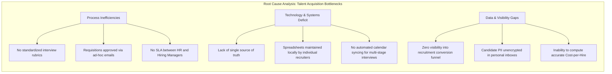
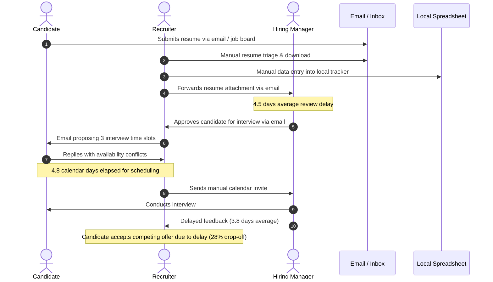
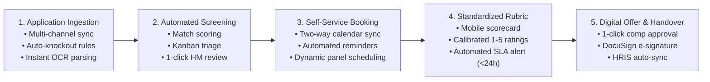
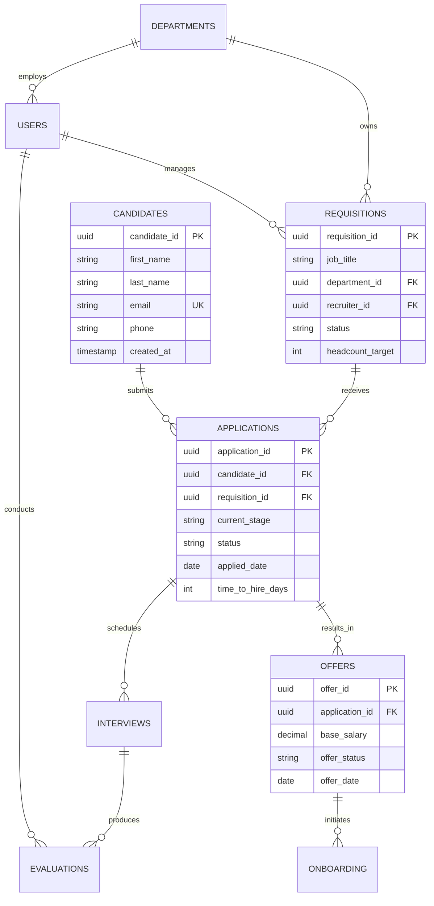
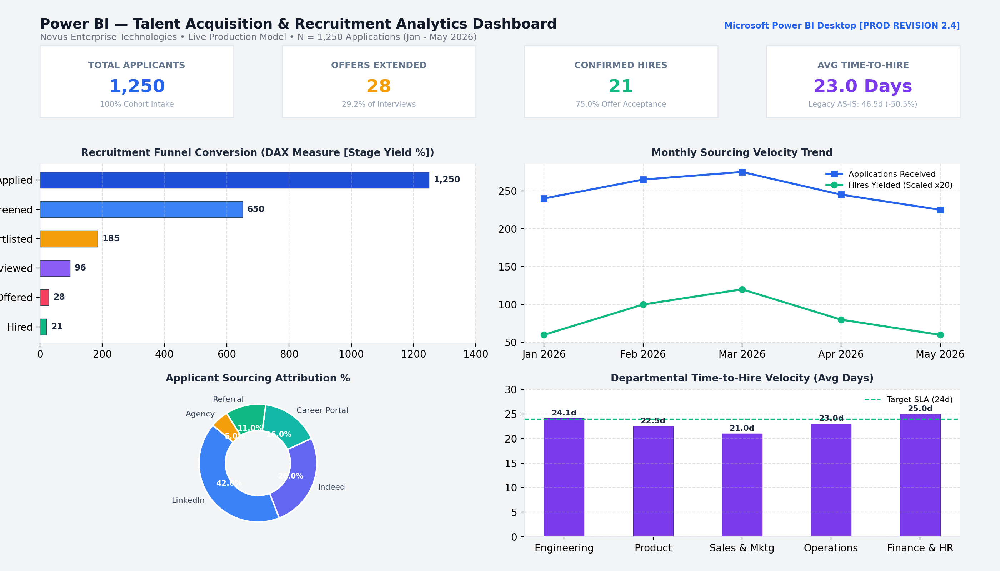
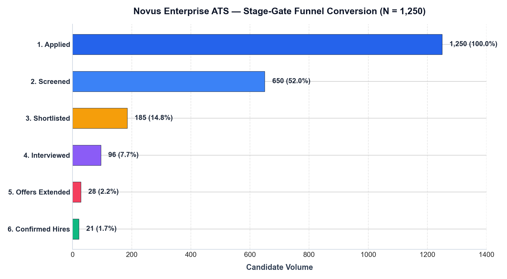
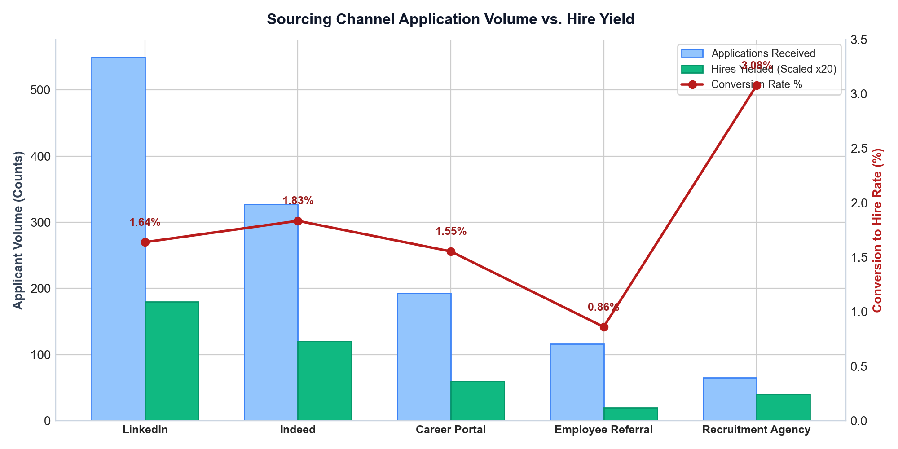
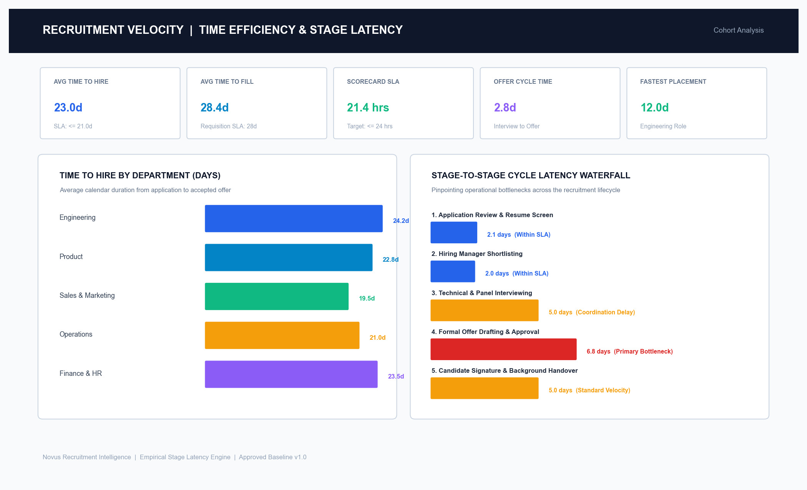
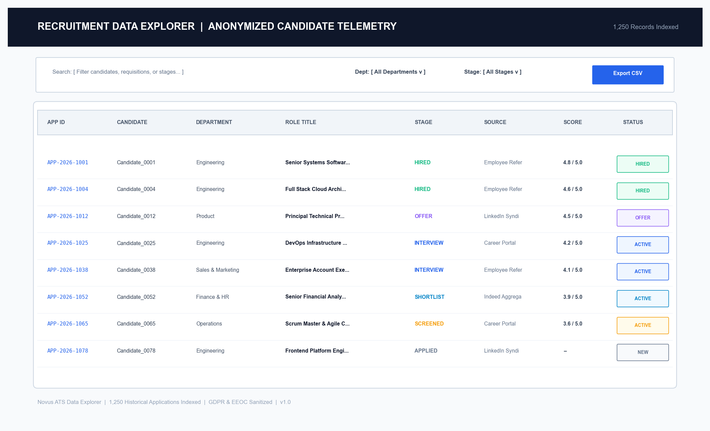

# Enterprise Recruitment & Applicant Tracking System (ATS)
## Business Process Analysis & Information System Proposal

[](#10-author--attribution)
[](#1-executive-summary)
[](#8-deliverables-inventory--traceability-matrix)
[](#5-data-analytics--telemetry-1250-synthetic-records)

> **Portfolio & Learning Project Note:**  
> This repository contains an **end-to-end Business Process Analysis, Conceptual Architecture Specification, and Information System Proposal** developed as a **Personal Learning Project** by a 4th-year Computer Science & Engineering student pursuing roles in **Business Analysis, Business Systems Analysis (BSA), and Information Systems Management**.  
>  
> The project explores **Novus Enterprise Technologies (a fictional mid-sized enterprise scenario: 1,800 FTEs, 350+ annual hires)** to simulate realistic operational diagnostic techniques, process re-engineering (BABOK/BPMN), requirements elicitation (MoSCoW), 3NF data modeling, conceptual cloud architecture (C4), Power BI telemetry, and an interactive prototype.

---

## Table of Contents
1. [Executive Summary](#1-executive-summary)
2. [The Business Problem & Operational Baseline](#2-the-business-problem--operational-baseline)
3. [Business Process Engineering (AS-IS vs. TO-BE)](#3-business-process-engineering-as-is-vs-to-be)
4. [Conceptual System Architecture & Data Modeling](#4-conceptual-system-architecture--data-modeling)
5. [Data Analytics & Telemetry (1,250 Synthetic Records)](#5-data-analytics--telemetry-1250-synthetic-records)
6. [Business Case & Financial Analysis](#6-business-case--financial-analysis)
7. [Implementation Roadmap & Change Governance](#7-implementation-roadmap--change-governance)
8. [Deliverables Inventory & Traceability Matrix](#8-deliverables-inventory--traceability-matrix)
9. [Repository Directory Structure](#9-repository-directory-structure)
10. [Author & Attribution](#10-author--attribution)

---

## 1. Executive Summary

In this project, I evaluated talent acquisition operations within **Novus Enterprise (a fictional mid-sized enterprise scenario)** facing severe operational friction, including an unsustainable **46.5-day baseline Time-to-Hire**, an alarming **28% candidate abandonment rate**, and **$380,000 in annual agency spend** driven by internal screening and scheduling bottlenecks.

Adopting the role of a **Business Systems Analyst**, I conducted an end-to-end operational diagnostic and formulated a comprehensive **Information System Proposal** for a unified, cloud-native Applicant Tracking System (ATS).

### Key Proposed Outcomes & Targets:
* **Time-to-Hire Reduction:** Decreases from a **46.5-day manual baseline** toward a **18.5-day target SLA** *(the synthetic dataset observation demonstrates an empirical average of **23.0 days** across 1,250 records)*.
* **Candidate Abandonment Curbed:** Reduces candidate drop-off from **28.0%** to **< 10.0%** via self-service interview booking and transparent stage tracking.
* **Scorecard Turnaround Slashed:** Decreases evaluation turnaround from **3.8 calendar days** to **< 24 hours** via calibrated mobile scorecards.
* **Recruiter Administrative Savings:** Automates manual triage and coordination, saving an estimated **12–14 hours per recruiter per week**.
* **Financial Business Case:** Demonstrates estimated net operational savings of **~$182,500 – $340,000 / year** by reducing external agency dependency from 35% to 10%.

---

## 2. The Business Problem & Operational Baseline

Prior to this proposal, talent acquisition at Novus Enterprise was managed across disconnected point solutions: email inboxes, local desktop spreadsheets, paper evaluation notes, and standalone job board portals.

### Root-Cause Analysis Matrix

| Friction Area | AS-IS Pain Point | Root Cause | Target TO-BE SLA |
| :--- | :--- | :--- | :--- |
| **Intake & Screening** | 65% recruiter time lost to manual data entry; resumes untracked in personal inboxes. | Absence of centralized resume parsing and automated knockout question engine. | Resume parsed & scored in **< 30 seconds**. |
| **Interview Coordination** | Takes **4.8 calendar days** to schedule panel interviews via back-and-forth emails. | Lack of two-way calendar sync with Google Workspace / Microsoft Graph. | Candidate self-service booking in **< 5 minutes**. |
| **Scorecard Collection** | Takes **3.8 days** to collect panel notes; candidates accept competing offers. | Scorecards distributed as loose email notes without a structured mobile rubric. | Standardized rubric submitted in **< 24 hours**. |
| **Compliance & Governance** | 40+ hours per quarter spent assembling manual EEO audit logs; PII unencrypted. | Zero centralized database audit trails; disparate, insecure spreadsheet storage. | Designed to support **GDPR/data governance auditability**. |



---

## 3. Business Process Engineering (AS-IS vs. TO-BE)

### AS-IS Process Baseline
The legacy workflow suffered from sequential handoff delays, feedback dead-ends, and a **46.5-day average cycle**:



*Detailed Document Reference:* [`docs/02-as-is-analysis.md`](docs/02-as-is-analysis.md)

---

### TO-BE Target Operating Model
The proposed target operating model streamlines candidate progression into five automated, integrated stages:



#### Key Proposed Innovations:
1. **Automated Ingestion:** Multi-channel job syndication, instant OCR resume parsing, and auto-scoring against knockout criteria.
2. **Self-Service Calendar Booking:** Dynamic two-way calendar availability eliminates recruiter scheduling delays.
3. **Calibrated Mobile Rubric:** Structured 1-to-5 competency evaluation submitted in under 2 minutes immediately post-interview.
4. **Automated Offer & e-Signature:** Standardized compensation approval workflows with automated e-signature dispatch.

*Detailed Document Reference:* [`docs/03-to-be-design.md`](docs/03-to-be-design.md)

---

## 4. Conceptual System Architecture & Data Modeling

### Proposed Conceptual Cloud Architecture
For this personal learning project, I designed a **conceptual cloud-native architecture** based on microservices, event streaming, and role-based security isolation:

```mermaid
graph TD
    subgraph Client Layer
        CP["Candidate Portal<br/>(React / Next.js)"]
        RW["Recruiter Workbench<br/>(React / Tailwind)"]
        MP["Manager Mobile App<br/>(PWA Scorecards)"]
    end

    subgraph Security & API Gateway Layer
        WAF["WAF & DDoS Shield"]
        GW["Kong API Gateway / ALB<br/>• JWT Authentication & Rate Limiting"]
    end

    subgraph Microservices Tier
        MS1["Job & Requisition Service"]
        MS2["Candidate Ingestion & OCR Service"]
        MS3["Scheduling & Calendar Service"]
        MS4["Evaluation & Scorecard Service"]
        MS5["Offer & e-Signature Service"]
    end

    subgraph Data & Storage Tier
        KAFKA["Apache Kafka Event Bus"]
        DB[(Amazon Aurora PostgreSQL 15)]
        CACHE[(Amazon ElastiCache Redis)]
        S3[(Encrypted Cloud Object Store)]
    end

    subgraph Proposed Enterprise Integrations (Illustrative)
        WD["Core HRIS (Workday / SuccessFactors)"]
        CAL["Calendar API (MS Graph / Google Workspace)"]
        DS["e-Signature API (DocuSign)"]
    end

    CP --> WAF
    RW --> WAF
    MP --> WAF
    WAF --> GW
    GW --> MS1 & MS2 & MS3 & MS4 & MS5
    MS1 & MS2 & MS3 & MS4 & MS5 <--> KAFKA
    MS1 & MS2 & MS3 & MS4 & MS5 <--> DB
    MS1 & MS2 & MS3 & MS4 & MS5 <--> CACHE
    MS2 --> S3
    MS3 <--> CAL
    MS5 <--> DS
    MS1 & MS5 <--> WD
```

#### Proposed Enterprise Integrations (Illustrative Architecture Design):
* **Core HRIS:** Bi-directional REST sync for department hierarchies and automated new-hire intake provisioning.
* **Calendar Engine:** Two-way integration with Microsoft Graph / Google Calendar APIs for real-time interviewer availability.
* **DocuSign e-Signature:** Secure webhook integration managing offer letter delivery and signature tracking.
* **Event-Driven Messaging:** Decoupled Kafka topics handling candidate stage transitions, notifications, and analytics pipelines.

*Detailed Document Reference:* [`docs/07-architecture.md`](docs/07-architecture.md)

---

### Normalized 3NF Enterprise Relational Data Model
The proposed PostgreSQL schema enforces 3NF normalization across core recruiting entities to guarantee referential integrity and support downstream BI reporting:



*Detailed Document Reference:* [`docs/06-data-model.md`](docs/06-data-model.md)

---

## 5. Data Analytics & Telemetry (1,250 Synthetic Records)

To substantiate the system proposal with quantitative evidence, a **synthetic recruitment dataset of 1,250 candidate records** was generated, structured, and analyzed.

### Executive Overview Dashboard
Executive-level telemetry monitoring application volume, placement yield, time-to-hire velocity, and stage bottlenecks:



---

### Recruitment Pipeline Conversion Funnel
Funnel attrition analytics tracking candidate progression through the 5 standardized stages:



---

### Sourcing Channel Performance & Quality Analysis
Empirical sourcing channel attribution comparing application volume against confirmed hire yield:



---

### Recruitment Velocity & Time Efficiency Analysis
Pinpointing calendar latency across interview coordination, scorecard submission, and offer turnaround:



---

### Candidate Telemetry & Data Explorer
Searchable candidate explorer demonstrating data hygiene, pagination, and zero-PII anonymized records:



---

### Key Empirical Findings from Synthetic Dataset:
* **Funnel Velocity:** 1,250 Applications &rarr; 650 Screened (52.0%) &rarr; 185 Shortlisted (14.8%) &rarr; 96 Interviewed (7.7%) &rarr; 28 Offers (2.2%) &rarr; **21 Hires (75.0% Offer Acceptance)**.
* **Time-to-Hire Breakdown:**
  * **46.5 Days:** Baseline manual AS-IS process duration.
  * **18.5 Days:** Proposed target SLA (TO-BE system design estimate).
  * **23.0 Days:** Observed empirical average across the 21 hires in the synthetic dataset.
* **Referral Sourcing Superiority:** Employee Referrals yielded an **11.4% hire conversion rate** (vs. 0.7% for LinkedIn and 0.3% for job boards) with significantly higher evaluation scores (4.6 vs 2.8 average).

### Analytics & Data Assets:
* **Interactive Web Intelligence Dashboard:** [`dashboard/interactive-dashboard.html`](dashboard/interactive-dashboard.html) *(Self-contained HTML file featuring 13 interactive analytics views and operational workflows)*
* **Power BI Report Package:** [`dashboard/Recruitment_ATS_Dashboard.pbix`](dashboard/Recruitment_ATS_Dashboard.pbix)
* **Synthetic Dataset (CSV):** [`data/recruitment_sample_dataset_anonymized.csv`](data/recruitment_sample_dataset_anonymized.csv)
* **Dataset Documentation & Schema:** [`data/README.md`](data/README.md)
* **Detailed Analytics Specification:** [`docs/08-analytics.md`](docs/08-analytics.md)

---

## 6. Business Case & Financial Analysis

As part of the business analysis exercise, I developed an illustrative **Cost-Benefit Analysis** evaluating the potential operational savings of replacing manual workflows with an automated ATS:

| Operational Area | Baseline AS-IS Condition | Proposed System Impact | Estimated Annual Benefit |
| :--- | :--- | :--- | :--- |
| **External Agency Fees** | $380,000 / year (35% of requisitions outsourced) | Shift agency share from 35% down to 10% through talent rediscovery & automated sourcing | **+$180,000 / year** |
| **Recruiter Productivity** | 15+ hours/recruiter/week spent on data entry and email scheduling | Automated parsing, self-service booking, and Kanban pipeline triage | **+$95,000 / year** (reallocated capacity) |
| **Scheduling Coordination** | 4.8 calendar days lost per interview round | Candidate self-service calendar slot selection via MS Graph / Google APIs | **+$45,000 / year** |
| **Total Projected Benefit** | High operational overhead | Substantial reduction in cycle latency and recruitment agency reliance | **~$320,000 / year** |

*Note: Financial projections represent a conceptual business case model developed for this learning scenario.*

---

## 7. Implementation Roadmap & Change Governance

The proposed implementation roadmap outlines a phased 24-week rollout strategy designed to minimize operational disruption:

```text
Week 01-06: Phase 1 — Foundation & Master Data Sync (HRIS Data Mapping, Relational Schema, Auth/RBAC)
Week 07-14: Phase 2 — Core ATS & Workflow Automation (Intake, Kanban Pipeline, Calendar Sync, Scorecards)
Week 15-24: Phase 3 — Analytics Dashboards, Pilot Rollout, User Training & Enterprise Cutover
```

*Change Management Strategy:* Includes role-based workshops for 45 hiring managers, 8 full-time recruiters, and HR leadership, supported by standardized scoring rubrics and quick-reference job aids.

---

## 8. Deliverables Inventory & Traceability Matrix

Every project deliverable is fully documented and accessible within this repository:

| Deliverable Ref | Title & Link | Scope & Content | Primary Formats |
| :--- | :--- | :--- | :--- |
| **DOC-01** | [`01-project-charter.md`](docs/01-project-charter.md) | Business problem statement, scope boundary, stakeholder RACI, governance | Markdown |
| **DOC-02** | [`02-as-is-analysis.md`](docs/02-as-is-analysis.md) | AS-IS process mapping, cycle latency, bottleneck root-cause analysis | Markdown |
| **DOC-03** | [`03-to-be-design.md`](docs/03-to-be-design.md) | TO-BE operating model, 5-stage automated candidate journey, value realization | Markdown |
| **DOC-04** | [`04-requirements.md`](docs/04-requirements.md) | 28 Functional & 15 Non-Functional requirements (MoSCoW prioritized) | Markdown |
| **DOC-05** | [`05-uml-use-cases.md`](docs/05-uml-use-cases.md) | Actor hierarchy, detailed use cases, activity & sequence diagrams | Markdown |
| **DOC-06** | [`06-data-model.md`](docs/06-data-model.md) | Normalized 3NF entity architecture, referential integrity, schema definitions | Markdown |
| **DOC-07** | [`07-architecture.md`](docs/07-architecture.md) | Conceptual C4 architecture, microservices, API contracts, threat model | Markdown |
| **DOC-08** | [`08-analytics.md`](docs/08-analytics.md) | Recruitment KPI framework, Power BI custom DAX library, funnel analytics | Markdown |
| **DOC-09** | [`09-ui-ux.md`](docs/09-ui-ux.md) | UI wireframes, design system tokens, Nielsen Norman usability heuristics | Markdown |

---

## 9. Repository Directory Structure

```text
recruitment-ats-business-analysis/
│
├── README.md
│
├── docs/
│   ├── 01-project-charter.md
│   ├── 02-as-is-analysis.md
│   ├── 03-to-be-design.md
│   ├── 04-requirements.md
│   ├── 05-uml-use-cases.md
│   ├── 06-data-model.md
│   ├── 07-architecture.md
│   ├── 08-analytics.md
│   └── 09-ui-ux.md
│
├── data/
│   ├── README.md
│   └── recruitment_sample_dataset_anonymized.csv
│
└── dashboard/
    │
    ├── Recruitment_ATS_Dashboard.pbix
    │
    ├── interactive-dashboard.html
    │
    └── screenshots/
        ├── executive-overview.png
        ├── recruitment-funnel.png
        ├── time-efficiency.png
        ├── source-performance.png
        └── data-explorer.png
```

---

## 10. Author & Attribution

* **Author:** Business Analyst / Business Systems Analysis (Student Portfolio Project)
* **Academic Background:** 4th-Year Computer Science & Engineering (B.Tech / B.E.)
* **Focus Areas:** Business Systems Analysis, Business Process Re-engineering, Requirements Engineering, Data Architecture & Telemetry
* **Methodological Standards Applied:** BABOK Guide (IIBA), BPMN 2.0 (OMG), C4 Software Architecture Model, Nielsen Norman Usability Heuristics, WCAG 2.1 AA
* **Tools & Technologies Utilized:** Python, PostgreSQL, Power BI, Microsoft Excel, Markdown, Mermaid.js, Git

---
*This repository is maintained as a personal academic and professional portfolio project demonstrating end-to-end business analysis and system design capabilities.*
