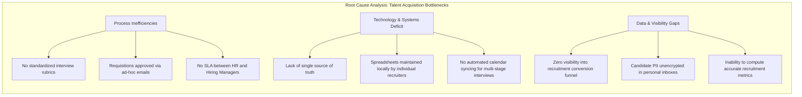
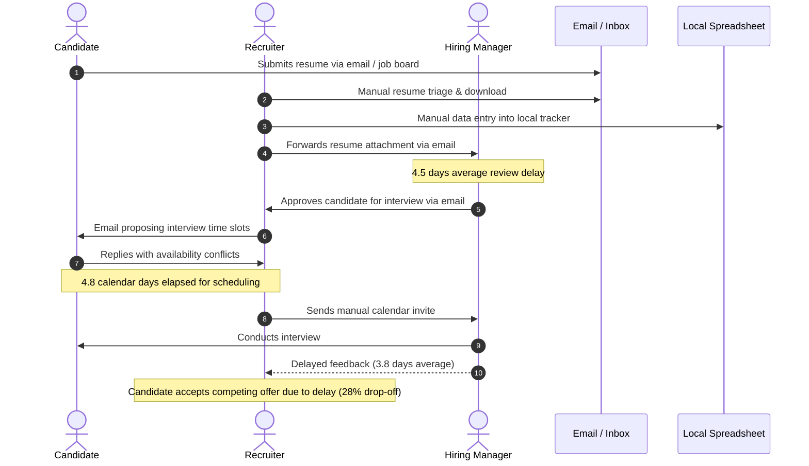
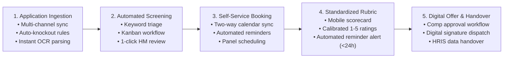
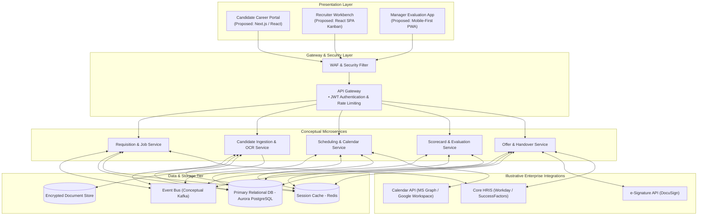
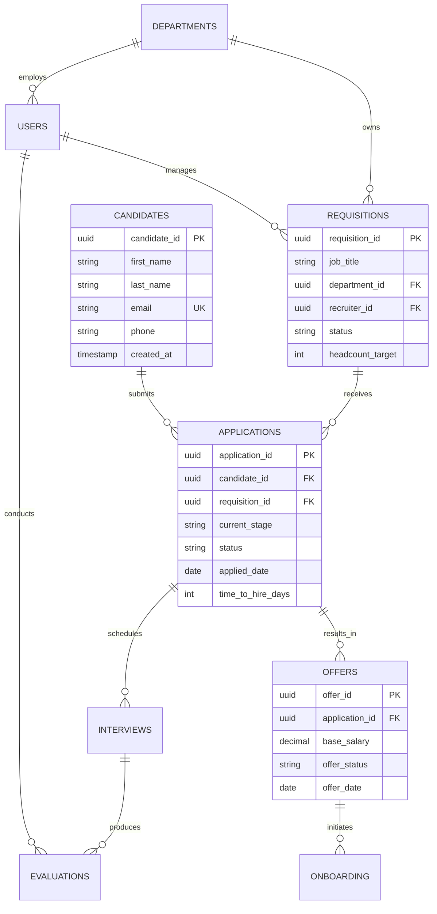

# Recruitment & Applicant Tracking System (ATS)
## Business Analysis & Systems Project — Student Portfolio

> 🌐 **Live Interactive Dashboard:**  
> Experience the full recruitment analytics prototype directly in your browser:  
> 👉 [**Launch Live Interactive ATS Dashboard**](https://namrathach10.github.io/recruitment-ats-business-analysis/)
---

> **Portfolio & Learning Project Note:**  
> This repository contains an **end-to-end Business Process Analysis, Requirements Specification, Conceptual System Architecture, and Analytics Project** developed as a **Personal Learning Project** by a 4th-year Computer Science & Engineering student pursuing careers in **Business Analysis, Business Systems Analysis (BSA), and Information Management**.  
>  
> The project explores **Novus Enterprise Technologies (a fictional mid-sized enterprise scenario: 1,800 FTEs, ~350 annual hiring demand)** to simulate realistic operational diagnosis, process re-engineering (BABOK/BPMN 2.0), requirements elicitation (MoSCoW), 3NF data modeling, conceptual cloud architecture (C4), Power BI analytics telemetry, and an interactive browser prototype.

---

## Table of Contents
1. [Project Overview](#project-overview)
2. [What I Worked On](#what-i-worked-on)
3. [The Business Problem & Operational Baseline](#the-business-problem--operational-baseline)
4. [AS-IS Process Analysis](#as-is-process-analysis)
5. [Proposed TO-BE Solution & Operating Model](#proposed-to-be-solution--operating-model)
6. [Conceptual System Architecture & Data Model](#conceptual-system-architecture--data-model)
7. [Synthetic Dataset](#synthetic-dataset)
8. [Power BI Dashboard](#power-bi-dashboard)
9. [Interactive Prototype](#interactive-prototype)
10. [Documentation & Traceability](#documentation--traceability)
11. [Project Limitations](#project-limitations)
12. [Skills Demonstrated](#skills-demonstrated)
13. [Repository Directory Structure](#repository-directory-structure)

---

## Project Overview

In this personal learning project, I conducted an independent operational study of talent acquisition within **Novus Enterprise Technologies (a fictional mid-sized enterprise scenario)**. 

The fictional scenario models an organization experiencing significant recruitment drag:
* **Baseline Time-to-Hire:** **46.5 calendar days** (manual AS-IS baseline).
* **Candidate Abandonment:** **28%** drop-off rate during prolonged screening and scheduling handoffs.
* **Agency Dependency:** **$380,000 / year** illustrative spend on external contingency recruiters to bypass internal screening delays.
* **Data Governance Risk:** Candidate information is managed across decentralized files and inboxes, creating privacy, retention, and employment-recordkeeping governance risks.

To resolve these operational bottlenecks, I formulated a comprehensive **Information System Proposal** for a unified Applicant Tracking System (ATS), documented formal functional requirements, designed a conceptual cloud architecture, created a synthetic dataset of 1,250 applicant records, built an analytical dashboard in Power BI, and developed an interactive prototype.

---

## What I Worked On

As part of this project, I independently produced:
* **Operational Process Modeling:** Mapped legacy AS-IS workflows and engineered automated TO-BE swimlane processes using BPMN 2.0 notation.
* **Requirements Engineering:** Authored a Software Requirements Specification (SRS) comprising 33 Functional Requirements (FR) and 10 Non-Functional Requirements (NFR), structured under MoSCoW prioritization.
* **System Design & Modeling:** Developed UML 2.5 use case diagrams, sequence flows, and a normalized Third Normal Form (3NF) relational data model with 12 entities.
* **Conceptual Cloud Architecture:** Designed a modular, microservices-oriented C4 architectural model with illustrative REST/webhook integration contracts for HRIS, calendar, and e-signature services.
* **Data Engineering & Telemetry:** Generated an anonymized synthetic dataset of 1,250 historical applicant records modeling recruitment funnel progression.
* **Analytics Implementation:** Built a multi-page recruitment intelligence dashboard in Microsoft Power BI using custom DAX measures.
* **Interactive Prototype:** Developed a self-contained web prototype demonstrating candidate self-service scheduling, recruiter Kanban pipeline triage, and manager evaluation scorecards.

---

## The Business Problem & Operational Baseline

The fictional baseline assumes recruitment was managed across disconnected tools: email inboxes, local desktop spreadsheets, paper evaluation notes, and standalone job board portals.

### Root-Cause Analysis Matrix

| Friction Area | AS-IS Operational Friction | Root Cause Identified | Proposed Design Target |
| :--- | :--- | :--- | :--- |
| **Intake & Screening** | Resumes untracked in personal email inboxes; recruiters lose time to manual data entry. | Absence of centralized resume parsing and automated knockout question screening. | Automated parsing & knockout evaluation in **< 30 seconds**. |
| **Interview Coordination** | Takes **4.8 calendar days** to coordinate panel interview availability via back-and-forth emails. | Lack of two-way calendar synchronization with corporate email platforms. | Candidate self-service slot booking in **< 5 minutes**. |
| **Scorecard Collection** | Takes **3.8 calendar days** on average to collect interview evaluation notes. | Scorecards distributed as loose email notes without a standardized rubric. | Calibrated evaluation rubric submitted in **< 24 hours**. |
| **Data Governance** | Candidate PII stored unencrypted in local spreadsheets and email archives. | Absence of a centralized relational database with role-based access control. | Centralized database designed to support **data privacy and retention governance**. |

---

## AS-IS Process Analysis

The legacy operational workflow suffered from sequential handoff delays, feedback dead-ends, and a **46.5-calendar-day baseline cycle time**:

*Detailed Analysis Document:* [`docs/02-as-is-analysis.md`](docs/02-as-is-analysis.md)

---

## Proposed TO-BE Solution & Operating Model

The proposed target operating model streamlines the recruitment lifecycle into five automated, integrated stages:

### Metric Interpretation & Velocity Targets:
* **46.5 Calendar Days:** The baseline manual AS-IS process duration established in the fictional scenario.
* **18.5 Calendar Days:** The **proposed TO-BE process-performance target** under the fully optimized operating model.
* **23.0 Calendar Days:** The **observed empirical average** calculated across the 21 hires in the 1,250-record synthetic dataset (range: 20 to 28 days).  
*(Note: The 23.0-day result represents an analytical finding from the synthetic dataset, not real-world performance of a deployed system.)*

*Detailed Process Design Document:* [`docs/03-to-be-design.md`](docs/03-to-be-design.md)

---

## Conceptual System Architecture & Data Model

### Proposed Conceptual Cloud Architecture
For this personal learning project, I designed a **conceptual cloud-native architecture** demonstrating multi-tier micro-modular principles:

*Note: All architecture tiers, microservices, and external integrations represent an **illustrative system proposal** developed for learning and evaluation.*

*Detailed Architecture Document:* [`docs/07-architecture.md`](docs/07-architecture.md)

---

### Normalized 3NF Relational Data Model
The proposed relational schema models 12 core recruiting entities normalized to Third Normal Form (3NF):

*Detailed Data Model Document:* [`docs/06-data-model.md`](docs/06-data-model.md)

---

## Synthetic Dataset

To substantiate the business analysis proposal and drive the reporting models, I authored a **synthetic dataset of 1,250 historical applicant records**:

* **File Location:** [`data/recruitment_sample_dataset_anonymized.csv`](data/recruitment_sample_dataset_anonymized.csv)
* **Dataset Documentation:** [`data/README.md`](data/README.md)
* **Zero Real PII:** Candidate names are standardized (`Candidate_0001` through `Candidate_1250`) and email addresses utilize the RFC 2606 reserved `.example.com` domain.

### Funnel Progression Summary:

| Stage | Candidates | Cohort % | Stage-to-Stage Yield |
| :--- | :---: | :---: | :---: |
| **1. Applications** | 1,250 | 100.0% | Initial Cohort Volume |
| **2. Screened** | 650 | 52.0% | 52.0% Screening Pass Rate |
| **3. Shortlisted** | 185 | 14.8% | 28.5% Shortlist Rate |
| **4. Interviewed** | 96 | 7.7% | 51.9% Interview Conversion |
| **5. Offers Extended** | 28 | 2.2% | 29.2% Offer Extension Rate |
| **6. Confirmed Hires** | **21** | **1.7%** | **75.0% Offer Acceptance Rate** (21 / 28) |

* **Observed Time-to-Hire:** **23.0 Calendar Days** empirical average across the 21 hired records.

---

### Visual Telemetry Preview:

| Executive Overview | Recruitment Funnel |
| :---: | :---: |
|  |  |

| Sourcing Performance | Time & Efficiency |
| :---: | :---: |
|  |  |

---

## Interactive Prototype

To illustrate the proposed user experience for candidates, recruiters, and hiring managers, I created a self-contained, browser-based interactive prototype:

* **Interactive Prototype File:** [`dashboard/interactive-dashboard.html`](dashboard/interactive-dashboard.html) *(Open in any modern browser)*
* **Key Demonstration Modules:**
  * **Candidate Portal Prototype:** Application tracker with stage timeline and self-service panel interview slot booking.
  * **Recruiter Kanban Workbench:** Drag-and-drop candidate pipeline stage transitions with dynamic stage counters.
  * **Manager Evaluation Scorecard:** Split-screen candidate dossier with calibrated 1-to-5 star competency rating rubrics.
  * **Executive Analytics Suite:** 8 interactive analytics views reflecting the 1,250 synthetic records with dynamic client-side filtering.
  * **Data Explorer:** Searchable candidate registry with pagination and dynamically filtered CSV export.

---

## Documentation & Traceability

All 9 deliverables follow professional business analysis standards and are accessible directly via GitHub-relative links:

| Ref | Deliverable Title & Link | Focus & Methodology |
| :---: | :--- | :--- |
| **DOC-01** | [`01-project-charter.md`](docs/01-project-charter.md) | Business problem statement, scope boundary, simulated stakeholder personas |
| **DOC-02** | [`02-as-is-analysis.md`](docs/02-as-is-analysis.md) | AS-IS process analysis, BPMN swimlanes, 46.5-day baseline latency diagnostics |
| **DOC-03** | [`03-to-be-design.md`](docs/03-to-be-design.md) | TO-BE operating model, 5-stage automated flow, 18.5-day proposed performance target |
| **DOC-04** | [`04-requirements.md`](docs/04-requirements.md) | Proposed Software Requirements Specification (33 FRs, 10 NFRs, MoSCoW, RTM) |
| **DOC-05** | [`05-uml-use-cases.md`](docs/05-uml-use-cases.md) | UML 2.5 use case diagrams, actor-goal matrix, detailed specifications |
| **DOC-06** | [`06-data-model.md`](docs/06-data-model.md) | Normalized 3NF entity-relationship model, SQL schema, data dictionary |
| **DOC-07** | [`07-architecture.md`](docs/07-architecture.md) | Conceptual C4 architecture, microservices breakdown, illustrative API contracts |
| **DOC-08** | [`08-analytics.md`](docs/08-analytics.md) | Recruitment KPI framework, Power BI custom DAX measure library, funnel metrics |
| **DOC-09** | [`09-ui-ux.md`](docs/09-ui-ux.md) | Role-specific UI wireframes, design system tokens, usability specifications |

---

## Project Limitations

> **Transparency Disclosure:**  
> * **Fictional Scenario:** Novus Enterprise Technologies is a fictional organization created for this academic and portfolio learning project. All operational metrics, employee personas, and business scenario assumptions are illustrative.
> * **Conceptual Solution:** The ATS software requirements, architecture, and enterprise integrations represent a proposed conceptual design rather than a deployed production software system.
> * **Synthetic Data:** The 1,250 applicant records are synthetic data generated for modeling purposes; no real candidate personal data was accessed or utilized.
> * **Analytics & Prototype Scope:** The Microsoft Power BI report and browser-based HTML prototype were developed as interactive portfolio demonstrations of the proposed solution.

---

## Skills Demonstrated

* **Business Systems Analysis (BSA):** Process modeling (AS-IS / TO-BE), swimlane mapping (BPMN 2.0), root-cause analysis (Fishbone, 5-Whys), MoSCoW requirements prioritization.
* **Requirements Engineering:** Functional decomposition, Non-Functional Requirements (ISO 25010), Requirements Traceability Matrix (RTM).
* **System Architecture & Modeling:** UML 2.5 use cases, C4 conceptual architecture, Third Normal Form (3NF) relational database design.
* **Data Analytics & BI:** Kimball star schema dimensional modeling, custom DAX measure authoring, recruitment funnel analytics in Microsoft Power BI.
* **Prototyping & UX Design:** Wireframe design, Nielsen Norman usability heuristics, client-side HTML5/JavaScript interactive prototype development.

---
*Maintained as a student portfolio project demonstrating business systems analysis, software modeling, and data analytics.*
