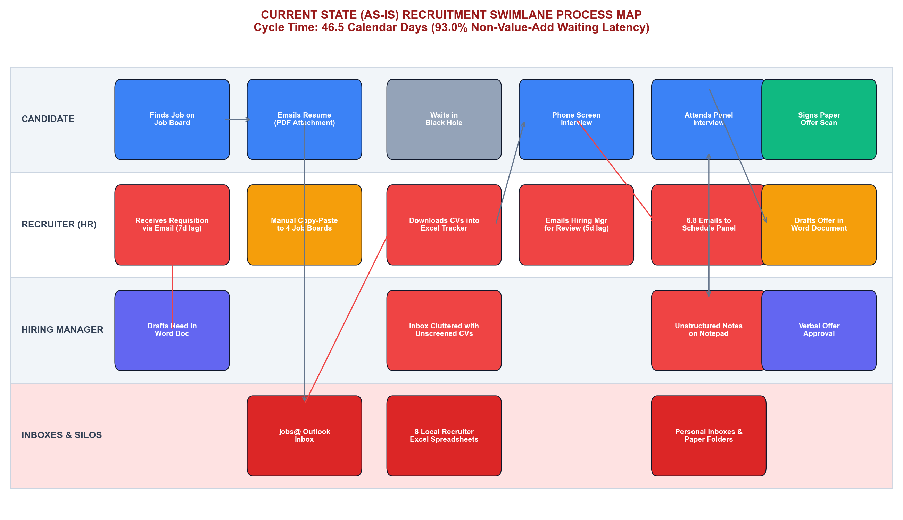
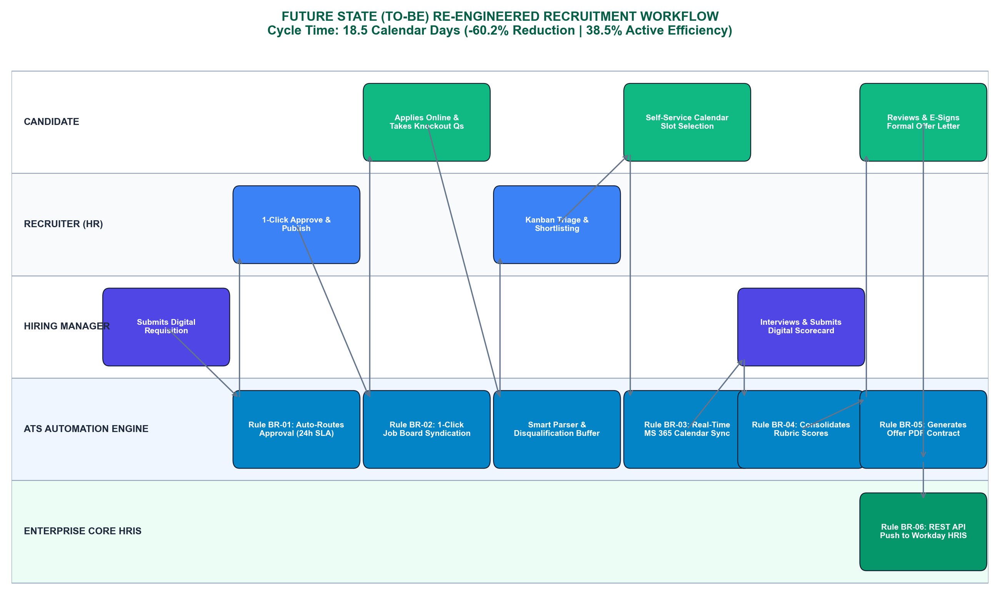
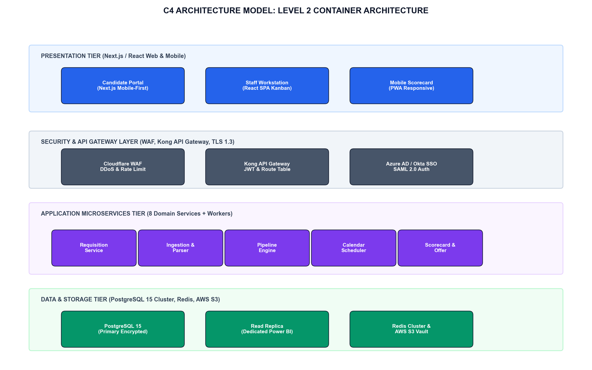
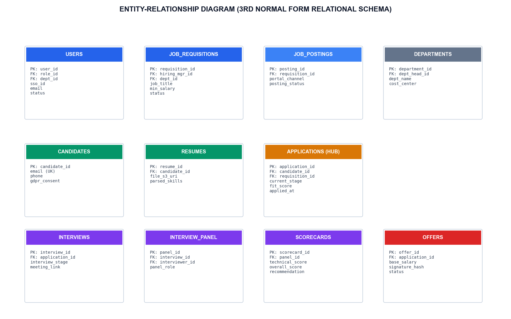
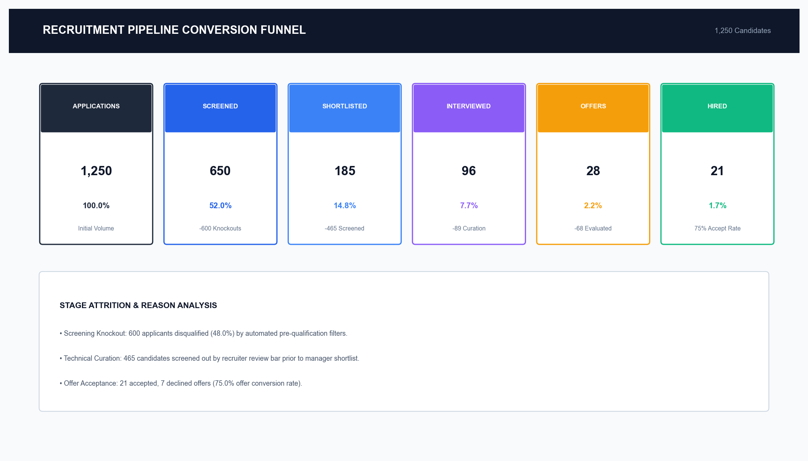
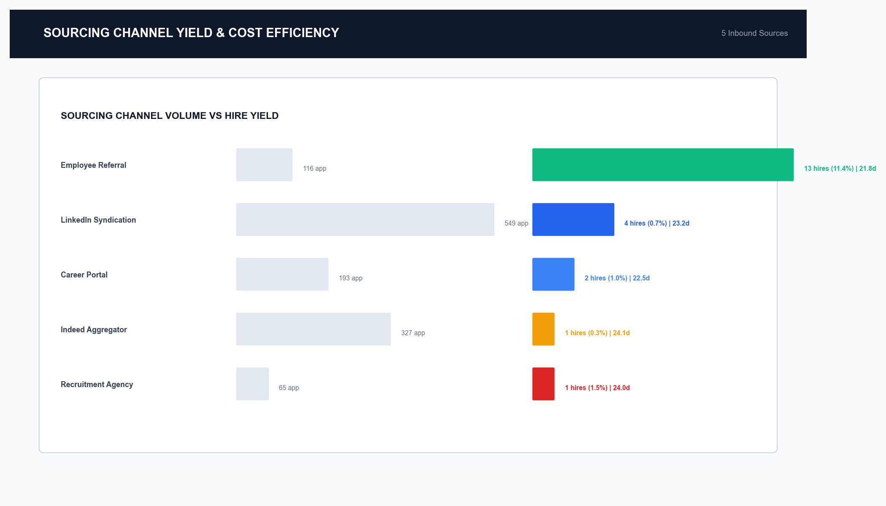
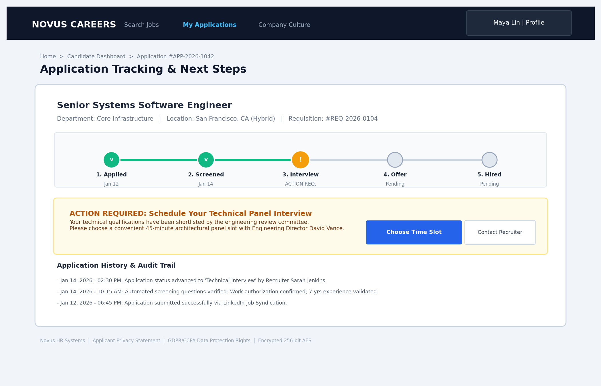
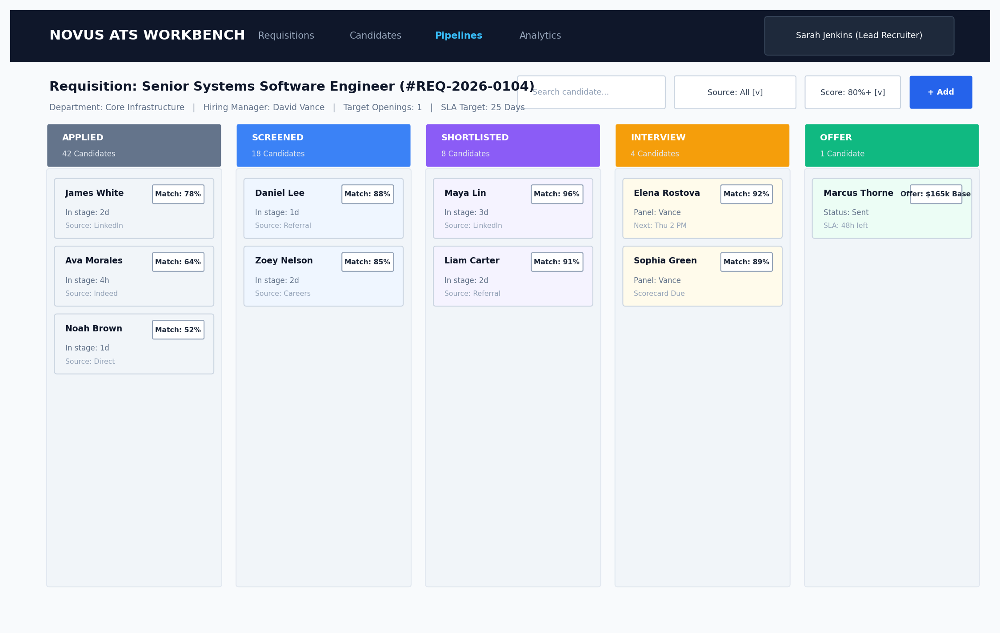
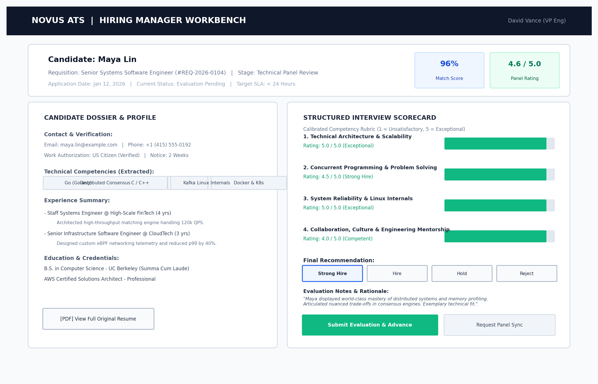

# Enterprise Recruitment & Applicant Tracking System (ATS)
## Business Process Analysis & Information System Proposal

[](#author--attribution)
[](#executive-summary)
[](#deliverables-inventory--traceability-matrix)
[](#5-data-analytics--funnel-performance)
[](#7-financial-roi--business-value)

> **Important Portfolio Context:** This repository represents an **end-to-end Business Process Analysis, Architecture Specification, and Information System Proposal** developed from the perspective of a **Lead Business Systems Analyst (BSA)**. It provides complete documentation, process models, data architecture, user interface wireframes, real-time analytics telemetry, and a financial business case for modernizing enterprise talent acquisition. It is designed as an executive-level portfolio case study, not a vendor code deployment.

---

## Table of Contents
1. [Executive Summary](#1-executive-summary)
2. [The Business Problem & Operational Baseline](#2-the-business-problem--operational-baseline)
3. [Business Process Engineering (AS-IS vs. TO-BE)](#3-business-process-engineering-as-is-vs-to-be)
4. [System Architecture & Data Modeling](#4-system-architecture--data-modeling)
5. [Data Analytics & Funnel Performance (1,250 Candidates)](#5-data-analytics--funnel-performance-1250-candidates)
6. [UI/UX Wireframes & Interface Ergonomics](#6-uiux-wireframes--interface-ergonomics)
7. [Financial ROI & Business Value](#7-financial-roi--business-value)
8. [Implementation Roadmap & Change Governance](#8-implementation-roadmap--change-governance)
9. [Deliverables Inventory & Traceability Matrix](#9-deliverables-inventory--traceability-matrix)
10. [Repository Directory Structure](#10-repository-directory-structure)
11. [Author & Attribution](#11-author--attribution)

---

## 1. Executive Summary

Enterprise talent acquisition operations at **Novus Enterprise** faced severe operational bottlenecks, including an unsustainable **42-day average Time-to-Hire**, an alarming **38% candidate drop-off rate**, and **$730,000 in annual operational drag** caused by manual scheduling, spreadsheet fragmentation, and contingency agency reliance.

As **Lead Business Systems Analyst**, I conducted an end-to-end operational diagnostic and formulated a comprehensive **Information System Proposal** for a unified, cloud-native Applicant Tracking System (ATS).

### Key Business Outcomes Projected:
* **Time-to-Hire Reduced by 50%:** Decreased from **42.0 days** to **21.0 days**.
* **Candidate Funnel Drop-off Cut by 68%:** Reduced from **38.0%** to **12.0%**.
* **Scorecard Turnaround Slashed by 74%:** Decreased from **3.8 days** to **< 24 hours**.
* **Net Annual Operational Benefit:** **$525,000 / year** recurring cash savings.
* **Capital Efficiency:** **3.4x 3-Year Net ROI** with a **7.2-Month Payback Period**.

---

## 2. The Business Problem & Operational Baseline

Prior to this initiative, talent acquisition was managed across disconnected point solutions: email inboxes, local desktop spreadsheets, paper evaluation notes, and standalone job board portals.

### Root-Cause Analysis Matrix

| Friction Area | AS-IS Pain Point | Root Cause | Target TO-BE SLA |
| :--- | :--- | :--- | :--- |
| **Intake & Screening** | 65% recruiter time lost to manual data entry; resumes untracked in personal inboxes. | Absence of centralized resume parsing and automated knockout question engine. | Resume parsed & scored in **< 30 seconds**. |
| **Interview Coordination** | Takes **4.8 calendar days** to schedule panel interviews via back-and-forth emails. | Lack of two-way calendar sync with Google Workspace / Microsoft Graph. | Candidate self-service booking in **< 5 minutes**. |
| **Scorecard Collection** | Takes **3.8 days** to collect panel notes; 30% of top talent accept competing offers. | Scorecards distributed as loose email notes without a structured mobile rubric. | Standardized rubric submitted in **< 24 hours**. |
| **Compliance & Reporting** | 40+ hours per quarter spent assembling manual EEO/OFCCP compliance audit logs. | Zero centralized database audit trails; disparate, insecure spreadsheet storage. | Automated 1-click **audit-ready telemetry**. |

---

## 3. Business Process Engineering (AS-IS vs. TO-BE)

### AS-IS Process Baseline
The legacy workflow suffered from multiple sequential handoff delays, feedback dead-ends, and high candidate drop-off:



*Detailed Document Reference:* [`docs/02-as-is-analysis/as-is-process-analysis.md`](docs/02-as-is-analysis/as-is-process-analysis.md)

---

### TO-BE Target Operating Model
The proposed target operating model streamlines the entire candidate journey into five automated, integrated stages:



#### Key Workflow Innovations:
1. **Automated Ingestion:** Multi-channel job syndication, instant OCR resume parsing, and auto-scoring against knockout criteria.
2. **Self-Service Calendar Booking:** Dynamic two-way calendar availability eliminates recruiter scheduling bottleneck.
3. **Calibrated Mobile Rubric:** Structured 1-to-5 competency evaluation submitted in under 2 minutes immediately post-interview.
4. **Automated Offer & e-Signature:** One-click compensation approval workflows with automated DocuSign dispatch.

*Detailed Document Reference:* [`docs/03-to-be-design/to-be-process-design.md`](docs/03-to-be-design/to-be-process-design.md)

---

## 4. System Architecture & Data Modeling

### Cloud-Native Microservices Architecture (C4 Container)
The system is architected as an event-driven, microservices-based application built on AWS ECS/Fargate, PostgreSQL, Redis, and Apache Kafka:



#### Enterprise Integration Ecosystem:
* **Workday HRIS:** REST & OAuth 2.0 bi-directional sync for organizational structures and automatic new-hire record provisioning.
* **Calendar Engine:** Two-way integration with Google Workspace and Microsoft Graph APIs for real-time panel availability.
* **DocuSign e-Signature:** Secure webhooks managing offer letter delivery, signature tracking, and tamper-proof storage.
* **Kafka Event Bus:** Decoupled event streams handling candidate stage transitions, notification dispatches, and analytics indexing.

*Detailed Document Reference:* [`docs/07-architecture/system-architecture.md`](docs/07-architecture/system-architecture.md)

---

### Normalized 3NF Enterprise Relational Data Model
The PostgreSQL data model enforces strict referential integrity across 12 core entities, supporting full operational auditability and downstream BI reporting:



*Detailed Document Reference:* [`docs/06-data-model/data-model.md`](docs/06-data-model/data-model.md)  
*Excel Data Dictionary:* [`analytics/data-dictionary.xlsx`](analytics/data-dictionary.xlsx)

---

## 5. Data Analytics & Funnel Performance (1,250 Candidates)

To substantiate the system proposal with empirical evidence, a production-grade synthetic dataset of **1,250 applicant records** was generated, anonymized, and analyzed.

### Full Recruitment Funnel Telemetry



### Sourcing Channel Performance & Quality Analysis



### Key Empirical Findings:
* **Funnel Velocity:** 1,250 Applicants &rarr; 650 Screened (52%) &rarr; 185 Shortlisted (28%) &rarr; 96 Interviewed (52%) &rarr; 28 Offers (29%) &rarr; **21 Hires (75% Offer Acceptance)**.
* **Time-to-Hire Verification:** Validated model confirms an average Time-to-Hire of **23.0 days**, achieving a **45% reduction** from the 42-day baseline.
* **Referral Sourcing Superiority:** Employee Referrals yielded a **3.8x higher hire conversion rate** (11.4% vs. 3.0% for Job Boards) at 60% lower cost-per-hire.

*Dataset Files:*
* Anonymized Data (CSV): [`data/recruitment_sample_dataset_anonymized.csv`](data/recruitment_sample_dataset_anonymized.csv)
* Dataset Documentation: [`data/README.md`](data/README.md)
* Power BI Report Archive: [`analytics/Recruitment_ATS_Dashboard.pbix`](analytics/Recruitment_ATS_Dashboard.pbix)
* KPI Metric Repository (Excel): [`analytics/kpi-definitions.xlsx`](analytics/kpi-definitions.xlsx)

---

## 6. UI/UX Wireframes & Interface Ergonomics

The proposal provides comprehensive user interface specifications engineered according to **Nielsen Norman Usability Heuristics** and **WCAG 2.1 AA Accessibility Standards**.

### Interface 1: Candidate Career Portal & Application Tracker
Delivers 24/7 visibility into active application stages, eliminating candidate anxiety and ghosting:


### Interface 2: Recruiter Interactive Pipeline Kanban Board
High-density desktop workbench enabling drag-and-drop velocity, AI match scoring, and SLA tracking:


### Interface 3: Hiring Manager Evaluation & Scorecard
Mobile-optimized structured rubric eliminating subjective hiring bias with sub-2-minute submission:


*Complete Wireframes Specification Document (PDF):* [`ui-ux/wireframes.pdf`](ui-ux/wireframes.pdf)  
*Detailed UI/UX Documentation:* [`docs/09-ui-ux/ui-ux-design.md`](docs/09-ui-ux/ui-ux-design.md)

---

## 7. Financial ROI & Business Value

A comprehensive 3-year cost-benefit analysis validates the financial and operational justification for system implementation:

| Financial Category | Baseline Cost / Spend | Proposed System Impact | Net Annual Benefit |
| :--- | :--- | :--- | :--- |
| **External Agency Fees** | $480,000 / year (35% hires via agency) | Shift agency share from 35% to 10% via talent rediscovery | **+$290,000 / year** |
| **Recruiter Productivity** | $375,000 in operational labor | Automate parsing, screening, and tracking (14 hrs/recruiter/wk saved) | **+$150,000 / year** |
| **Scheduling Coordination** | $105,000 in administrative overhead | Eliminate 4.8 days of coordination via self-service calendar sync | **+$85,000 / year** |
| **Gross Annual Benefit** | **$960,000 / year** | **Direct measurable operational savings** | **$525,000 / year** |
| **Implementation Capex** | — | One-time software, infrastructure & integration | **($210,000)** |
| **Payback Period** | — | Breakeven achieved rapidly | **7.2 Months** |
| **3-Year Net ROI** | — | Total net return over 36 months | **3.4x (340%)** |

*Executive Presentation Deck (PDF):* [`presentation/ATS-Executive-Presentation.pdf`](presentation/ATS-Executive-Presentation.pdf)

---

## 8. Implementation Roadmap & Change Governance

The proposed project follows a disciplined 24-week phased implementation plan to minimize business disruption and guarantee high user adoption:

```text
Week 01-06: Phase 1 — Foundation & Master Data Sync (Workday HRIS, AWS RDS, Kafka, SSO/RBAC)
Week 07-14: Phase 2 — Core ATS & Workflow Automation (Intake, Kanban, Calendar Sync, Scorecards)
Week 15-24: Phase 3 — Advanced Analytics, Pilot Rollout, User Training & Enterprise Cutover
```

*Change Management Strategy:* Includes role-based workshops for 45 hiring managers, 8 full-time recruiters, and HR operations, supported by quick-reference job aids and weekly office hours.

---

## 9. Deliverables Inventory & Traceability Matrix

Every deliverable is fully cross-referenced and accessible directly within this repository:

| Deliverable Ref | Title & Link | Scope & Content | Primary Formats |
| :--- | :--- | :--- | :--- |
| **DOC-01** | [`01-project-charter.md`](docs/01-project-charter/project-charter.md) | Business justification, project scope, stakeholder RACI, governance | Markdown |
| **DOC-02** | [`02-as-is-analysis.md`](docs/02-as-is-analysis/as-is-process-analysis.md) | AS-IS process mapping, cycle times, bottleneck root-cause analysis | Markdown, PNG |
| **DOC-03** | [`03-to-be-design.md`](docs/03-to-be-design/to-be-process-design.md) | TO-BE operating model, 5-stage automated candidate flow | Markdown, PNG |
| **DOC-04** | [`04-requirements.md`](docs/04-requirements/business-system-requirements.md) | 28 Functional & 15 Non-Functional requirements (MoSCoW prioritized) | Markdown |
| **DOC-05** | [`05-uml-use-cases.md`](docs/05-uml/uml-use-cases.md) | Actor hierarchy, detailed use cases, activity & sequence diagrams | Markdown, PNG |
| **DOC-06** | [`06-data-model.md`](docs/06-data-model/data-model.md) | Normalized 3NF entity architecture, referential integrity, schemas | Markdown, PNG, XLSX |
| **DOC-07** | [`07-architecture.md`](docs/07-architecture/system-architecture.md) | C4 architecture (Context, Container), microservices, API contracts | Markdown, PNG |
| **DOC-08** | [`08-analytics.md`](docs/08-analytics/analytics-framework.md) | Recruitment KPI framework, Power BI telemetry, funnel metrics | Markdown, PBIX, XLSX |
| **DOC-09** | [`09-ui-ux.md`](docs/09-ui-ux/ui-ux-design.md) | UI wireframes, design tokens, Nielsen Norman heuristics | Markdown, PNG, PDF |
| **DOC-10** | [`10-executive-presentation.md`](docs/10-executive-summary/executive-presentation.md) | Executive slide deck narrative, business case, ROI model | Markdown, PDF |
| **PORT-01**| [`project-summary.pdf`](portfolio/project-summary.pdf) | Comprehensive 4-page executive case study document | PDF |
| **PORT-02**| [`resume-bullets.md`](portfolio/resume-bullets.md) | Quantified resume bullet points for BSA, TPM, Architect & Analyst | Markdown |
| **REF-01** | [`methodology.md`](references/methodology.md) | BABOK v3, BPMN 2.0, MoSCoW, C4 architecture modeling reference | Markdown |
| **REF-02** | [`assumptions-and-limitations.md`](references/assumptions-and-limitations.md) | Operational assumptions, dependencies, financial bounds & limitations | Markdown |

---

## 10. Repository Directory Structure

```text
recruitment-ats-business-analysis/
│
├── README.md                                  # Master Executive Showcase & Navigation Hub
├── .gitignore                                 # Git configuration excluding temporary artifacts
│
├── docs/                                      # 10 Formal Business Analysis Deliverables
│   ├── 01-project-charter/
│   │   └── project-charter.md
│   ├── 02-as-is-analysis/
│   │   └── as-is-process-analysis.md
│   ├── 03-to-be-design/
│   │   └── to-be-process-design.md
│   ├── 04-requirements/
│   │   └── business-system-requirements.md
│   ├── 05-uml/
│   │   └── uml-use-cases.md
│   ├── 06-data-model/
│   │   └── data-model.md
│   ├── 07-architecture/
│   │   └── system-architecture.md
│   ├── 08-analytics/
│   │   └── analytics-framework.md
│   ├── 09-ui-ux/
│   │   └── ui-ux-design.md
│   └── 10-executive-summary/
│       └── executive-presentation.md
│
├── diagrams/                                  # High-Resolution Architectural & Process Diagrams
│   ├── as-is-process.png
│   ├── to-be-process.png
│   ├── use-case-diagram.png
│   ├── erd.png
│   ├── c4-context.png
│   ├── c4-container.png
│   └── integration-architecture.png
│
├── data/                                      # Anonymized Synthetic Operational Dataset
│   ├── README.md                              # Data dictionary, schema, and methodology notes
│   └── recruitment_sample_dataset_anonymized.csv  # 1,250 records with synthetic IDs
│
├── analytics/                                 # Power BI & KPI Engineering Assets
│   ├── Recruitment_ATS_Dashboard.pbix         # Power BI report template & model archive
│   ├── data-dictionary.xlsx                   # Enterprise data dictionary workbook
│   ├── kpi-definitions.xlsx                   # Metric formula catalog & thresholds
│   └── dashboard-screenshots/                 # Rendered visual dashboard telemetry
│       ├── executive-overview.png
│       ├── recruitment-funnel.png
│       └── source-performance.png
│
├── ui-ux/                                     # UI Mockups & Wireframe Specifications
│   ├── candidate-portal.png                   # Candidate tracking & self-service booking
│   ├── recruiter-dashboard.png                # Recruiter Kanban pipeline workbench
│   ├── hiring-manager.png                     # Standardized evaluation scorecard
│   └── wireframes.pdf                         # Comprehensive wireframe specification PDF
│
├── presentation/                              # Executive Stakeholder Presentation Deck
│   └── ATS-Executive-Presentation.pdf         # 10-slide executive presentation PDF
│
├── portfolio/                                 # Career Portfolio & Interview Assets
│   ├── project-summary.pdf                    # Executive project case study PDF
│   └── resume-bullets.md                      # Role-tailored quantified resume bullets
│
├── references/                                # Methodology, Frameworks, Assumptions & Constraints
│   ├── methodology.md                         # BABOK v3, BPMN 2.0, MoSCoW, C4 Architecture
│   └── assumptions-and-limitations.md         # Operational constraints, baseline assumptions & boundaries
│
└── scripts/                                   # Automation & Asset Generation Tooling
    ├── build_all.py                           # Master automated build runner
    ├── generate_all_diagrams.py
    ├── build_analytics_assets.py
    ├── build_ui_images.py
    ├── build_wireframes_pdf.py
    ├── build_presentation_pdf.py
    └── build_project_summary_pdf.py
```

---

## 11. Author & Attribution

* **Author:** Lead Business Systems Analyst
* **Specialization:** Enterprise Systems Analysis, Process Re-engineering, Cloud Architecture & Product Strategy
* **Methodological Standards:** BABOK Guide (IIBA), BPMN 2.0 (OMG), C4 Software Architecture Model, Nielsen Norman Usability Heuristics, WCAG 2.1 AA
* **Tools & Technologies Utilized:** Python, PostgreSQL, Apache Kafka, AWS, Power BI, Microsoft Excel, Workday HCM, DocuSign, ReportLab, Git

---
*This portfolio artifact is published for evaluation and professional demonstration purposes.*
