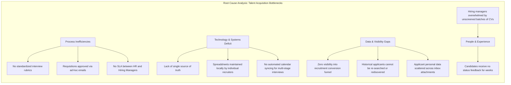
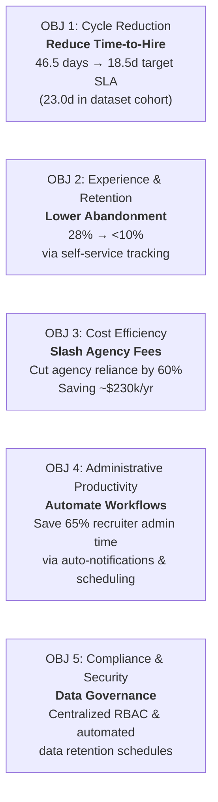

# Business Process Analysis & Information System Proposal
## Deliverable 1: Project Charter, Business Problem Statement, Scope & Stakeholder Analysis

**Project Name:** Recruitment & Applicant Tracking Information System (ATS Proposal)  
**Document Reference:** ATS-BA-DOC-001  
**Project Version:** 1.0  
**Project Type:** Personal Learning Project / Business Systems Analysis Portfolio  
**Author / Role:** Business Analyst / Business Systems Analysis (Student Portfolio Project)  
**Target Organization:** Novus Enterprise Technologies (Fictional mid-sized enterprise scenario: 1,800 FTEs; 350+ annual hires)  
**Study Scope:** Business Process Re-engineering, Requirements Engineering & Information System Proposal  

---

## 1. Project Charter Overview

### 1.1 Executive Summary
Novus Enterprise Technologies is a **fictional mid-sized enterprise scenario** created to simulate realistic operational friction and escalating recruitment costs across decentralized corporate business units. In this operational baseline, talent acquisition is managed via fragmented email correspondence, manual desktop spreadsheets, third-party job boards, and disparate calendar invites.

This fragmentation has resulted in an average **Time-to-Hire of 46.5 calendar days**, a **28% candidate abandonment rate** during screening and scheduling stages, compliance vulnerabilities regarding resume data privacy (GDPR / EEOC), and an annual spend of **$380,000 in redundant external recruitment agency fees** incurred to bypass internal screening bottlenecks.

This document establishes the charter for an end-to-end **Business Process Analysis and Information System Proposal** for a unified, cloud-native **Recruitment & Applicant Tracking System (ATS)**. The initiative redesigns the talent acquisition lifecycle into a standardized, auditable, and automated digital ecosystem from job requisition inception through candidate offer acceptance and onboarding handover.

### 1.2 Project Mandate & Study Scope
* **Project Context:** Personal Learning Project & Academic / Professional Portfolio Demonstration
* **Analyst Role:** Business Analyst / Business Systems Analysis (Student Scenario)
* **Study Mandate:** Formulate an end-to-end operational diagnostic across Talent Acquisition, Hiring Managers, IT Governance, and Executive Leadership, evaluate AS-IS process inefficiencies, and formulate the TO-BE Information System Architecture and Functional Specification.

---

## 2. Business Problem Statement & Root Cause Analysis

### 2.1 The Core Problem Statement
> **Problem Statement:**  
> The current recruitment operating model at Novus Enterprise Technologies relies on disconnected communication channels, unstandardized evaluations, and uncentralized candidate records. This creates significant delays in candidate screening, data duplication across siloed spreadsheets, lost applicant history, scheduling bottlenecks, and zero centralized recruitment analytics. Consequently, the organization loses top-tier talent to competitors, experiences bloated cost-per-hire, and lacks compliance governance over candidate personal data.

### 2.2 Root Cause Analysis (Fishbone / 4M Framework)



### 2.3 The 5-Whys Deep-Dive Analysis
1. **Why is the average Time-to-Hire 46.5 days?**  
   *Because resume screening, interview scheduling, and feedback collection stall for 7–12 days at each stage.*
2. **Why do these stages stall?**  
   *Because recruiters coordinate availability back and forth across individual emails and spreadsheets, waiting days for hiring managers to reply.*
3. **Why do hiring managers take days to reply?**  
   *Because resumes arrive as loose PDF/Word attachments in unorganized email threads with no structured scorecards or consolidated review interface.*
4. **Why are there no scorecards or consolidated review platforms?**  
   *Because the organization has never deployed a centralized Applicant Tracking System integrated with corporate authentication, role-based workflows, and automated communication.*
5. **Root Cause:**  
   *Absence of an integrated Information System that enforces systematic workflow states, centralizes candidate data, automates repetitive administrative communication, and provides real-time visibility to both candidates and internal decision-makers.*

### 2.4 Quantification of Inaction (Cost of Doing Nothing)

| Operational Dimension | Current AS-IS Metric | Business Consequence | Annual Scenario Impact (Illustrative) |
| :--- | :--- | :--- | :--- |
| **Time-to-Hire** | 46.5 Calendar Days | Stalled engineering & sales product delivery; lost candidate interest | Illustrative scenario estimate: \$420,000 in delayed project productivity |
| **Agency Spend** | 35% of positions routed to external recruiters | Inefficient bypass of internal recruiters due to capacity crunch | Illustrative scenario assumption: \$380,000/year in external agency commissions |
| **Candidate Drop-Off** | 28% drop-off post-application | Top talent withdraws due to lack of timely status visibility | Severe brand impairment in competitive talent market |
| **Data Redundancy & Errors** | 8 disparate recruiter spreadsheets | Multiple recruiters contact same candidate; mismatched notes | 15+ recruiter hours wasted per week on manual data reconciliation |
| **Data Governance Risk** | Resumes held in Outlook inboxes indefinitely | Inability to track data retention or satisfy privacy requests (such as GDPR right-to-erasure) or EEOC recordkeeping | Heightened data privacy and governance vulnerabilities across unmanaged personal inboxes |

---

## 3. Strategic Alignment & SMART Business Objectives

### 3.1 Strategic Alignment
The proposed ATS directly supports Novus Enterprise's 3-Year Strategic Imperative:  
* **Operational Excellence:** Streamlining internal overhead and eliminating non-value-adding manual admin.
* **Talent Density:** Competing aggressively for high-caliber engineering, analyst, and operational talent through premium candidate experience.
* **Data-Driven Governance:** Establishing automated, audit-ready operational metrics for management decision-making.

### 3.2 SMART Project Objectives



* **Objective 1 (Cycle Time Reduction):** Reduce the end-to-end average Time-to-Hire from **46.5 calendar days** toward an **18.5-calendar-day target SLA** (with synthetic cohort testing demonstrating an empirical average of **23.0 days** across 1,250 records).
* **Objective 2 (Candidate Conversion):** Decrease candidate drop-off and withdrawal rates from **28% to under 10%** by implementing automated status notifications and a self-service candidate tracking portal.
* **Objective 3 (Direct Agency Cost Avoidance):** Reduce external recruitment agency reliance by **60%** within the first full operating year, generating an estimated direct cost savings of **\$228,000 annually**.
* **Objective 4 (Administrative Efficiency):** Reduce recruiter manual administrative hours spent on data entry, email chasing, and schedule coordination by **65%**, redirecting recruiter capacity toward active talent sourcing and relationship building.
* **Objective 5 (Compliance & Governance):** **Designed to support GDPR-related and EEOC data governance requirements** through automated audit logging, centralized role-based data access (RBAC), and automated data purging schedules.

### 3.3 Target Performance Baseline vs. Target Table

| Metric / KPI | Current Baseline (AS-IS) | Target State (TO-BE) | Measurement Frequency |
| :--- | :---: | :---: | :--- |
| **Average Time-to-Hire** | 46.5 Days | 18.5 Days (Target SLA) | Monthly aggregated by department |
| **Candidate Drop-Off Rate** | 28% | < 10% | Weekly funnel stage analysis |
| **Resume Screening Turnaround Time** | 6.5 Days | ≤ 48 Hours | Weekly recruiter SLA audit |
| **Hiring Manager Feedback Lag** | 5.2 Days | ≤ 24 Hours post-interview | Post-interview scorecard tracking |
| **Offer Acceptance Rate** | 68% | ≥ 85% | Monthly cohort analysis |
| **Recruitment Analytics Visibility** | Zero (Manual Excel rollup quarterly) | Real-time Power BI Dashboard | Continuous daily refresh |

---

## 4. Project Scope Definition

### 4.1 Process Boundaries
* **Inception Trigger:** A Department Manager identifies a staffing vacancy or growth headcount and submits a formal digital Job Requisition.
* **Termination / Handover Trigger:** A selected candidate accepts the formal digital Offer Letter, triggering an automated data package handover to the HRIS/Onboarding system.

```mermaid
flowchart LR
    A([Start Trigger:<br/>Hiring Need Identified]) --> B[Job Requisition Creation]
    B --> C[Approval Workflow]
    C --> D[Job Posting & Distribution]
    D --> E[Candidate Application & Ingestion]
    E --> F[Screening & Shortlisting]
    F --> G[Multi-Stage Interviewing & Scorecards]
    G --> H[Hiring Decision & Approvals]
    H --> I[Offer Generation & Digital Acceptance]
    I --> J([End Trigger:<br/>Handover to HRIS / Onboarding])
```



### 4.2 In-Scope Functional Modules
The proposed ATS Information System incorporates **8 Core Modules**:

1. **Module 1: User & Access Management (RBAC)**  
   Multi-role access (Candidate, Recruiter, Hiring Manager, System Admin) with Single Sign-On (SSO) integration, permission profiles, and audit logging.
2. **Module 2: Requisition & Job Posting Management**  
   Requisition authoring, hierarchical departmental approval chains, job description library, qualification criteria, and automatic publication to the internal/external career portal.
3. **Module 3: Candidate & Talent Pool Management**  
   Structured candidate profiles, multi-version resume upload (PDF/DOCX), searchable skills database, historical application tracking, and talent rediscovery repository.
4. **Module 4: Application Processing & Pipeline Management**  
   Stage-gate progression (Applied $\rightarrow$ Screened $\rightarrow$ Shortlisted $\rightarrow$ Interviewing $\rightarrow$ Offered $\rightarrow$ Hired/Rejected), bulk status updates, and automated disqualification rules.
5. **Module 5: Interview Scheduling & Collaborative Evaluation**  
   Calendar synchronization (Outlook / Google Workspace), interview stage configuration (HR Phone Screen, Technical, Behavioral, Executive), and standardized quantitative scoring rubrics.
6. **Module 6: Offer Management & Approvals**  
   Dynamic offer template generation, compensation parameter verification, internal executive approval routing, and candidate e-signature / acceptance capture.
7. **Module 7: Automated Notification & Communication Hub**  
   Event-triggered email/SMS notifications (Application received, Interview scheduled, Status updates, Rejection notices, Offer letters) and customizable communication templates.
8. **Module 8: Recruitment Analytics & Executive Dashboards**  
   Operational reporting and executive BI dashboards tracking Time-to-Hire, Cost-per-Hire, pipeline conversion rates, source effectiveness, and recruiter productivity.

### 4.3 Out-of-Scope (Explicit Project Boundaries)
To ensure project feasibility, budget discipline, and architectural clarity, the following items are strictly **Out-of-Scope**:
* **Post-Hire Employee Onboarding Execution:** (Equipment provisioning, benefits enrollment, company orientation; system will output an API/CSV handover payload to the core HRIS).
* **Payroll & Compensation Management:** Handled exclusively by the enterprise ERP/payroll software.
* **Employee Performance Management:** Post-probation evaluations and appraisal systems.
* **Third-Party Background Investigation Execution:** The ATS will store background check status flags (Passed/Failed), but the actual investigation is executed externally by third-party screening vendors.
* **Internal Employee Re-skilling / Learning Management (LMS):** Training delivery is handled by the corporate LMS.

### 4.4 Project Constraints, Assumptions, and Dependencies

#### Assumptions
* Corporate IT infrastructure supports cloud SaaS hosting or internal containerized deployment.
* Hiring managers and recruiters will adopt standard evaluation rubrics rather than informal verbal feedback.
* Company email and calendar infrastructure uses standard Microsoft 365 / Exchange APIs.
* Management will enforce adherence to the new ATS, discouraging off-platform hiring.

#### Constraints
* **Regulatory Governance:** Designed to support data privacy principles (e.g. GDPR data minimization and consent) and non-discrimination record-keeping guidelines (e.g. EEOC).
* **Budgetary Constraints:** System implementation and software licensing capped within annual HR Capital Expenditure allowance.
* **Timeline Constraint:** Phased roll-out must achieve minimum viable production (MVP) within 16 weeks to support upcoming Q1 peak hiring.

#### Dependencies
* Integration access to Microsoft 365 Graph API for corporate calendar availability.
* Secure REST API bridge to the core HRIS (Workday / SAP SuccessFactors) for new-hire profile ingestion.
* Corporate Single Sign-On (SAML 2.0 / Okta / Azure AD) directory provisioning.

---

## 5. Comprehensive Stakeholder Analysis

### 5.1 Stakeholder Register

| Stakeholder ID | Simulated Stakeholder Persona | Department / Group | Primary Interests & Business Goals | Pain Points with Current Process | Influence (1-5) | Impact (1-5) | Engagement Strategy |
| :---: | :--- | :--- | :--- | :--- | :---: | :---: | :--- |
| **SH-01** | **Job Candidate** (Internal & External) | External Market / Internal Staff | Transparent hiring process, rapid feedback, easy application, mobile accessibility. | Black hole applications; never informed of rejection; clunky forms. | 2 | 5 | Provide self-service candidate portal, instant confirmation, status tracking. |
| **SH-02** | **Corporate Recruiter** | Talent Acquisition (HR) | Candidate pipeline velocity, automated scheduling, centralized candidate history, eliminating manual data entry. | Managing multiple spreadsheets; lost candidate emails; endless scheduling ping-pong. | 4 | 5 | Involve as primary user group in daily backlog refinement and UI workflow design. |
| **SH-03** | **Hiring Manager** | Functional Business Units (Eng, Sales, Ops) | Fast position fulfillment, qualified candidates, simple review interface, structured interview feedback. | Inundated with poor CVs in email inbox; no reminder of upcoming interviews; complex forms. | 4 | 4 | Provide streamlined dashboard, 1-click candidate review, and mobile-friendly scorecards. |
| **SH-04** | **VP of Human Resources** | Executive Leadership | Recruitment cost reduction, lower time-to-hire, employer brand reputation, headcount plan delivery. | Agency fee overspending; lack of strategic recruitment data for board reports. | 5 | 4 | Weekly steering committee updates; executive dashboard demonstrations; milestone sign-offs. |
| **SH-05** | **System Administrator / IT Security** | Enterprise IT & Infosec | Security architecture, SSO integration, role-based access control, data encryption, high availability. | Shadow IT spreadsheets containing PII; unvetted SaaS tools; unauthorized file sharing. | 4 | 3 | Technical architecture reviews; compliance verification sessions; security audits. |
| **SH-06** | **Legal & Compliance Officer** | Corporate Legal / Risk | Adherence to labor laws, EEOC/OFCCP compliance, GDPR data subject rights, fair evaluation audit trails. | Inability to audit hiring decisions or verify fair evaluation rubrics in email threads. | 3 | 4 | Review requirement specifications for data retention, consent mechanisms, and audit logging. |
| **SH-07** | **Chief Financial Officer (CFO)** | Executive Finance | Recruitment ROI, agency fee minimization, headcount budget control against authorized requisitions. | Unbudgeted hiring requisitions; inability to forecast talent acquisition spend. | 5 | 3 | Deliver clear business case, ROI calculations, and requisition financial approval controls. |

### 5.2 Stakeholder Power-Interest Matrix (Mendelow's Grid)

```mermaid
quadrantChart
    title Stakeholder Power vs. Interest Grid
    x-axis Low Interest --> High Interest
    y-axis Low Power --> High Power
    quadrant-1 Manage Closely (Key Players)
    quadrant-2 Keep Satisfied
    quadrant-3 Monitor (Minimum Effort)
    quadrant-4 Keep Informed
    "VP of Human Resources": [0.85, 0.90]
    "Corporate Recruiters": [0.92, 0.75]
    "Hiring Managers": [0.78, 0.70]
    "Chief Financial Officer": [0.45, 0.88]
    "Legal & Compliance": [0.55, 0.65]
    "System Admin / IT": [0.60, 0.68]
    "Job Candidates": [0.90, 0.30]
```

* **Quadrant 1: Manage Closely (High Power, High Interest)**
  * *VP of Human Resources, Corporate Recruiters, Hiring Managers.*
  * Strategy: Continuous collaborative workshops, prototype co-design, weekly steering reviews.
* **Quadrant 2: Keep Satisfied (High Power, Low/Medium Interest)**
  * *Chief Financial Officer, IT Security Steering Group.*
  * Strategy: Clear executive milestone summaries, budget adherence tracking, enterprise architecture alignment.
* **Quadrant 3: Keep Informed (Low Power, High Interest)**
  * *Job Candidates, Recruitment Coordinators.*
  * Strategy: Usability testing sessions, candidate satisfaction surveys, clear user onboarding guides.
* **Quadrant 4: Monitor (Low Power, Low/Medium Interest)**
  * *External Agency Vendors, General Employee Base.*
  * Strategy: Policy update memos, standardized vendor submission portal documentation.

### 5.3 RACI Matrix Across the Recruitment Lifecycle

* **R (Responsible):** The role that executes the task.
* **A (Accountable):** The single role with ultimate ownership and decision-making veto.
* **C (Consulted):** The role providing key domain input and feedback.
* **I (Informed):** The role kept updated on progress and results.

| Recruitment Process Stage | Candidate (CAN) | Recruiter (REC) | Hiring Manager (HM) | HR Leadership (VP) | System Admin (IT) | Legal / Compliance |
| :--- | :---: | :---: | :---: | :---: | :---: | :---: |
| **1. Identify Need & Create Requisition** | I | C | **R** | **A** | I | I |
| **2. Requisition Approval & Budget Check** | I | I | C | **A** / R | I | I |
| **3. Job Posting & Distribution** | I | **R** | C | A | I | I |
| **4. Candidate Application & Ingestion** | **R** | A | I | I | I | I |
| **5. Initial Resume Screening** | I | **R** / A | C | I | I | I |
| **6. Shortlisting Candidates** | I | R | **A** | I | I | I |
| **7. Interview Scheduling** | C | **R** | C | I | I | I |
| **8. Conducting Interviews & Scorecards** | C | C | **R** / A | I | I | C |
| **9. Final Hiring Decision** | I | C | **R** | **A** | I | I |
| **10. Offer Calculation & Creation** | I | **R** | C | **A** | I | C |
| **11. Offer Acceptance / Signature** | **R** | A | I | I | I | I |
| **12. Handover to HRIS / Onboarding** | I | **R** | I | A | **R** (System) | I |
| **13. System Maintenance & Audit Logs** | I | I | I | C | **R** / A | C |

---

## 6. Detailed Stakeholder Personas

> **Note on Persona Archetypes:** All named stakeholder personas (Maya Lin, Sarah Jenkins, David Vance, Alex Rivera) represent **fictional user archetype profiles** created for user-centered requirements elicitation and usability modeling.

```text
┌─────────────────────────────────────────────────────────────────────────────┐
│ PERSONA 1: The Frustrated Candidate                                          │
│ Name: Maya Lin | Role: Senior Systems Software Engineer                      │
├─────────────────────────────────────────────────────────────────────────────┤
│ • Demographic: 31 years old, 7 years experience, actively pursued by tech   │
│   companies; applies primarily via mobile and laptop during evening hours. │
│ • Goals: Clear job specifications, fast application without repetitive CV   │
│   re-typing, transparent application status, timely scheduling updates.     │
│ • Frustrations: Submitting resumes into "black holes", waiting 3 weeks with │
│   no reply, receiving generic rejection emails months later.                │
│ • ATS Success Metric: Application completed in < 5 minutes; real-time stage │
│   tracking dashboard accessible 24/7.                                       │
└─────────────────────────────────────────────────────────────────────────────┘
```

```text
┌─────────────────────────────────────────────────────────────────────────────┐
│ PERSONA 2: The Overwhelmed Corporate Recruiter                              │
│ Name: Sarah Jenkins | Role: Senior Talent Acquisition Specialist            │
├─────────────────────────────────────────────────────────────────────────────┤
│ • Demographic: 28 years old, manages 15–20 active open requisitions across  │
│   engineering and operations simultaneously.                                │
│ • Goals: Rapid resume screening, instant shortlisting, zero calendar        │
│   coordination friction, automated rejection notifications for non-matches. │
│ • Frustrations: Keeping 6 separate Excel spreadsheets up to date; losing    │
│   candidate emails; hiring managers ignoring candidate review emails.      │
│ • ATS Success Metric: 60% reduction in manual data entry; candidate status  │
│   updated in one click with automated candidate notification.               │
└─────────────────────────────────────────────────────────────────────────────┘
```

```text
┌─────────────────────────────────────────────────────────────────────────────┐
│ PERSONA 3: The Time-Constrained Hiring Manager                              │
│ Name: David Vance | Role: Director of Engineering                           │
├─────────────────────────────────────────────────────────────────────────────┤
│ • Demographic: 42 years old, leads a team of 35 engineers; hiring is critical│
│   to project delivery, but day-to-day meetings leave little time for HR.   │
│ • Goals: Receive only pre-screened, qualified candidates; 1-click access to │
│   resumes; standardized interview feedback forms on mobile or laptop.       │
│ • Frustrations: Inboxes cluttered with 50-page resume attachments; lack of  │
│   standardized interview notes from other team interviewers.                │
│ • ATS Success Metric: Candidate review completed in under 2 minutes per CV; │
│   all team interview scorecards consolidated on a single screen.            │
└─────────────────────────────────────────────────────────────────────────────┘
```

```text
┌─────────────────────────────────────────────────────────────────────────────┐
│ PERSONA 4: The Security & Governance Administrator                          │
│ Name: Alex Rivera | Role: Enterprise Systems & Security Administrator       │
├─────────────────────────────────────────────────────────────────────────────┤
│ • Demographic: 38 years old, responsible for enterprise SaaS integrations,  │
│   identity access management (IAM), data security, and audit compliance.    │
│ • Goals: Centralized Single Sign-On (SSO), granular role-based permissions, │
│   encrypted PII data storage, automatic audit logging of all system actions.│
│ • Frustrations: Business units using ungoverned spreadsheet trackers that   │
│   violate GDPR data minimization and right-to-be-forgotten regulations.     │
│ • ATS Success Metric: Zero PII stored outside encrypted database; automated │
│   audit trail for all user interactions and resume downloads.               │
└─────────────────────────────────────────────────────────────────────────────┘
```

---

## 7. Deliverable Baseline & Simulated Governance Review

| Role | Simulated Stakeholder Persona | Baseline Status | Review Date | Alignment Comments |
| :--- | :--- | :---: | :---: | :--- |
| **Executive Sponsor Simulation** | VP of Human Resources | **ALIGNED** | 2026-09-24 | Scope and business objectives aligned with corporate talent scenario. |
| **Business Systems Analyst (Author)** | B.Tech CSE (Student Portfolio) | **BASELINED** | 2026-09-24 | Baseline established for AS-IS process modeling and requirements. |
| **Enterprise IT Architecture Lead** | Chief Technology Officer Persona | **ALIGNED** | 2026-09-24 | Approved scope boundaries; SSO & API integration model endorsed. |
| **Legal & Compliance Representative** | Compliance Lead Persona | **ALIGNED** | 2026-09-24 | Scope includes mandatory GDPR data governance controls. |

---
*End of Deliverable 1. Next Phase: Deliverable 2 — Comprehensive AS-IS Process Modeling, Pain-Point Inventory & Bottleneck Heatmap.*
