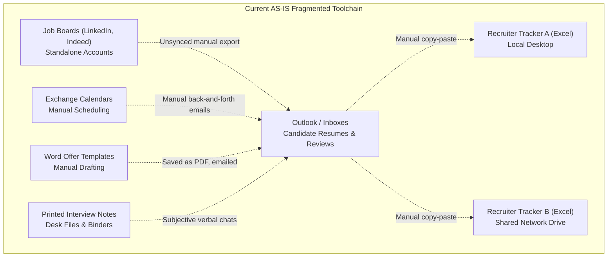
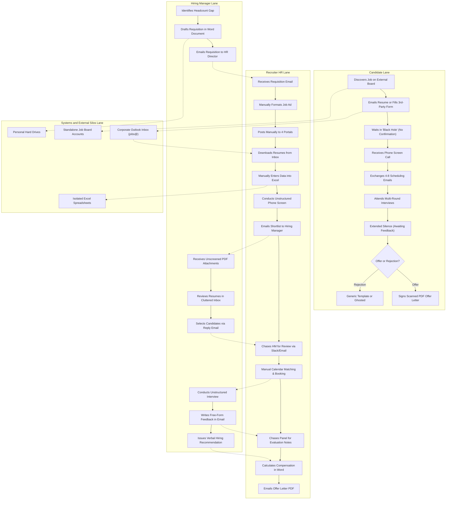
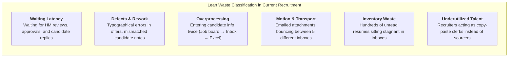
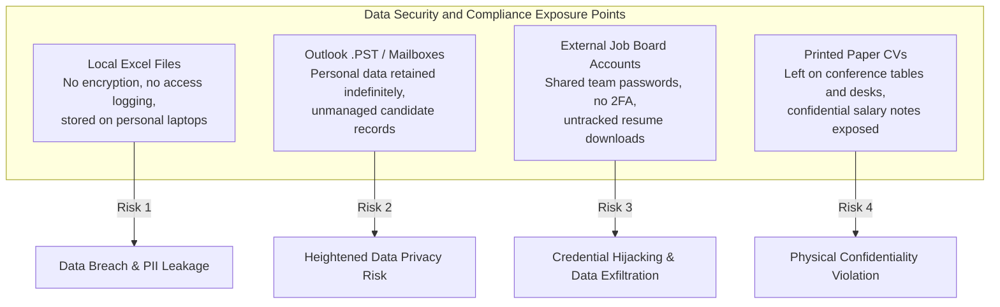

# Business Process Analysis & Information System Proposal
## Deliverable 2: AS-IS Process Analysis, Swimlane Modeling & Bottleneck Heatmap

**Project Name:** Recruitment & Applicant Tracking Information System (ATS Proposal)  
**Document Reference:** ATS-BA-DOC-002  
**Project Version:** 1.0  
**Project Type:** Personal Learning Project / Business Systems Analysis Portfolio  
**Author / Role:** Business Analyst / Business Systems Analysis (Student Portfolio Project)  
**Target Organization:** Novus Enterprise Technologies (Fictional mid-sized enterprise scenario)  
**Dependencies:** Cross-referenced with ATS-BA-DOC-001 (Project Charter & Stakeholder Analysis)  

---

## 1. Current State (AS-IS) Environmental Assessment

### 1.1 The Fragmented Operating Landscape
> **Context:** Novus Enterprise Technologies is a **fictional enterprise scenario** analyzed to model operational bottlenecks, swimlane workflows, and root causes for learning and portfolio demonstration.

The current talent acquisition operation across Novus Enterprise Technologies operates in an unintegrated, decentralized state. Rather than utilizing a centralized platform, the organization relies on what business systems analysts term a **"Spaghetti Toolchain"**—a patchwork of disparate office tools, standalone accounts, and informal manual practices.



### 1.2 Channel & Media Fragmentation Matrix
* **Intake & Requisitions:** Word documents filled out by Hiring Managers, emailed as attachments to HR; informal approvals exchanged in message threads without budget verification audit trails.
* **Job Advertising:** Individual recruiters log in manually to 4 distinct job boards (LinkedIn, Indeed, Glassdoor, local university boards), manually copy-pasting descriptions and manually renewing expired postings.
* **Resume Ingestion:** Resumes land in a generic corporate inbox (`jobs@novusenterprise.com`) and individual recruiter inboxes as unindexed PDF/DOCX attachments.
* **Tracking & Pipeline:** 8 independent Excel spreadsheets maintained locally by recruiters, causing conflicting candidate ownership, duplicate outreach, and zero centralized reporting.
* **Interview Scheduling:** Back-and-forth email chains (averaging 6.8 emails per scheduled interview) to align candidate availability with panel calendars.
* **Evaluation & Scoring:** Subjective, unstandardized notes taken on notepads or emailed as free-form text. No unified evaluation criteria across interviewers.
* **Offer Letters:** Manually drafted in Microsoft Word from outdated templates, requiring manual calculation of equity and benefits, resulting in periodic typographical and salary calculation errors.

---

## 2. AS-IS End-to-End Process Map (Cross-Functional Swimlane)

The following BPMN-style Swimlane diagram documents the operational flow across all 4 operational lanes: **Candidate**, **Recruiter (HR)**, **Hiring Manager**, and **External Systems / Inboxes**.



---

## 3. Stage-by-Stage Operational Walkthrough & Lead Time Analysis

The end-to-end recruitment lifecycle currently averages **46.5 Calendar Days**. The breakdown below details the activities, manual handoffs, friction points, and specific stage durations.

```mermaid
gantt
    title AS-IS Recruitment Lifecycle Elapsed Time Breakdown (Average 46.5 Days)
    dateFormat  X
    axisFormat  Day %d
    section Phase 1: Requisition
    Requisition Drafting & Approval (7.5 days)      :0, 7.5
    section Phase 2: Sourcing & Intake
    Job Description & Multi-Board Posting (3.0 days):7.5, 10.5
    Application Ingestion & Spreadsheet Entry (4.0 days):10.5, 14.5
    section Phase 3: Screening & Triage
    Resume Triage & Recruiter Phone Screen (6.5 days):14.5, 21.0
    Hiring Manager Resume Review Lag (5.5 days)     :21.0, 26.5
    section Phase 4: Interviewing
    Interview Scheduling Email Ping-Pong (4.5 days) :26.5, 31.0
    Interview Execution & Feedback Chasing (6.0 days):31.0, 37.0
    section Phase 5: Offer & Close
    Hiring Manager Decision Deliberation (3.5 days) :37.0, 40.5
    Offer Drafting, Approval & Signing (6.0 days)   :40.5, 46.5
```

### 3.1 Stage-by-Stage Lead Time Breakdown

| Stage # | Stage Name | Primary Actor | Process Activity & Operational Bottleneck | Typical Stage Duration |
| :---: | :--- | :--- | :--- | :---: |
| **01** | **Requisition & Headcount Approval** | Hiring Manager, VP HR | Word doc drafted, emailed to VP, budget verified via multi-day email thread. | **7.5 Calendar Days** |
| **02** | **Job Description & Sourcing Posting** | Recruiter | Manual copywriting, logging into 4 job boards separately, manual copy-pasting. | **3.0 Calendar Days** |
| **03** | **Application Intake & Ingestion** | Candidate, Recruiter | Resumes land in personal inbox; recruiter downloads PDFs and retypes into Excel. | **4.0 Calendar Days** |
| **04** | **Resume Screening & Recruiter Screen** | Recruiter | Manual reading of 60+ CVs per job; phone screen notes recorded on local notepad. | **6.5 Calendar Days** |
| **05** | **Hiring Manager Shortlist Review** | Hiring Manager | Recruiter emails 5–8 resumes; HM reviews between meetings; leaves in inbox. | **5.5 Calendar Days** |
| **06** | **Interview Scheduling & Logistics** | Recruiter, Candidate | 6–8 back-and-forth emails checking candidate and interviewer calendar availability. | **4.5 Calendar Days** |
| **07** | **Interview Execution & Feedback Collection** | Hiring Manager, Panel | 2–3 rounds of interviews; interviewers forget to send feedback; recruiter chases. | **6.0 Calendar Days** |
| **08** | **Hiring Decision & Compensation Review** | Hiring Manager, VP HR | Ad-hoc meeting or email thread to debate candidate rating and salary band. | **3.5 Calendar Days** |
| **09** | **Offer Drafting, Approval & Acceptance** | Recruiter, Candidate | Manual Word template creation; approval via email; scanned signature return. | **6.0 Calendar Days** |
| **TOTAL** | **End-to-End Recruitment Cycle** | **All Actors** | **Disconnected, manual, email-dependent pipeline across 8 recruiters** | **46.5 Calendar Days** |

---

## 4. AS-IS Pain-Point Inventory (Categorized & Quantified)

The table below catalogs the **12 core operational pain points** identified during stakeholder interviews and process observation sessions.

| Pain Point ID | Process Stage | Category | Detailed Description of Defect | Operational & Financial Impact | Severity Rating |
| :---: | :--- | :--- | :--- | :--- | :---: |
| **PP-01** | Requisition Inception | **Process** | No standardized requisition form; managers use differing salary bands and outdated job specifications. | 40% of requisitions require rework or clarification; delayed kickoff. | **High** |
| **PP-02** | Requisition Approval | **Process** | Approvals handled through unstructured email chains with no automated SLA or escalation rules. | Requisitions sit idle in executive inboxes for over 7 business days on average. | **High** |
| **PP-03** | Job Posting | **Technology** | Recruiters must log into 4 distinct portals separately to post, edit, or close listings. | 8–10 recruiter hours wasted weekly on manual copy-pasting across portals. | **Medium** |
| **PP-04** | Resume Ingestion | **Data** | Resumes are scattered across personal inboxes, desktop downloads, and external job board portals. | Zero centralized talent search; candidates applying to multiple roles are missed. | **Critical** |
| **PP-05** | Applicant Tracking | **Technology** | Pipeline maintained on 8 unlinked Excel files across 8 recruiters. | Data collisions; duplicate candidate calls; mismatched status information. | **Critical** |
| **PP-06** | Candidate Communication | **People** | No automated receipt confirmation or stage updates sent to applicants. | 28% candidate abandonment; negative Glassdoor employer reviews. | **High** |
| **PP-07** | Screening & Triage | **Process** | No standardized pre-screening qualification questions; all resumes must be parsed manually. | Recruiters spend 65% of working hours reading unqualified applications. | **High** |
| **PP-08** | HM Review Turnaround | **People / Process** | Hiring managers take 5+ days to review emailed resumes due to cluttered inboxes. | Top-tier candidates receive competing offers and withdraw before round 1. | **Critical** |
| **PP-09** | Interview Scheduling | **Process** | Scheduling requires an average of 6.8 manual emails between recruiter, candidate, and panel. | 4.5 days elapsed time just to set an interview date; frequent double-bookings. | **High** |
| **PP-10** | Interview Scoring | **Process** | Feedback provided via unstructured emails or verbal water-cooler chats. | Inconsistent evaluations; hiring decisions based on subjective bias rather than rubrics. | **Critical** |
| **PP-11** | Offer Generation | **Process / Tech** | Offers generated by editing legacy Word documents; compensation checked against manual spreadsheets. | High risk of clerical errors; compensation discrepancies; slow turnaround. | **High** |
| **PP-12** | Executive Reporting | **Data** | Recruitment metrics are compiled once a quarter by manually merging 8 Excel spreadsheets. | Metrics are outdated upon delivery; leadership cannot track operational hiring bottlenecks dynamically. | **Critical** |

---

## 5. Process Waste & Bottleneck Heatmap (Lean Six Sigma Analysis)

To rigorously substantiate the business case for an information system, the current process is analyzed against the **Lean TIMWOOD Waste Taxonomy**:



### 5.1 Elapsed Duration vs. Idle Waiting Latency Analysis

* **Total Baseline Cycle Time:** **46.5 Calendar Days**
* **Process Flow Characteristic:** The majority of the 46.5 calendar days represents idle queue latency—applications sitting in inboxes, scheduling back-and-forth delays, and feedback collection lag.
* **Elimination Opportunity:** The proposed ATS targets automating routine handoffs (instant parsing, self-scheduling, structured rubric alerts) to eliminate unnecessary waiting time across the pipeline.

> **Key Analytical Finding:**  
> The overwhelming majority of the current recruitment lifecycle is idle administrative latency: awaiting email replies, scheduling ping-pong across calendars, delayed feedback collection, and manual spreadsheet synchronization.

---

## 6. Information Architecture & Compliance Risk Analysis



### 6.1 Regulatory Vulnerabilities
1. **Data Privacy Governance (e.g., GDPR):**  
   Under privacy frameworks such as Article 17 of the GDPR (*Right to Erasure*), an applicant may request complete deletion of their personal records. In the current AS-IS environment, satisfying this request requires manually searching through 8 distinct recruiter inboxes, 40+ hiring manager inboxes, and multiple decentralized Excel sheets—making verified compliance with data subject erasure requests virtually impossible.
2. **Employment Recordkeeping Guidelines (e.g., EEOC):**  
   Equal employment opportunity recordkeeping guidelines require organizations to maintain applicant records for defined audit periods. In the current state, unstandardized rejections and unrecorded candidate evaluations expose the organization to significant operational and compliance vulnerabilities in the event of an audit or dispute.
3. **Information Security & Access Control:**  
   Candidate resumes contain sensitive Personally Identifiable Information (PII), including home addresses, personal phone numbers, and employment history. Storing these on unencrypted local drives violates corporate information security standards.

---

## 7. Transition Bridge: Strategic Requirements for the TO-BE System

Based on the quantitative bottlenecks and compliance exposures identified in this AS-IS analysis, the proposed TO-BE Information System must fulfill four non-negotiable architectural mandates:

1. **Unified Central Candidate Repository:** Replace all local spreadsheets with an encrypted relational database providing a Single Source of Truth (SSOT).
2. **Automated Stage-Gate Progression & SLAs:** Replace unstructured email handoffs with automated task assignment, 24-hour review reminders, and one-click stage advancements.
3. **Self-Service Portals with Calendar Integration:** Provide candidates with an interactive tracking interface and automated calendar self-scheduling to eliminate the 4.5-day scheduling delay.
4. **Structured Standardized Evaluation Scorecards:** Replace free-form email notes with quantitative, rubric-based evaluation scorecards directly linked to job requisitions.

---
*End of Deliverable 2. Next Phase: Deliverable 3 — Comprehensive TO-BE Process Design, Re-Engineered Swimlane Workflows & Business Value Realization.*
