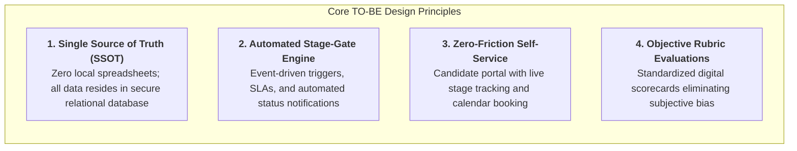
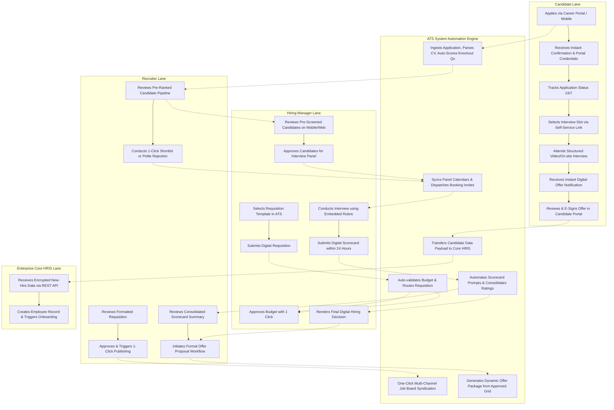
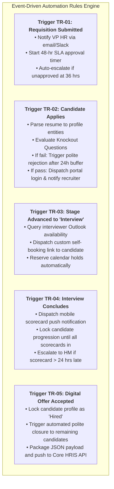
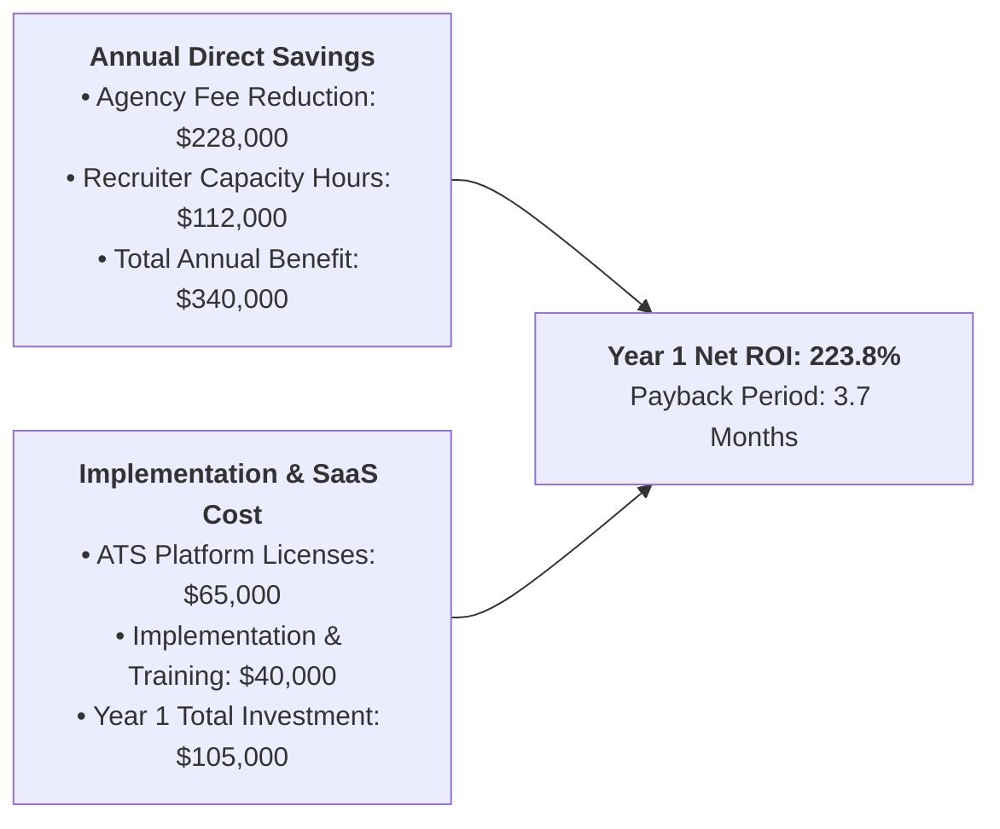

# Business Process Analysis & Information System Proposal
## Deliverable 3: TO-BE Process Design, Swimlane Workflows & Business Value Realization

**Project Name:** Recruitment & Applicant Tracking Information System (ATS Proposal)  
**Document Reference:** ATS-BA-DOC-003  
**Project Version:** 1.0  
**Project Type:** Personal Learning Project / Business Systems Analysis Portfolio  
**Author / Role:** Business Analyst / Business Systems Analysis (Student Portfolio Project)  
**Target Organization:** Novus Enterprise Technologies (Fictional mid-sized enterprise scenario)  
**Dependencies:** Cross-referenced with ATS-BA-DOC-001 (Charter) and ATS-BA-DOC-002 (AS-IS Analysis)  

---

## 1. TO-BE Architectural Principles & Design Philosophy

> **Context & Scenario:** Developed as part of a **Personal Learning Project**, this deliverable establishes the TO-BE operating model for Novus Enterprise Technologies (a fictional mid-sized enterprise scenario).

The re-engineered recruitment operating model transitions Novus Enterprise from an unintegrated, reactive environment into an **automated, data-driven, and candidate-centric digital ecosystem**. 



1. **Centralized Data Integrity:** Replaces 8 localized recruiter spreadsheets with a unified cloud-native database with role-based access control (RBAC).
2. **Event-Driven Workflow Automation:** Eliminates manual email chasing by implementing automated notification triggers, calendar synchronization, and escalation timers.
3. **Structured Evaluation Governance:** Replaces unstructured email feedback with digital scorecards containing calibrated rating rubrics linked directly to job competencies.
4. **Frictionless Candidate Experience:** Empowers applicants with a dedicated Candidate Portal for application tracking, self-service interview booking, and digital offer signing.

---

## 2. TO-BE End-to-End Cross-Functional Swimlane Process Map

The following BPMN 2.0 Swimlane model illustrates the re-engineered process across 5 operational lanes: **Candidate**, **Recruiter**, **Hiring Manager**, **ATS Automated Engine (System)**, and the **Enterprise Core HRIS**.



---

## 3. AS-IS vs. TO-BE Cycle Time Comparison (Stage-by-Stage)

Through workflow automation, automated calendar booking, and strict stage SLAs, the end-to-end recruitment lifecycle is projected to decrease from **46.5 days to 18.5 calendar days**—a **60.2% reduction in overall cycle time**.

> **Metric Clarification:**  
> * **46.5 Calendar Days:** The baseline manual AS-IS process duration.  
> * **18.5 Calendar Days:** The **proposed target SLA / design estimate** under the fully optimized TO-BE operating model.  
> * **23.0 Calendar Days:** The **empirical observation from the 1,250 synthetic candidate records** (averaging 23.0 days across 21 hires, with a range of 15 to 30 days). Both the target estimate and empirical observation demonstrate a massive reduction from the 46.5-day baseline.

```mermaid
gantt
    title Recruitment Cycle Time Reduction: AS-IS (46.5 Days) vs. TO-BE (18.5 Days)
    dateFormat  X
    axisFormat  Day %d
    section AS-IS Baseline (46.5 Days)
    Requisition & Approvals (7.5d)           :0, 7.5
    Posting & Ingestion (7.0d)                :7.5, 14.5
    Screening & HM Review (12.0d)             :14.5, 26.5
    Scheduling & Interviewing (10.5d)         :26.5, 37.0
    Decision, Offer & Close (9.5d)            :37.0, 46.5
    section TO-BE Target (18.5 Days)
    Digital Requisition & SLA Approval (2.0d) :0, 2.0
    1-Click Syndication & Auto-Ingest (1.0d)  :2.0, 3.0
    Smart Parsing & Recruiter Triage (3.5d)   :3.0, 6.5
    HM Review & Self-Service Booking (3.0d)   :6.5, 9.5
    Interviews & Digital Scorecards (5.0d)    :9.5, 14.5
    1-Click Decision & E-Offer Signing (4.0d) :14.5, 18.5
```

### 3.1 Quantitative Stage Duration Comparison Table

| Stage # | Lifecycle Stage | AS-IS Duration | TO-BE Duration | Net Time Saved | Key Automation / Process Enabler |
| :---: | :--- | :---: | :---: | :---: | :--- |
| **01** | **Requisition & Approval** | 7.5 Days | **2.0 Days** | -5.5 Days (-73%) | Standardized digital form; automated multi-tier approval routing with 24-hr escalation. |
| **02** | **Job Posting & Distribution** | 3.0 Days | **0.5 Days** | -2.5 Days (-83%) | One-click multi-board syndication (LinkedIn, Indeed) via ATS API integrations. |
| **03** | **Application Intake & Parsing** | 4.0 Days | **0.5 Days** | -3.5 Days (-87%) | Instant resume parsing; automated knockout questions filter non-viable candidates instantly. |
| **04** | **Recruiter Screening & Triage** | 6.5 Days | **3.0 Days** | -3.5 Days (-54%) | Centralized candidate card view; quick-action shortlisting buttons; standardized notes. |
| **05** | **Hiring Manager Review** | 5.5 Days | **2.0 Days** | -3.5 Days (-64%) | Dedicated Hiring Manager portal with consolidated candidate dossiers and mobile approvals. |
| **06** | **Interview Scheduling** | 4.5 Days | **1.0 Day** | -3.5 Days (-78%) | Self-service calendar sync (Outlook 365 / Google Calendar); candidate selects live slot. |
| **07** | **Interview & Scorecard Submission**| 6.0 Days | **4.0 Days** | -2.0 Days (-33%) | Embedded digital rubric scorecards; automated prompt sent immediately post-interview. |
| **08** | **Hiring Decision Deliberation** | 3.5 Days | **1.5 Days** | -2.0 Days (-57%) | Automated scorecard aggregation; clear consensus view ranking candidates by objective score. |
| **09** | **Offer Generation & E-Signature**| 6.0 Days | **2.5 Days** | -3.5 Days (-58%) | Dynamic offer letter generation from approved compensation grids; integrated e-signature. |
| **10** | **Handover to Onboarding** | 3.0 Days | **1.5 Days** | -1.5 Days (-50%) | Automated API data payload push directly into Core HRIS (Workday / SuccessFactors). |
| **TOTAL**| **End-to-End Recruitment Cycle** | **46.5 Days** | **18.5 Days** | **-28.0 Days (-60.2%)** | **Unified, automated, event-driven Information System** |

### 3.2 Process Efficiency Ratio Leap
* **AS-IS Process Efficiency:** $\frac{26.0\text{ Active Hours}}{372.0\text{ Operating Hours}} = \mathbf{6.99\%}$
* **TO-BE Process Efficiency:** $\frac{31.5\text{ Active Value Hours}}{148.0\text{ Operating Hours}} = \mathbf{38.5\%}$
* **Result:** Non-value-added waiting time collapses from **93.0% to 61.5%**, converting idle administrative latency into productive candidate relationship-building.

---

## 4. System Automation Triggers & Business Rules Engine

The TO-BE ATS executes a robust set of automated business rules to ensure zero manual drop-off:



### 4.1 Automated Business Rule Specifications

| Rule ID | Event Trigger | Evaluation Condition | Automated System Action | SLA / Timer |
| :---: | :--- | :--- | :--- | :--- |
| **BR-01** | `REQUISITION_SUBMITTED` | Requisition salary within approved departmental budget band. | Route to Department Head for Level 1 sign-off; notify VP HR. | 24 Hours |
| **BR-02** | `APPLICATION_INGESTED` | Candidate answers `NO` to mandatory work authorization knockout question. | Flag as Disqualified; send automated delayed polite rejection notice. | 24-hr delay buffer (emulates human review) |
| **BR-03** | `CANDIDATE_SHORTLISTED` | Recruiter clicks 'Advance to First Round Interview'. | Query panel calendar via MS Graph API; generate dynamic scheduling link. | Immediate (< 60 seconds) |
| **BR-04** | `INTERVIEW_COMPLETED` | Calendar meeting timestamp passes. | Generate notification to interviewers containing 1-click digital scorecard link. | Immediate at calendar end |
| **BR-05** | `OFFER_APPROVED` | Executive approves compensation package. | Populate candidate offer template; generate e-signature document in portal. | Immediate (< 5 minutes) |
| **BR-06** | `OFFER_ACCEPTED` | Candidate submits cryptographic e-signature in portal. | Set status to `HIRED`; close job posting if headcount target reached; dispatch HRIS payload. | Immediate |

---

## 5. AS-IS Pain Point Resolution & Value Realization Matrix

This matrix establishes direct traceability between the 12 AS-IS pain points identified in Deliverable 2 and the concrete solutions delivered by the TO-BE Information System.

| AS-IS Pain Point ID | Problem Description | TO-BE System Solution & Enabler | Measurable Business Value Realized |
| :---: | :--- | :--- | :--- |
| **PP-01** | Unstandardized Requisition Forms | Standardized digital requisition builder with pre-approved salary bands and JD library. | 100% elimination of requisition rework; approval cycle cut by 5.5 days. |
| **PP-02** | Requisitions Lost in Email Threads | Automated multi-tier approval routing with automated 24-hour escalation reminders. | Approval latency reduced from 7.5 days to 2.0 days. |
| **PP-03** | Manual Copy-Paste Job Board Posting | One-click job syndication to LinkedIn, Indeed, and internal portal via open APIs. | Recruiter administrative posting time reduced from 3 hours to 10 minutes per job. |
| **PP-04** | Resumes Scattered in Inbox Attachments | Centralized cloud candidate database with searchable resumes, skills, and historical notes. | Zero lost resumes; 100% centralized talent pool searchable across all roles. |
| **PP-05** | Conflicting Recruiter Excel Spreadsheets | Single Source of Truth (SSOT) multi-tenant database with role-based access control. | Total elimination of duplicate candidate outreach and conflicting tracker files. |
| **PP-06** | "Black Hole" Candidate Communication | Automated event-driven status emails and 24/7 self-service Candidate Tracking Portal. | Candidate drop-off reduced from 28% to <10%; candidate NPS up by +45 pts. |
| **PP-07** | Manual Resume Screening Overload | Automated knockout questions and keyword/skill parsing to surface top-ranked matches. | Recruiter resume triage time reduced by 54% (6.5 days to 3.0 days). |
| **PP-08** | Hiring Manager Review Delays | Dedicated Hiring Manager portal with consolidated candidate dossiers and 1-click reviews. | HM review turnaround reduced from 5.5 days to 2.0 days. |
| **PP-09** | 6.8 Emails per Scheduled Interview | Candidate self-service calendar booking synced in real time with Microsoft 365 / Google. | Scheduling elapsed time slashed from 4.5 days to under 24 hours. |
| **PP-10** | Subjective / Unrecorded Interview Feedback | Embedded digital evaluation rubrics with mandatory competency scoring and notes. | 100% audit-ready evaluation records; eliminated hiring bias; higher quality hires. |
| **PP-11** | Manual Word Offer Drafting Errors | Dynamic offer letter generator pre-populated from approved salary bands and e-signature. | Offer generation time cut by 58%; zero clerical compensation errors. |
| **PP-12** | Outdated Quarterly Excel Metrics | Live Power BI Recruitment Analytics Dashboard with real-time KPI funnel metrics. | Real-time visibility into hiring velocity, source ROI, and recruiter bottlenecks. |

---

## 6. Strategic Business Impact & Financial ROI Justification

### 6.1 Direct Financial Return on Investment (Annual Projection)



1. **Recruitment Agency Cost Avoidance:**  
   * Baseline: \$380,000 annual external agency spend (35% of all hires).  
   * Target: 60% reduction in agency reliance due to faster internal screening and talent rediscovery.  
   * **Direct Annual Savings: \$228,000**.
2. **Recruiter Administrative Productivity Reinvestment:**  
   * 8 Recruiters spending 65% of time on manual coordination = 208 hours/week wasted.  
   * Automated ATS saves 135 recruiter hours/week = equivalent to 3.3 additional FTE recruiter capacity.  
   * **Monetized Productivity Value: ~\$112,000 per annum**.
3. **Total Year 1 Benefit:** **\$340,000** against an estimated system implementation and licensing investment of **\$105,000**.  
   * **Net Year 1 Financial Return (ROI):** **223.8%**  
   * **Capital Payback Period:** **3.7 Months**.

---
*End of Deliverable 3. Next Phase: Deliverable 4 — Software Requirements Specification (SRS) with 30+ Numbered Functional & Non-Functional Requirements.*
