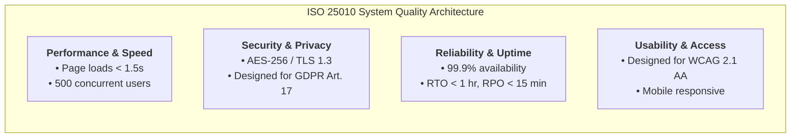

# Business Process Analysis & Information System Proposal
## Deliverable 4: Software Requirements Specification (SRS) & Traceability Matrix

**Project Name:** Recruitment & Applicant Tracking Information System (ATS Proposal)  
**Document Reference:** ATS-BA-DOC-004  
**Project Version:** 1.0  
**Project Type:** Personal Learning Project / Business Systems Analysis Portfolio  
**Author / Role:** Business Analyst / Business Systems Analysis (Student Portfolio Project)  
**Target Organization:** Novus Enterprise Technologies (Fictional mid-sized enterprise scenario)  
**Specification Reference:** Referencing the ISO/IEC/IEEE 29148:2018 framework (Requirements Engineering)  
**Dependencies:** Cross-referenced with ATS-BA-DOC-001 (Charter), DOC-002 (AS-IS), and DOC-003 (TO-BE)  

---

## 1. Requirements Engineering Framework & Conventions

> **Framing Note:** This SRS defines proposed requirements for the conceptual ATS solution. Requirements were created for this personal learning project and were not elicited from a real organization.

### 1.1 Requirements Classification Scheme
Every requirement in this specification is assigned a unique tracking identifier, descriptive title, MoSCoW priority classification, and traceability mapping.

* **FR-MOD-XX:** Functional Requirement (System action or operational capability)
* **NFR-CAT-XX:** Non-Functional Requirement (Quality attribute, constraint, or performance SLA)
* **MoSCoW Prioritization:**
  * **Must Have (M):** Critical for Minimum Viable Product (MVP); non-negotiable for system launch.
  * **Should Have (S):** High priority; essential for full operational optimization.
  * **Could Have (C):** Desirable enhancement; scheduled for Phase 2 enhancement.
  * **Won't Have (W):** Explicitly deferred to future product releases (e.g. video interviewing AI facial analysis).

---

## 2. Functional Requirements Specification (FR) by Module

```mermaid
flowchart TD
    subgraph ATS System Modules (33 Functional Requirements)
        M1["Module 1: User & RBAC Management<br/>(FR-UM-01 to 04)"]
        M2["Module 2: Job Requisitions & Posting<br/>(FR-JM-01 to 04)"]
        M3["Module 3: Candidate & Talent Pool<br/>(FR-CM-01 to 04)"]
        M4["Module 4: Application Pipeline<br/>(FR-AM-01 to 04)"]
        M5["Module 5: Interview Scheduling & Scorecards<br/>(FR-IM-01 to 05)"]
        M6["Module 6: Offer & E-Signature<br/>(FR-OM-01 to 04)"]
        M7["Module 7: Notifications & Communication<br/>(FR-NM-01 to 04)"]
        M8["Module 8: Recruitment Analytics<br/>(FR-RA-01 to 04)"]
    end
```

### Module 1: User Management & Role-Based Access Control (RBAC)

| Requirement ID | Requirement Name | Detailed Specification | MoSCoW | Actor |
| :---: | :--- | :--- | :---: | :--- |
| **FR-UM-01** | Candidate Registration & Self-Service Account | The system shall allow external candidates to create and manage an authenticated account using email/password or OAuth2 (LinkedIn, Google) with multi-factor authentication (MFA) option. | **Must** | Candidate |
| **FR-UM-02** | Role-Based Authorization & Permission Profiles | The system shall enforce discrete permission sets for 4 primary roles: Candidate, Recruiter, Hiring Manager, and System Administrator, restricting data visibility based on role and department assignment. | **Must** | Admin |
| **FR-UM-03** | Enterprise Single Sign-On (SSO) | The system shall integrate with corporate identity providers via SAML 2.0 / OpenID Connect (Azure AD / Okta) for all internal enterprise users (Recruiters, Hiring Managers, Admins). | **Must** | Admin |
| **FR-UM-04** | User Activity Audit Trail Logging | The system shall record an immutable audit log of all user authentication events, record modifications, resume views, and candidate status transitions with user ID and timestamp. | **Must** | Admin |

### Module 2: Job Requisition & Posting Management

| Requirement ID | Requirement Name | Detailed Specification | MoSCoW | Actor |
| :---: | :--- | :--- | :---: | :--- |
| **FR-JM-01** | Digital Requisition Builder & Templating | The system shall allow hiring managers to author job requisitions using standardized departmental templates pre-populated with approved salary bands, job families, and required competencies. | **Must** | Hiring Manager |
| **FR-JM-02** | Multi-Tier Requisition Approval Engine | The system shall route submitted requisitions through a sequential approval chain (Department Head $\rightarrow$ Finance/Compensation $\rightarrow$ VP HR) with automated notification and 24-hr reminder alerts. | **Must** | HR / Finance |
| **FR-JM-03** | One-Click Multi-Channel Job Syndication | The system shall syndicate approved job listings simultaneously to the internal career portal and external job aggregators (LinkedIn Job Wrap, Indeed XML feed) via automated API connectors. | **Must** | Recruiter |
| **FR-JM-04** | Job Lifecycle & Headcount Status Control | The system shall support job lifecycle state transitions: Draft, Pending Approval, Active, On Hold, Closed, and Archived, automatically updating linked job listings upon state change. | **Should** | Recruiter |

### Module 3: Candidate & Talent Pool Management

| Requirement ID | Requirement Name | Detailed Specification | MoSCoW | Actor |
| :---: | :--- | :--- | :---: | :--- |
| **FR-CM-01** | Multi-Format Resume Ingestion & Parsing | The system shall accept resumes in PDF, DOCX, and TXT formats (up to 10MB) and automatically extract text fields into structured candidate profile entities (Name, Contact, Skills, Experience, Education). | **Must** | Candidate / Recruiter |
| **FR-CM-02** | Centralized Talent Pool & Boolean Search | The system shall index candidate profiles and provide recruiters with a global search interface supporting Boolean operators (AND, OR, NOT), skill filters, location radii, and keyword searching. | **Must** | Recruiter |
| **FR-CM-03** | Duplicate Candidate Detection & Merging | The system shall automatically detect duplicate candidate profiles based on matching email addresses or phone numbers, prompting recruiters with an audit-logged profile merge tool. | **Must** | Recruiter |
| **FR-CM-04** | Candidate Data Privacy & GDPR Erasure | The system shall provide candidates with self-service data export and deletion request capabilities, executing automated data masking/erasure across all tables upon verified GDPR request. | **Must** | Candidate / Admin |

### Module 4: Application Processing & Pipeline Management

| Requirement ID | Requirement Name | Detailed Specification | MoSCoW | Actor |
| :---: | :--- | :--- | :---: | :--- |
| **FR-AM-01** | Configurable Stage-Gate Recruitment Pipeline | The system shall support a configurable recruitment pipeline for each job, comprising default stages: Applied, Screened, Shortlisted, Interview 1, Interview 2, Offered, Hired, and Disqualified. | **Must** | Recruiter |
| **FR-AM-02** | Automated Knockout Screening Questions | The system shall allow recruiters to attach weighted or disqualifying knockout screening questions (e.g. work authorization, certifications) to job applications, auto-tagging non-qualifying submissions. | **Must** | Recruiter |
| **FR-AM-03** | Interactive Kanban & Grid Pipeline Board | The system shall display candidates in an interactive visual Kanban board allowing recruiters to drag-and-drop candidates between stages with real-time stage counter metrics. | **Must** | Recruiter |
| **FR-AM-04** | Bulk Candidate Action Processing | The system shall allow recruiters to select multiple candidates simultaneously to perform batch actions: bulk stage advancement, bulk rejection with customized templates, or batch tagging. | **Should** | Recruiter |

### Module 5: Interview Scheduling & Collaborative Evaluation

| Requirement ID | Requirement Name | Detailed Specification | MoSCoW | Actor |
| :---: | :--- | :--- | :---: | :--- |
| **FR-IM-01** | Bi-Directional Corporate Calendar Sync | The system shall integrate bi-directionally with Microsoft 365 Exchange and Google Workspace to detect interviewer calendar availability and inject confirmed bookings automatically. | **Must** | Recruiter |
| **FR-IM-02** | Candidate Self-Service Slot Booking | The system shall generate a secure, tokenized self-service scheduling link dispatched to the candidate, allowing them to choose from real-time available interviewer time slots. | **Must** | Candidate |
| **FR-IM-03** | Multi-Stage Panel Interview Configuration | The system shall allow recruiters to configure single or multi-interviewer panels, attach video conference links (Teams / Zoom / Google Meet), and distribute interview briefs to the panel. | **Must** | Recruiter |
| **FR-IM-04** | Standardized Digital Scorecards & Rubrics | The system shall provide interviewers with a digital scorecard containing quantitative rating scales (1–5) for specific job competencies and mandatory qualitative justification notes. | **Must** | Hiring Manager |
| **FR-IM-05** | Consolidated Feedback Review & Blind Mode | The system shall consolidate all completed interview scorecards into a unified panel summary, optionally supporting 'blind evaluation' where interviewers cannot view peer ratings until submitting their own. | **Should** | Hiring Manager |

### Module 6: Offer Management & E-Signatures

| Requirement ID | Requirement Name | Detailed Specification | MoSCoW | Actor |
| :---: | :--- | :--- | :---: | :--- |
| **FR-OM-01** | Dynamic Offer Package Generation | The system shall auto-generate personalized offer letters using predefined legal templates populated dynamically with candidate details, salary, equity, benefits, and start date. | **Must** | Recruiter |
| **FR-OM-02** | Compensation Parameter Validation Engine | The system shall validate proposed offer compensation parameters against the requisition's approved budget band, blocking offer progression and requiring executive override if out of range. | **Must** | Finance / HR |
| **FR-OM-03** | Internal Offer Sign-Off Workflow | The system shall route offer proposals through a digital approval chain (Hiring Manager $\rightarrow$ HR Lead $\rightarrow$ Finance Director) prior to external release to the candidate. | **Must** | Recruiter / VP HR |
| **FR-OM-04** | Integrated Cryptographic E-Signature | The system shall allow candidates to review and execute legally binding digital signatures directly within the Candidate Portal, capturing timestamp, IP address, and generating a sealed PDF. | **Must** | Candidate |

### Module 7: Automated Notification & Communication Hub

| Requirement ID | Requirement Name | Detailed Specification | MoSCoW | Actor |
| :---: | :--- | :--- | :--- | :--- |
| **FR-NM-01** | Event-Driven Automated Email Notifications | The system shall dispatch event-driven transactional emails for key milestones (Application received, Interview scheduled, Status change, Offer released) with deliverability tracking. | **Must** | System |
| **FR-NM-02** | Dynamic Email Template Management | The system shall provide recruiters with a template builder supporting variable merge tags (`{{Candidate.FirstName}}`, `{{Job.Title}}`, `{{Interview.Date}}`) and corporate branding headers. | **Must** | Recruiter |
| **FR-NM-03** | Centralized Communication Timeline Audit | The system shall log all incoming and outgoing candidate email and SMS communications on the candidate's unified profile timeline. | **Must** | Recruiter |
| **FR-NM-04** | Automated Graceful Rejection Delay Buffer | The system shall support a configurable delay buffer (default 24 hours) for automated rejection notifications to prevent demoralizing immediate rejections. | **Should** | Recruiter |

### Module 8: Recruitment Analytics & Executive Dashboards

| Requirement ID | Requirement Name | Detailed Specification | MoSCoW | Actor |
| :---: | :--- | :--- | :---: | :--- |
| **FR-RA-01** | Core Recruitment KPI Calculation Engine | The system shall compute real-time operational recruitment metrics: Time-to-Hire, Time-in-Stage, Source Effectiveness, Offer Acceptance Rate, and Cost-per-Hire. | **Must** | Management |
| **FR-RA-02** | Interactive Visual Recruitment Funnel | The system shall visualize candidate drop-off and conversion rates across each stage of the recruitment funnel, filterable by date range, department, recruiter, and job requisition. | **Must** | Recruiter / VP HR |
| **FR-RA-03** | Recruiter Productivity & SLA Adherence Metrics | The system shall track recruiter and hiring manager SLA compliance (e.g. time to review applications, time to submit scorecards), highlighting workflow bottlenecks. | **Should** | VP HR |
| **FR-RA-04** | Automated Data Export & BI API Bridge | The system shall provide automated CSV/Excel data export capabilities and a secure REST/OData API endpoint for live data ingestion into Microsoft Power BI. | **Must** | BI Analyst |

---

## 3. Non-Functional Requirements (NFR) Specification

The system's non-functional attributes are structured in accordance with the **ISO/IEC 25010 Quality Model**.



| NFR ID | Quality Characteristic | Detailed Specification & Acceptance Metric | Verification Method |
| :---: | :--- | :--- | :--- |
| **NFR-PERF-01** | **Response Time** | Web portal page load times shall not exceed 1.5 seconds under normal operational load; complex search queries shall return results within 2.0 seconds. | Automated Load Testing |
| **NFR-PERF-02** | **Scalability & Concurrency** | The architecture shall support at least 500 concurrent internal users and 10,000 concurrent external candidates without performance degradation. | Stress Testing (JMeter) |
| **NFR-SEC-01** | **Data Encryption** | All Personally Identifiable Information (PII) and resume documents shall be encrypted at rest using AES-256 and in transit using TLS 1.3 cryptographic protocols. | Security Architecture Audit |
| **NFR-SEC-02** | **Access Control & RBAC** | The system shall strictly enforce principle of least privilege via granular Role-Based Access Control, preventing hiring managers from viewing unassigned candidate files. | Penetration & Access Testing |
| **NFR-SEC-03** | **Regulatory Governance** | The system shall be designed to support GDPR data privacy mandates (consent tracking, right-to-erasure), EEOC record-keeping mandates, and SOC 2 data governance controls. | Compliance Verification Review |
| **NFR-REL-01** | **System Availability** | The proposed system architecture shall be designed to target an operational uptime SLA of 99.9% (excluding scheduled maintenance windows during off-peak weekend hours). | Cloud Monitoring Simulation |
| **NFR-REL-02** | **Disaster Recovery** | Recovery Point Objective (RPO) shall be $\le 15$ minutes; Recovery Time Objective (RTO) shall be $\le 1$ hour in the event of an infrastructure failover. | Disaster Recovery Simulation |
| **NFR-USE-01** | **Web Accessibility** | The Candidate Portal and public career site shall be designed in alignment with WCAG 2.1 Level AA accessibility guidelines, including screen-reader compatibility and keyboard navigation. | Automated Accessibility Audit (Lighthouse) |
| **NFR-USE-02** | **Responsive Design** | The Candidate and Hiring Manager interfaces shall render responsively across mobile (iOS/Android), tablet, and desktop viewports (320px to 4K resolutions). | Cross-Browser / Multi-Device Test |
| **NFR-MNT-01** | **Extensibility & APIs** | The system shall expose documented RESTful OpenAPI 3.0 endpoints with rate limiting, supporting seamless integration with Microsoft 365, LinkedIn, and core HRIS. | API Contract Verification |

---

## 4. Requirements Traceability Matrix (RTM)

The Requirements Traceability Matrix guarantees that every functional requirement directly addresses a validated business problem and maps to a verified business objective.

| Business Objective ID (DOC-001) | AS-IS Pain Point ID (DOC-002) | Functional Requirement (FR) ID | Module Name | Verification Method |
| :---: | :---: | :---: | :--- | :---: |
| **OBJ-01** (Reduce Time-to-Hire) | PP-01, PP-02 | **FR-JM-01, FR-JM-02** | Job Requisitions | Demonstration & UAT |
| **OBJ-01** (Reduce Time-to-Hire) | PP-08 | **FR-AM-01, FR-AM-03** | Application Pipeline | System Testing |
| **OBJ-01** (Reduce Time-to-Hire) | PP-09 | **FR-IM-01, FR-IM-02** | Interview Scheduling | Integration Testing |
| **OBJ-02** (Lower Abandonment) | PP-06 | **FR-UM-01, FR-NM-01** | User Mgmt & Notifications | User Acceptance Testing |
| **OBJ-02** (Lower Abandonment) | PP-11 | **FR-OM-01, FR-OM-04** | Offer Management | Demonstration & UAT |
| **OBJ-03** (Cut Agency Spend) | PP-04, PP-05 | **FR-CM-01, FR-CM-02** | Candidate Talent Pool | Functional Test |
| **OBJ-03** (Cut Agency Spend) | PP-03 | **FR-JM-03, FR-JM-04** | Job Requisitions | Integration Testing |
| **OBJ-04** (Recruiter Productivity)| PP-07 | **FR-AM-02, FR-AM-04** | Application Pipeline | UAT & Load Testing |
| **OBJ-04** (Recruiter Productivity)| PP-10 | **FR-IM-04, FR-IM-05** | Interview Scorecards | User Acceptance Testing |
| **OBJ-05** (Compliance & Security) | PP-05, Section 6 | **FR-UM-02, FR-UM-04** | User & RBAC Mgmt | Security Audit & Pen Test |
| **OBJ-05** (Compliance & Security) | PP-04, Section 6 | **FR-CM-03, FR-CM-04** | Candidate Management | Compliance Verification |
| **OBJ-01 & 04** (Analytics) | PP-12 | **FR-RA-01 to FR-RA-04**| Recruitment Analytics | BI Report Verification |

---
*End of Deliverable 4. Next Phase: Deliverable 5 — UML Use Case Diagram, Actor Matrix & Detailed Use Case Specifications.*
