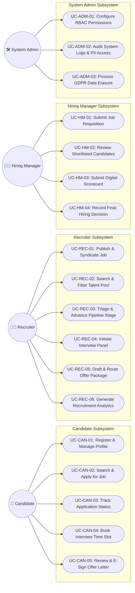
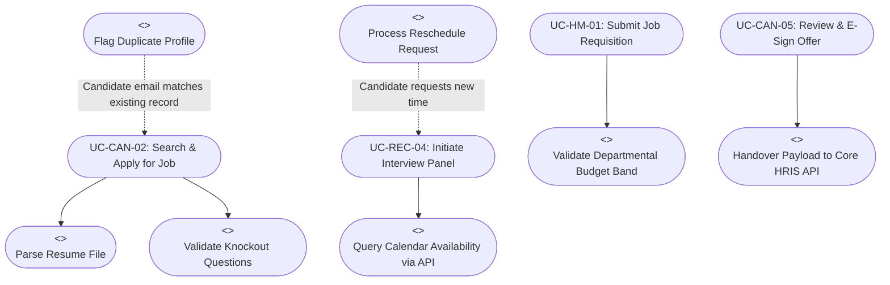

# Business Process Analysis & Information System Proposal
## Deliverable 5: UML Use Cases, Actor-Goal Matrix & Detailed Specifications

**Project Name:** Recruitment & Applicant Tracking Information System (ATS Proposal)  
**Document Reference:** ATS-BA-DOC-005  
**Project Version:** 1.0  
**Project Type:** Personal Learning Project / Business Systems Analysis Portfolio  
**Author / Role:** Business Analyst / Business Systems Analysis (Student Portfolio Project)  
**Target Organization:** Novus Enterprise Technologies (Fictional mid-sized enterprise scenario)  
**Specification Standard:** Object Management Group (OMG) UML 2.5 Standard  
**Dependencies:** Cross-referenced with ATS-BA-DOC-001 through DOC-004  

---

## 1. Actor-Goal Matrix & System Interaction Model

> **Context:** Conceptual UML use case modeling and detailed interaction specifications developed for Novus Enterprise Technologies (fictional enterprise scenario).

The proposed ATS interacts with **4 Primary Human Actors** and **2 Secondary System Actors**.

| Actor Name | Actor Type | Role & Interaction Summary | Primary Business Goals in ATS | Operational Frequency |
| :--- | :--- | :--- | :--- | :--- |
| **Candidate** | Primary (Human) | External job seeker or internal employee applying for open positions. | Search vacancies, submit applications, upload resumes, select interview slots, review & e-sign offer. | Ad-hoc / Daily during job search |
| **Recruiter** | Primary (Human) | Talent Acquisition specialist managing end-to-end requisition pipelines. | Post jobs, parse & triage resumes, manage Kanban stages, schedule panels, draft offer packages, review analytics. | Continuous daily usage (5–8 hrs/day) |
| **Hiring Manager** | Primary (Human) | Functional department head seeking to fill team vacancies. | Create requisitions, review shortlisted candidate profiles, conduct interviews, submit rubrics, approve offers. | 2–4 times weekly (1–2 hrs/day) |
| **System Administrator** | Primary (Human) | Enterprise IT / SecOps administrator managing identity and compliance. | Manage RBAC roles, configure SSO, audit system logs, execute GDPR erasure requests, monitor health. | Weekly maintenance & as-needed |
| **Calendar Service** | Secondary (System) | Microsoft 365 Exchange / Google Calendar API (Proposed illustrative integration). | Provide real-time free/busy interviewer availability, inject calendar event holds and video links. | Real-time automated API calls |
| **Enterprise HRIS** | Secondary (System) | Workday / SAP SuccessFactors Core HR platform (Proposed illustrative integration). | Ingest new-hire employee profile data, trigger downstream IT provisioning and payroll enrollment. | Event-driven upon offer acceptance |

---

## 2. UML Use Case Architecture Diagram



### 2.1 Use Case Relationships (`<<include>>` and `<<extend>>`)



---

## 3. High-Impact Use Case Detailed Specifications

The 5 most critical, high-impact use cases across the recruitment lifecycle are specified below using the formal **Cockburn Methodology**.

---

### Use Case Specification 1: UC-CAN-02
```text
================================================================================
USE CASE ID:        UC-CAN-02
USE CASE NAME:      Apply for Open Job & Complete Knockout Screening
ACTOR(S):           Primary: Candidate; Supporting: ATS Parsing Service
TRIGGER:            Candidate clicks "Apply Now" on a published job requisition.
PRECONDITIONS:      1. The job requisition is published and in 'Active' state.
                    2. Candidate has internet access and a valid email address.
POSTCONDITIONS:     1. Application record is created in 'Screened' or 'Disqualified' state.
                    2. Candidate profile is indexed in the central talent database.
                    3. Candidate receives an automated confirmation email.
================================================================================

MAIN SUCCESS SCENARIO (Happy Path):
1. Candidate views active job posting on the Career Portal.
2. Candidate clicks "Apply Now" and enters core details (Name, Email, Phone, LinkedIn).
3. Candidate uploads resume file (PDF or DOCX format).
4. System executes automated resume parsing, populating candidate work history and education fields.
5. Candidate reviews parsed data, makes optional manual adjustments, and confirms accuracy.
6. System presents mandatory Knockout Screening Questions (e.g. Work authorization status, minimum years of experience).
7. Candidate submits answers and clicks "Submit Application".
8. System validates that all Knockout criteria are satisfied.
9. System generates a unique Application ID and stores the encrypted resume file.
10. System assigns the application to the 'Applied' pipeline stage and dispatches an automated confirmation email with portal login credentials.

EXTENSIONS & ALTERNATE FLOWS:
4a. Resume File Parsing Unsuccessful / Corrupt File:
    .1 System alerts candidate: "Unable to parse resume file. Please ensure document is unencrypted PDF or DOCX."
    .2 System presents blank manual entry form.
    .3 Candidate fills fields manually and proceeds to Step 6.
8a. Candidate Fails Mandatory Knockout Criteria (e.g., Lacks required work visa):
    .1 System records the application in the database.
    .2 System automatically flags application state as 'Disqualified - Knockout'.
    .3 System queues an automated polite rejection notice with a 24-hour delay buffer (Rule BR-02).
    .4 Candidate receives generic submission receipt without immediate rejection notification.
9a. Matching Existing Candidate Profile Detected (Duplicate Candidate):
    .1 System detects matching email or phone number in database.
    .2 System attaches the new application to the existing Candidate ID rather than creating a duplicate record.
    .3 System logs audit entry: "Existing candidate submitted application for Job ID: XXX."

EXCEPTIONS:
- Network timeout during file upload: System displays retry prompt; no partial record created.
- File exceeds 10MB limit: System blocks upload and notifies user of file size constraint.
================================================================================
```

---

### Use Case Specification 2: UC-REC-03
```text
================================================================================
USE CASE ID:        UC-REC-03
USE CASE NAME:      Triage & Advance Pipeline Stage
ACTOR(S):           Primary: Recruiter; Supporting: Notification Engine
TRIGGER:            Recruiter accesses the interactive Kanban Pipeline view for an active job.
PRECONDITIONS:      1. Recruiter is authenticated with 'Recruiter' role permissions.
                    2. One or more applications exist for the selected job.
POSTCONDITIONS:     1. Candidate stage is updated in the database.
                    2. Automated triggers associated with target stage are executed.
                    3. Audit log records the stage transition with user ID and timestamp.
================================================================================

MAIN SUCCESS SCENARIO (Happy Path):
1. Recruiter opens the Kanban board for Job Requisition #REQ-1042.
2. Recruiter views candidate cards grouped by stage columns (Applied, Screened, Shortlisted, Interview 1, Offered).
3. Recruiter clicks a candidate card to view consolidated dossier (Parsed CV, Knockout scores, recruiter notes).
4. Recruiter drags candidate card from 'Applied' to 'Shortlisted'.
5. System displays a confirmation modal with stage-specific actions (e.g. "Notify Hiring Manager" or "Request HM Review").
6. Recruiter confirms transition.
7. System updates `application_status` to 'SHORTLISTED' in the database.
8. System executes Trigger TR-03: dispatches notification to the designated Hiring Manager to review candidate dossier.
9. System logs audit event: `STAGE_CHANGE: Applied -> Shortlisted by user_id: REC_04`.

EXTENSIONS & ALTERNATE FLOWS:
4a. Recruiter Selects "Disqualify / Reject":
    .1 Recruiter selects rejection reason from standardized dropdown (e.g. Skills Mismatch, Compensation Expectation, Overqualified).
    .2 Recruiter selects whether to send rejection email immediately, send with 24-hr delay buffer, or suppress email.
    .3 System updates status to 'REJECTED' and queues scheduled notification.
4b. Bulk Action (Batch Advancement / Rejection):
    .1 Recruiter multi-selects 15 candidate checkboxes in list view.
    .2 Recruiter selects "Batch Move to Screened".
    .3 System validates all 15 records, executes bulk update, and updates stage metrics simultaneously.

EXCEPTIONS:
- Role permission check fails (User unauthorized for this department): System aborts transition with error 403.
================================================================================
```

---

### Use Case Specification 3: UC-CAN-04 / UC-REC-04
```text
================================================================================
USE CASE ID:        UC-CAN-04
USE CASE NAME:      Candidate Self-Service Interview Slot Selection & Calendar Sync
ACTOR(S):           Primary: Candidate; Supporting: Recruiter, MS 365 Exchange API
TRIGGER:            Candidate receives email invitation containing unique scheduling link.
PRECONDITIONS:      1. Candidate has been moved to 'Interview Stage' by Recruiter.
                    2. Interview panel members have connected their corporate calendars.
POSTCONDITIONS:     1. Interview session is booked in ATS database.
                    2. Calendar holds and meeting links (Teams/Zoom) dispatched to all parties.
================================================================================

MAIN SUCCESS SCENARIO (Happy Path):
1. Candidate clicks the tokenized scheduling link in their invitation email.
2. System validates the token security and expiration timestamp (< 72 hours).
3. System calls Microsoft 365 Graph API to query real-time availability of assigned interviewers.
4. Candidate views dynamic calendar showing open, mutually available 45-minute slots over the next 5 business days.
5. Candidate selects preferred date and time slot (e.g. Thursday, 2:00 PM).
6. Candidate confirms selection and enters optional accommodations note.
7. System locks the chosen time slot in the ATS database to prevent double-booking.
8. System calls Exchange API to create corporate calendar events for interviewer panel with attached candidate resume and scorecard link.
9. System dispatches calendar invitation (.ics) with video conference link to candidate's email.
10. System advances candidate pipeline stage to 'Interview 1 - Scheduled'.

EXTENSIONS & ALTERNATE FLOWS:
2a. Scheduling Token Expired (> 72 hours elapsed):
    .1 System notifies candidate: "This scheduling link has expired. A request has been sent to your recruiter to issue a new invite."
    .2 System alerts Recruiter to re-send booking link.
3a. Calendar Collision (Interviewer accepted another meeting 1 second before candidate confirmed):
    .1 System detects conflict during API write transaction.
    .2 System rolls back selection and displays updated availability grid: "This slot was just taken. Please select another time."

EXCEPTIONS:
- Exchange API unavailable: System notifies Recruiter to coordinate schedule manually; flags error in audit log.
================================================================================
```

---

### Use Case Specification 4: UC-HM-03
```text
================================================================================
USE CASE ID:        UC-HM-03
USE CASE NAME:      Submit Digital Interview Scorecard
ACTOR(S):           Primary: Hiring Manager / Panel Interviewer; Supporting: ATS Engine
TRIGGER:            Interview ends or interviewer accesses interview scorecard link.
PRECONDITIONS:      1. Interview record exists in 'Scheduled' or 'Completed' state.
                    2. Interviewer is assigned to the panel for this specific candidate.
POSTCONDITIONS:     1. Scorecard ratings and qualitative notes are recorded in database.
                    2. Recruiter is notified of completed evaluation.
                    3. Consensus view is unlocked once all panel scorecards are submitted.
================================================================================

MAIN SUCCESS SCENARIO (Happy Path):
1. Interviewer clicks "Complete Scorecard" prompt on mobile or desktop dashboard.
2. System presents candidate profile, job competency rubrics, and resume side-by-side.
3. Interviewer enters quantitative scores (1 = Unsatisfactory to 5 = Exceptional) for each required job competency:
   - Technical Competence
   - Problem Solving & Analytical Thinking
   - Communication & Teamwork
   - Cultural & Behavioral Alignment
4. System requires mandatory justification text for any competency scored $\le 2$ or $= 5$.
5. Interviewer enters overall hiring recommendation: Strong Yes, Yes, Neutral, No, Strong No.
6. Interviewer enters private qualitative notes and clicks "Submit Scorecard".
7. System validates that all mandatory rubric fields are completed.
8. System locks scorecard against subsequent modifications (audit compliance).
9. System recalculates candidate aggregate score and alerts Recruiter that scorecard is logged.

EXTENSIONS & ALTERNATE FLOWS:
6a. Blind Evaluation Enforcement Active:
    .1 System conceals ratings submitted by other panel members until current interviewer submits their scorecard.
    .2 Upon submission, system unlocks the consolidated panel summary screen.

EXCEPTIONS:
- Session timeout while drafting: Auto-save draft feature preserves entered notes locally every 30 seconds.
================================================================================
```

---

### Use Case Specification 5: UC-CAN-05 / UC-OM-02
```text
================================================================================
USE CASE ID:        UC-CAN-05
USE CASE NAME:      Review & E-Sign Offer Letter & Handover to Core HRIS
ACTOR(S):           Primary: Candidate; Supporting: Recruiter, Enterprise HRIS API
TRIGGER:            Candidate receives formal "Offer Extended" email notification.
PRECONDITIONS:      1. Executive and Finance approvals recorded for the compensation package.
                    2. Candidate status is 'Offered'.
POSTCONDITIONS:     1. Legally binding cryptographic signature recorded.
                    2. Candidate status updated to 'Hired'.
                    3. Employee profile payload transmitted to Core HRIS API.
================================================================================

MAIN SUCCESS SCENARIO (Happy Path):
1. Candidate logs into the secure Candidate Portal.
2. Candidate navigates to "My Offers" tab and opens the formal Offer Package.
3. System renders digital offer document detailing Job Title, Base Salary, Equity, Benefits, and Proposed Start Date.
4. Candidate reviews document terms and selects "Accept Offer".
5. Candidate executes cryptographic digital signature by typing legal name and agreeing to digital consent terms.
6. System captures candidate digital signature, IP address, user agent, and timestamp.
7. System generates sealed, tamper-evident PDF document stored in encrypted file repository.
8. System updates application state to `HIRED` and requisition filled headcount by $+1$.
9. System executes Trigger TR-05: packages candidate JSON payload and dispatches REST API POST call to Enterprise Core HRIS (`/api/v1/employees/onboarding-intake`).
10. Core HRIS acknowledges payload with `201 Created` and returns new Employee ID.
11. System alerts Recruiter, Hiring Manager, and IT Provisioning of confirmed hire.

EXTENSIONS & ALTERNATE FLOWS:
4a. Candidate Declines Offer:
    .1 Candidate selects "Decline Offer".
    .2 System prompts candidate for optional departure reason (e.g. Accepted another offer, Compensation, Relocation).
    .3 System updates status to `OFFER_DECLINED` and immediately alerts Recruiter to initiate backup candidate.
9a. Core HRIS API Down / Network Error:
    .1 System detects non-200 response from HRIS endpoint.
    .2 System marks handover state as `PENDING_HRIS_SYNC` and enqueues payload in resilient retry queue (exponential backoff).
    .3 System alerts System Administrator of sync delay; candidate status remains safely `HIRED`.

EXCEPTIONS:
- Security token tampered with: System invalidates session and forces re-authentication.
================================================================================
```

---
*End of Deliverable 5. Next Phase: Deliverable 6 — Entity-Relationship Diagram (ERD), Relational Schema & Enterprise Data Dictionary.*
