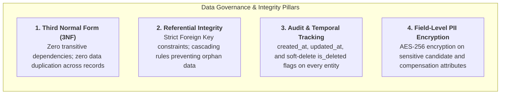
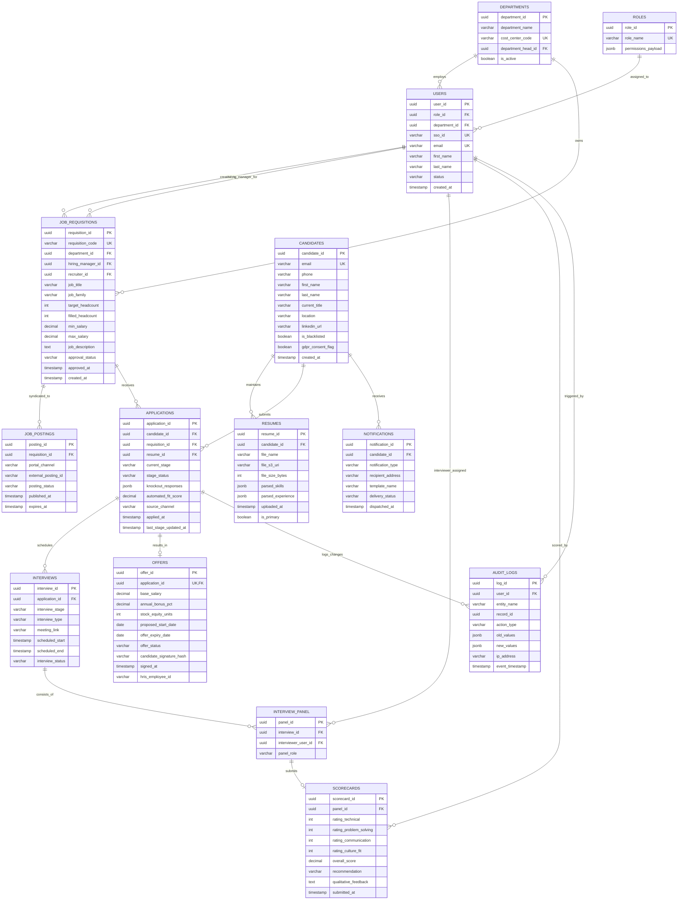
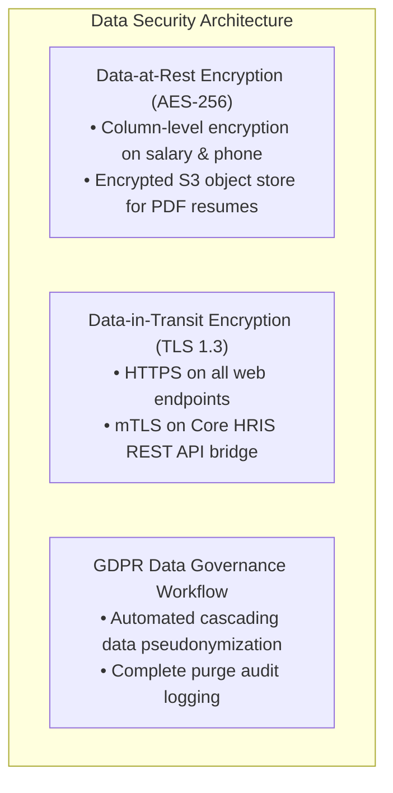

# Business Process Analysis & Information System Proposal
## Deliverable 6: Data Model, Entity-Relationship Diagram (ERD) & Data Dictionary

**Project Name:** Recruitment & Applicant Tracking Information System (ATS Proposal)  
**Document Reference:** ATS-BA-DOC-006  
**Project Version:** 1.0  
**Project Type:** Personal Learning Project / Business Systems Analysis Portfolio  
**Author / Role:** Business Analyst / Business Systems Analysis (Student Portfolio Project)  
**Target Organization:** Novus Enterprise Technologies (Fictional mid-sized enterprise scenario)  
**Design Standard:** Relational Database 3rd Normal Form (3NF) & ANSI/ISO SQL:2016  
**Dependencies:** Cross-referenced with ATS-BA-DOC-001 through DOC-005  

---

## 1. Data Architecture Principles & Normalization Strategy

> **Context:** Conceptual 3NF relational data model and enterprise data dictionary designed for Novus Enterprise Technologies (fictional enterprise scenario). Technical controls (such as AES-256 encryption, SSO integration, and audit logging) represent proposed architectural design specifications.

To eliminate the severe data fragmentation, duplication, and synchronization collisions identified in the AS-IS analysis (where 8 recruiters maintained conflicting Excel spreadsheets), the proposed ATS information architecture is modeled strictly in **Third Normal Form (3NF)**.



### Key Normalization Decisions:
1. **Separation of Authentication and Profile Entities:** System credentials (`USERS`), security permissions (`ROLES`), and candidate profiles (`CANDIDATES`) are decoupled to support internal enterprise Single Sign-On (SSO) alongside external applicant self-registration.
2. **Requisition vs. Job Posting Decoupling:** Internal hiring authorization (`JOB_REQUISITIONS`) is isolated from external advertising channels (`JOB_POSTINGS`), enabling a single approved requisition to be advertised across multiple syndicated boards with independent tracking.
3. **Application as the Core Associative Entity:** The `APPLICATIONS` table acts as the central hub uniting a `CANDIDATE` with a `JOB_REQUISITION`, ensuring candidates can apply to multiple jobs without duplicating their demographic data.
4. **Normalized Multi-Interviewer Scoring:** Rather than storing aggregate feedback, individual interviewer ratings are captured in atomic `SCORECARDS` linked to `INTERVIEW_PANEL` assignments, ensuring complete auditability and enabling blind scoring.

---

## 2. Logical Entity-Relationship Diagram (Crow's Foot ERD)



---

## 3. Comprehensive Enterprise Data Dictionary

The data dictionary below specifies the physical storage definitions, domain integrity rules, and business semantics for all core system tables.

### 3.1 Entity: `JOB_REQUISITIONS`
Stores formal internal headcount authorizations and hiring budgets.

| Attribute Name | Physical Data Type | Nullable | Constraint | Business Definition & Domain Rules |
| :--- | :--- | :---: | :---: | :--- |
| `requisition_id` | `UUID` | No | **PK** | Universally unique identifier generated by default `gen_random_uuid()`. |
| `requisition_code` | `VARCHAR(32)` | No | **UK** | Human-readable business identifier (e.g. `REQ-2026-0104`). |
| `department_id` | `UUID` | No | **FK** | References `DEPARTMENTS(department_id)`. Cost center assignment. |
| `hiring_manager_id`| `UUID` | No | **FK** | References `USERS(user_id)`. Designated approving manager. |
| `recruiter_id` | `UUID` | Yes | **FK** | References `USERS(user_id)`. Assigned lead talent acquisition specialist. |
| `job_title` | `VARCHAR(150)`| No | None | Official job role title (e.g. `Senior Data Systems Engineer`). |
| `job_family` | `VARCHAR(64)` | No | None | Functional track (e.g. `Engineering`, `Sales`, `Operations`). |
| `target_headcount` | `INTEGER` | No | $> 0$ | Total number of openings approved for this requisition (Default: `1`). |
| `filled_headcount` | `INTEGER` | No | $\ge 0$ | Number of candidates moved to `HIRED` status. Increments on e-sign. |
| `min_salary` | `DECIMAL(12,2)`| No | $> 0$ | Bottom of approved base compensation band (Encrypted). |
| `max_salary` | `DECIMAL(12,2)`| No | $\ge min$ | Top of approved base compensation band (Encrypted). |
| `approval_status` | `VARCHAR(32)` | No | Enum | Domain: `['DRAFT', 'PENDING_APPROVAL', 'APPROVED', 'REJECTED', 'CLOSED']`. |
| `created_at` | `TIMESTAMPTZ` | No | Default Now | Audit creation timestamp with time zone offset. |

---

### 3.2 Entity: `CANDIDATES`
Stores persistent personal candidate profiles and master contact details.

| Attribute Name | Physical Data Type | Nullable | Constraint | Business Definition & Domain Rules |
| :--- | :--- | :---: | :---: | :--- |
| `candidate_id` | `UUID` | No | **PK** | Master candidate identifier across all historical applications. |
| `email` | `VARCHAR(255)`| No | **UK** | Candidate primary email (Index key; validated via RFC 5322 regex). |
| `phone` | `VARCHAR(32)` | Yes | None | Contact telephone number (E.164 international format). |
| `first_name` | `VARCHAR(100)`| No | None | Candidate legal given name. |
| `last_name` | `VARCHAR(100)`| No | None | Candidate legal family name. |
| `current_title` | `VARCHAR(150)`| Yes | None | Current or most recent professional job title from resume. |
| `location` | `VARCHAR(150)`| Yes | None | City, State/Province, Country. |
| `linkedin_url` | `VARCHAR(255)`| Yes | None | Verified URL to candidate LinkedIn profile. |
| `is_blacklisted` | `BOOLEAN` | No | Default `F` | Flag for non-eligible candidates (dismissal for cause, fraud). |
| `gdpr_consent_flag`| `BOOLEAN` | No | Default `T` | Explicit consent captured at application time for data processing. |
| `created_at` | `TIMESTAMPTZ` | No | Default Now | Date and time profile was first ingested into talent pool. |

---

### 3.3 Entity: `APPLICATIONS`
The central transactional hub representing a candidate's journey through a specific job pipeline.

| Attribute Name | Physical Data Type | Nullable | Constraint | Business Definition & Domain Rules |
| :--- | :--- | :---: | :---: | :--- |
| `application_id` | `UUID` | No | **PK** | Unique application tracking instance ID. |
| `candidate_id` | `UUID` | No | **FK** | References `CANDIDATES(candidate_id)`. `ON DELETE RESTRICT`. |
| `requisition_id` | `UUID` | No | **FK** | References `JOB_REQUISITIONS(requisition_id)`. |
| `resume_id` | `UUID` | No | **FK** | References `RESUMES(resume_id)`. Specific version used for this job. |
| `current_stage` | `VARCHAR(32)` | No | Enum | Domain: `['APPLIED', 'SCREENED', 'SHORTLISTED', 'INTERVIEW_1', 'INTERVIEW_2', 'OFFER', 'HIRED', 'DISQUALIFIED']`. |
| `stage_status` | `VARCHAR(32)` | No | Enum | Domain: `['IN_PROGRESS', 'PASSED', 'REJECTED', 'WITHDRAWN']`. |
| `knockout_responses`| `JSONB` | Yes | None | Key-value dictionary of candidate answers to pre-screening questions. |
| `automated_fit_score`| `DECIMAL(5,2)`| Yes | 0 to 100 | Algorithmic match percentage based on required skills & qualifications. |
| `source_channel` | `VARCHAR(64)` | No | None | Ingestion attribution: `['LINKEDIN', 'INDEED', 'CAREER_PORTAL', 'REFERRAL', 'AGENCY']`. |
| `applied_at` | `TIMESTAMPTZ` | No | Default Now | Exact submission timestamp. Used for Time-to-Hire calculations. |
| `last_stage_updated_at`| `TIMESTAMPTZ`| No | Default Now | Timestamp of most recent stage movement (measures Time-in-Stage). |

---

### 3.4 Entity: `SCORECARDS`
Stores structured, quantitative candidate evaluations submitted by interview panelists.

| Attribute Name | Physical Data Type | Nullable | Constraint | Business Definition & Domain Rules |
| :--- | :--- | :---: | :---: | :--- |
| `scorecard_id` | `UUID` | No | **PK** | Unique evaluation record identifier. |
| `panel_id` | `UUID` | No | **UK, FK** | References `INTERVIEW_PANEL(panel_id)`. One scorecard per panelist. |
| `rating_technical` | `SMALLINT` | No | 1 to 5 | Quantitative score for technical competence (1=Poor to 5=Exceptional). |
| `rating_problem_solving`| `SMALLINT` | No | 1 to 5 | Quantitative score for analytical & problem-solving ability. |
| `rating_communication`| `SMALLINT` | No | 1 to 5 | Quantitative score for collaboration & stakeholder communication. |
| `rating_culture_fit`| `SMALLINT` | No | 1 to 5 | Quantitative score for organizational values alignment. |
| `overall_score` | `DECIMAL(3,2)`| No | 1.0 to 5.0 | Weighted mathematical average of rubric competency scores. |
| `recommendation` | `VARCHAR(32)` | No | Enum | Domain: `['STRONG_HIRE', 'HIRE', 'NEUTRAL', 'DO_NOT_HIRE', 'STRONG_REJECT']`. |
| `qualitative_feedback`| `TEXT` | No | Min 20 chars| Detailed textual justification for audit defense and consensus review. |
| `submitted_at` | `TIMESTAMPTZ` | No | Default Now | Immutable submission timestamp. Scorecard locks once written. |

---

### 3.5 Entity: `OFFERS`
Captures formal employment offer terms, compensation figures, and digital signatures.

| Attribute Name | Physical Data Type | Nullable | Constraint | Business Definition & Domain Rules |
| :--- | :--- | :---: | :---: | :--- |
| `offer_id` | `UUID` | No | **PK** | Unique offer contract identifier. |
| `application_id` | `UUID` | No | **UK, FK** | References `APPLICATIONS(application_id)`. Exactly 1 active offer per application. |
| `base_salary` | `DECIMAL(12,2)`| No | Encrypted | Proposed annual base compensation in USD. |
| `annual_bonus_pct`| `DECIMAL(5,2)` | Yes | $\ge 0$ | Target annual performance bonus percentage. |
| `stock_equity_units`| `INTEGER` | Yes | $\ge 0$ | Number of approved restricted stock units (RSUs). |
| `proposed_start_date`| `DATE` | No | $>$ Today | Proposed employment commencement date. |
| `offer_expiry_date` | `DATE` | No | $>$ Today | Deadline for candidate digital signature acceptance. |
| `offer_status` | `VARCHAR(32)` | No | Enum | Domain: `['DRAFT', 'PENDING_APPROVAL', 'EXTENDED', 'ACCEPTED', 'DECLINED', 'EXPIRED']`. |
| `candidate_signature_hash`| `VARCHAR(256)`| Yes | None | SHA-256 cryptographic hash of candidate digital signature block. |
| `signed_at` | `TIMESTAMPTZ` | Yes | None | Timestamp of verified candidate electronic signature. |
| `hris_employee_id` | `VARCHAR(64)` | Yes | None | Assigned employee ID returned by Enterprise Core HRIS upon handover. |

---

## 4. Physical Database Schema Implementation (PostgreSQL 15+ DDL)

```sql
-- Create Enumerations for System Domain States
CREATE TYPE requisition_status_enum AS ENUM ('DRAFT', 'PENDING_APPROVAL', 'APPROVED', 'REJECTED', 'CLOSED');
CREATE TYPE application_stage_enum AS ENUM ('APPLIED', 'SCREENED', 'SHORTLISTED', 'INTERVIEW_1', 'INTERVIEW_2', 'OFFER', 'HIRED', 'DISQUALIFIED');
CREATE TYPE recommendation_enum AS ENUM ('STRONG_HIRE', 'HIRE', 'NEUTRAL', 'DO_NOT_HIRE', 'STRONG_REJECT');
CREATE TYPE offer_status_enum AS ENUM ('DRAFT', 'PENDING_APPROVAL', 'EXTENDED', 'ACCEPTED', 'DECLINED', 'EXPIRED');

-- Core Table: Candidates
CREATE TABLE candidates (
    candidate_id UUID PRIMARY KEY DEFAULT gen_random_uuid(),
    email VARCHAR(255) NOT NULL UNIQUE,
    phone VARCHAR(32),
    first_name VARCHAR(100) NOT NULL,
    last_name VARCHAR(100) NOT NULL,
    current_title VARCHAR(150),
    location VARCHAR(150),
    linkedin_url VARCHAR(255),
    is_blacklisted BOOLEAN NOT NULL DEFAULT FALSE,
    gdpr_consent_flag BOOLEAN NOT NULL DEFAULT TRUE,
    created_at TIMESTAMPTZ NOT NULL DEFAULT CURRENT_TIMESTAMP,
    updated_at TIMESTAMPTZ NOT NULL DEFAULT CURRENT_TIMESTAMP
);

-- Core Table: Applications
CREATE TABLE applications (
    application_id UUID PRIMARY KEY DEFAULT gen_random_uuid(),
    candidate_id UUID NOT NULL REFERENCES candidates(candidate_id) ON DELETE RESTRICT,
    requisition_id UUID NOT NULL REFERENCES job_requisitions(requisition_id) ON DELETE RESTRICT,
    resume_id UUID NOT NULL REFERENCES resumes(resume_id),
    current_stage application_stage_enum NOT NULL DEFAULT 'APPLIED',
    stage_status VARCHAR(32) NOT NULL DEFAULT 'IN_PROGRESS',
    knockout_responses JSONB,
    automated_fit_score DECIMAL(5,2),
    source_channel VARCHAR(64) NOT NULL,
    applied_at TIMESTAMPTZ NOT NULL DEFAULT CURRENT_TIMESTAMP,
    last_stage_updated_at TIMESTAMPTZ NOT NULL DEFAULT CURRENT_TIMESTAMP,
    CONSTRAINT uq_candidate_job UNIQUE (candidate_id, requisition_id)
);

-- Strategic B-Tree Indexes for High-Velocity Analytics & Filtering
CREATE INDEX idx_applications_stage ON applications(current_stage);
CREATE INDEX idx_applications_applied_at ON applications(applied_at);
CREATE INDEX idx_applications_source ON applications(source_channel);
CREATE INDEX idx_candidates_email ON candidates(email);
```

---

## 5. Data Privacy, Encryption & Security Governance
*(Proposed Technical Design Specifications)*



1. **Column-Level Cryptographic Masking:**  
   Attributes `min_salary`, `max_salary`, and `base_salary` are encrypted at the database layer using PostgreSQL `pgcrypto` symmetric keys, ensuring database administrators cannot view compensation figures without explicit decryption grants.
2. **Audit Trail Immutability (`AUDIT_LOGS`):**  
   Every insert, update, or status change generates a non-updatable append-only audit log capturing `old_values`, `new_values`, `ip_address`, and `user_id`.
3. **Automated GDPR Right-to-Erasure Workflow:**  
   When a verified candidate deletion request is approved (FR-CM-04), an automated stored procedure overwrites name, email, phone, and resume attachments with cryptographic hashes while preserving anonymized transactional timestamps to preserve historical recruitment KPI accuracy.

---
*End of Deliverable 6. Next Phase: Deliverable 7 — System Architecture, Module Breakdown & Enterprise Integration Architecture.*
