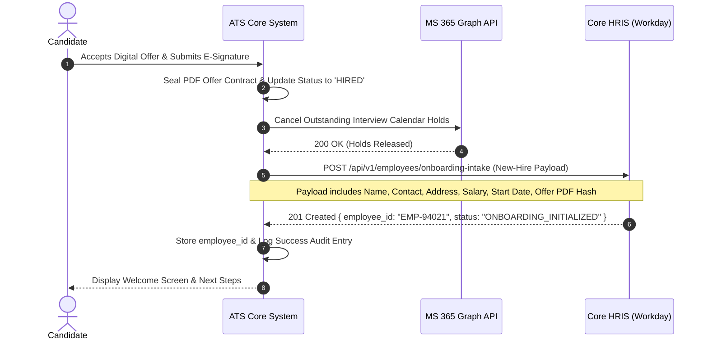
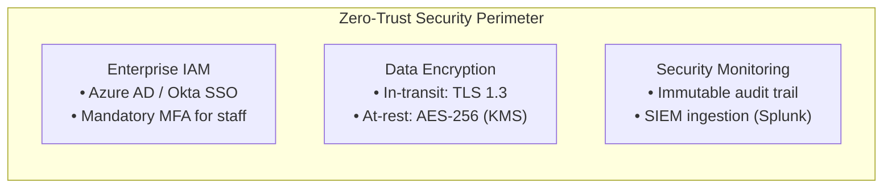

# Business Process Analysis & Information System Proposal
## Deliverable 7: System Architecture, Component Breakdown & Enterprise Integrations

**Project Name:** Recruitment & Applicant Tracking Information System (ATS Proposal)  
**Document Reference:** ATS-BA-DOC-007  
**Project Version:** 1.0  
**Project Type:** Personal Learning Project / Business Systems Analysis Portfolio  
**Author / Role:** Business Analyst / Business Systems Analysis (Student Portfolio Project)  
**Target Organization:** Novus Enterprise Technologies (Fictional mid-sized enterprise scenario)  
**Architecture Framework:** Conceptual Architecture based on TOGAF 9.2 & C4 Model (Context, Container, Component)  
**Dependencies:** Cross-referenced with ATS-BA-DOC-001 through DOC-006  

---

## 1. Enterprise System Context Diagram (C4 Level 1)

> **Framing Note:** This document presents a **conceptual cloud-native system architecture** designed as part of a personal learning project. It illustrates how modern enterprise software components, microservices, and external integrations would be structured to satisfy the business requirements of Novus Enterprise Technologies (fictional enterprise scenario).

The System Context diagram illustrates how the proposed Recruitment ATS interfaces with internal and external enterprise actors and third-party systems.

```mermaid
flowchart TD
    subgraph Users
        CAN[👤 Candidate]
        REC[👩‍💼 Corporate Recruiter]
        HM[👨‍💼 Hiring Manager]
        ADM[🛠️ System Admin]
    end

    subgraph ATS System Boundary ["Recruitment & Applicant Tracking Information System (ATS)"]
        ATS_CORE["ATS Core Platform<br/>• Web Portals & Mobile Responsive UI<br/>• Workflow & Rules Engine<br/>• Resume Parsing & Matching<br/>• Scorecard & Offer System"]
    end

    subgraph Proposed Integrations & Cloud Services (Illustrative Design)
        SSO["Enterprise Identity Provider<br/>Azure AD / Okta (SAML 2.0)"]
        CAL["Microsoft 365 Exchange<br/>Graph API (Calendars & Email)"]
        JB["Job Board Aggregators<br/>LinkedIn, Indeed, Glassdoor"]
        HRIS["Enterprise Core HRIS<br/>Workday / SAP SuccessFactors"]
        PBI["Microsoft Power BI<br/>Executive Analytics Service"]
    end

    CAN -->|Applies, schedules, signs| ATS_CORE
    REC -->|Triages, schedules, offers| ATS_CORE
    HM -->|Submits reqs, evaluates| ATS_CORE
    ADM -->|Configures, audits| ATS_CORE

    ATS_CORE <-->|Authenticates staff via SSO| SSO
    ATS_CORE <-->|Queries availability, syncs invites| CAL
    ATS_CORE -->|Syndicates job requisitions| JB
    ATS_CORE -.->|Proposed new-hire onboarding payload| HRIS
    ATS_CORE -.->|Would feed recruitment data mart| PBI
```

---

## 2. Multi-Tier Container Architecture (C4 Level 2)

**For this learning project, I proposed a conceptual cloud-native architecture** organized across multi-tier micro-modular layers prioritizing high availability, security isolation, and sub-second response times.

```mermaid
flowchart TD
    subgraph Presentation Tier (Edge & CDN)
        UI_CAN["Candidate Career Portal<br/>(Next.js / React Mobile-First)"]
        UI_INT["Internal Staff Workstation<br/>(React SPA Kanban & Dashboard)"]
    end

    subgraph Security & API Gateway Layer
        WAF["Cloudflare Web Application Firewall & DDoS"]
        GW["Kong API Gateway<br/>• JWT Authentication & Rate Limiting<br/>• TLS 1.3 Termination & Request Routing"]
    end

    subgraph Application & Microservices Tier
        SRV_AUTH["Auth & RBAC Service"]
        SRV_REQ["Requisition & Job Service"]
        SRV_CAND["Candidate & Ingestion Service"]
        SRV_PIPE["Pipeline & Stage-Gate Service"]
        SRV_SCHED["Interview Scheduling Service"]
        SRV_SCORE["Evaluation & Scorecard Service"]
        SRV_OFFER["Offer & E-Signature Service"]
        SRV_NOTIF["Notification & Messaging Worker"]
    end

    subgraph Data & Storage Tier
        DB_PRI["Primary PostgreSQL 15 Database<br/>(Encrypted Relational SSOT)"]
        DB_REP["Read-Replica PostgreSQL Database<br/>(Dedicated to BI & Querying)"]
        CACHE["Redis Cluster<br/>(Session Cache & Message Queues)"]
        S3["Encrypted Cloud Object Store (AWS S3)<br/>(PDF Resumes & Sealed Offer Contracts)"]
    end

    UI_CAN --> WAF
    UI_INT --> WAF
    WAF --> GW
    GW --> SRV_AUTH
    GW --> SRV_REQ
    GW --> SRV_CAND
    GW --> SRV_PIPE
    GW --> SRV_SCHED
    GW --> SRV_SCORE
    GW --> SRV_OFFER

    SRV_AUTH <--> CACHE
    SRV_PIPE <--> CACHE
    SRV_SCHED <--> CACHE
    SRV_NOTIF <--> CACHE

    SRV_REQ --> DB_PRI
    SRV_CAND --> DB_PRI
    SRV_PIPE --> DB_PRI
    SRV_SCHED --> DB_PRI
    SRV_SCORE --> DB_PRI
    SRV_OFFER --> DB_PRI

    SRV_CAND --> S3
    SRV_OFFER --> S3

    DB_PRI -.->|Asynchronous Replication| DB_REP
```

---

## 3. Detailed Component Breakdown by Tier
*(Proposed Technical Architecture Specifications)*

### 3.1 Presentation Tier
* **Candidate Career Portal (Proposed):** Proposed architecture specifies a Next.js framework (Server-Side Rendered for SEO), designed to be responsive down to mobile viewports, and structured in alignment with WCAG 2.1 AA accessibility guidelines. Features conceptual job search, frictionless application submission, application progress tracking, and calendar self-booking.
* **Internal Staff Workstation (Proposed):** Proposed Single Page Application (SPA) designed for recruiters and hiring managers. Features conceptual drag-and-drop Kanban pipeline boards, candidate profile split-screens, interactive stage counters, and mobile-optimized interview scorecard forms.

### 3.2 Security & Gateway Tier
* **Web Application Firewall (WAF):** Mitigates DDoS attacks, SQL injection attempts, cross-site scripting (XSS), and applies rate limiting to protect public application endpoints from automated bot spam.
* **API Gateway (Kong / AWS API Gateway):** Routes incoming REST calls, validates JSON Web Tokens (JWT) issued by corporate SSO, terminates TLS 1.3 connections, and logs API call telemetry.

### 3.3 Application Microservices Tier
* **Auth & RBAC Service:** Enforces least-privilege access, decodes SAML/JWT claims, and dynamically validates user permissions for every requested resource.
* **Candidate & Ingestion Service:** Orchestrates resume upload, executes virus scanning, triggers automated PDF text extraction, and flags duplicate candidate profiles.
* **Pipeline & Stage-Gate Orchestrator:** Manages state machine transitions (`APPLIED` $\rightarrow$ `OFFERED`), enforces mandatory stage prerequisite checks, and dispatches asynchronous domain events.
* **Interview Scheduling Service:** Interfaces with calendar APIs to evaluate panel availability, holds temporary booking locks, and issues ICS calendar invites.
* **Notification Worker (Celery / BullMQ):** Asynchronously processes event queues in Redis to dispatch transactional emails and SMS without blocking user web transactions.

### 3.4 Data & Storage Tier
* **Primary Relational Database (PostgreSQL 15):** High-availability multi-AZ deployment with automated failover, column-level PII encryption, and strict referential integrity.
* **Read-Replica Database:** Dedicated read-only instance handling resource-intensive reporting queries and Power BI DirectQuery calls without impacting transactional operations.
* **Redis Cluster:** Sub-millisecond caching of active user sessions, search indices, rate-limit counters, and asynchronous background worker queues.
* **Encrypted Object Storage (AWS S3 / Azure Blob):** Private storage bucket configured with Server-Side Encryption (SSE-KMS AES-256) storing original PDF resumes, portfolio assets, and cryptographically sealed offer letters.

---

## 4. Enterprise Integration Architecture & API Contracts

> **Note on Proposed Integrations:** The following sequence diagrams, endpoints, and JSON schemas represent **illustrative API contracts and proposed integrations** designed to demonstrate how an enterprise ATS would interface with corporate HRIS platforms (e.g. Workday), calendar APIs, and e-signature services.

The proposed ATS acts as an open, connected hub within the enterprise IT ecosystem.



### 4.1 Enterprise Core HRIS REST API Contract Specification
When a candidate accepts an offer, the ATS dispatches an authenticated JSON payload to the enterprise Core HRIS (Workday / SAP SuccessFactors) endpoint. *(Note: All names, IDs, and compensation figures below represent fictional sample data).*

* **Endpoint:** `POST https://hris.novusenterprise.internal/api/v1/employees/onboarding-intake`
* **Security:** Mutual TLS (mTLS) + OAuth 2.0 Client Credentials Grant.
* **JSON Payload Schema:**

```json
{
  "event_id": "evt_9f82a10b-8d34-4a21-8e99-72c019a3d421",
  "event_type": "CANDIDATE_OFFER_ACCEPTED",
  "timestamp": "2026-09-24T18:50:00Z",
  "candidate": {
    "candidate_id": "c8d41a7b-3b8e-49b2-9f12-8e3b5a123456",
    "first_name": "Maya",
    "last_name": "Lin",
    "personal_email": "maya.lin.engineer@example.com",
    "phone": "+1-415-555-0192",
    "residential_address": {
      "street": "742 Evergreen Terrace",
      "city": "San Francisco",
      "state_province": "CA",
      "postal_code": "94107",
      "country": "USA"
    }
  },
  "employment_details": {
    "requisition_code": "REQ-2026-0104",
    "job_title": "Senior Systems Software Engineer",
    "department_cost_center": "CC-ENG-402",
    "hiring_manager_sso_id": "dvance@novusenterprise.com",
    "hire_type": "REGULAR_FULL_TIME",
    "proposed_start_date": "2026-10-15",
    "compensation": {
      "currency": "USD",
      "base_annual_salary": 165000.00,
      "annual_bonus_target_pct": 15.00,
      "stock_equity_grant_units": 4000
    }
  },
  "compliance_verification": {
    "gdpr_consent_verified": true,
    "work_authorization_confirmed": true,
    "signed_offer_document_uri": "s3://novus-ats-vault/offers/2026/REQ-0104-MayaLin-Sealed.pdf",
    "signature_cryptographic_hash": "e3b0c44298fc1c149afbf4c8996fb92427ae41e4649b934ca495991b7852b855"
  }
}
```

* **Expected Response (`201 Created`):**
```json
{
  "status": "SUCCESS",
  "hris_employee_id": "EMP-94021",
  "onboarding_package_id": "ONB-2026-8812",
  "message": "Employee record created. IT equipment provisioning ticket queued."
}
```

---

## 5. Security Architecture & Threat Mitigation Framework
*(Proposed Technical Design Specifications)*



| Security Threat Vector | Risk Description | System Mitigation Control | Verification Standard |
| :--- | :--- | :--- | :--- |
| **Malicious Resume Uploads** | Attacker uploads macro-enabled PDF/DOCX containing malware or ransomware. | Automated sandboxed anti-virus scanning (ClamAV) executed in isolated container prior to S3 persistence. | SOC 2 Type II Security Standard |
| **Broken Object-Level Auth (BOLA)** | User alters `candidate_id` or `application_id` in API URL to view unauthorized candidate files. | Strict RBAC evaluation middleware verifying that requesting user is explicitly assigned to requisition's hiring team. | OWASP Top 10 API Security |
| **Data Leakage of Salary Data** | Internal recruiter or database admin views executive salary parameters. | Column-level encryption using customer-managed KMS keys; compensation views restricted to HR Director role. | ISO/IEC 27001 Annex A.10 |
| **Automated Job Board Spam** | Web scraper bot floods application forms with thousands of fake resumes. | Cloudflare Bot Management, hidden honeypot form fields, and rate-limiting (maximum 5 applications/IP/hour). | Cloudflare DDoS Protection |

---
*End of Deliverable 7. Next Phase: Deliverable 8 — Recruitment Analytics Framework, Funnel Mathematics, Power BI Data Model & Sample Dataset.*
