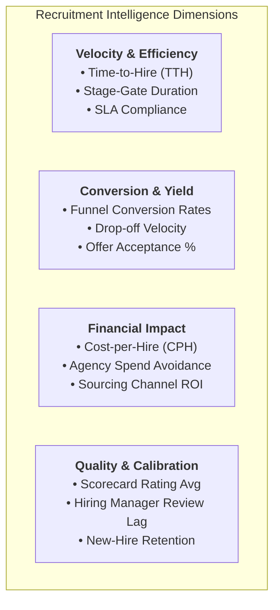
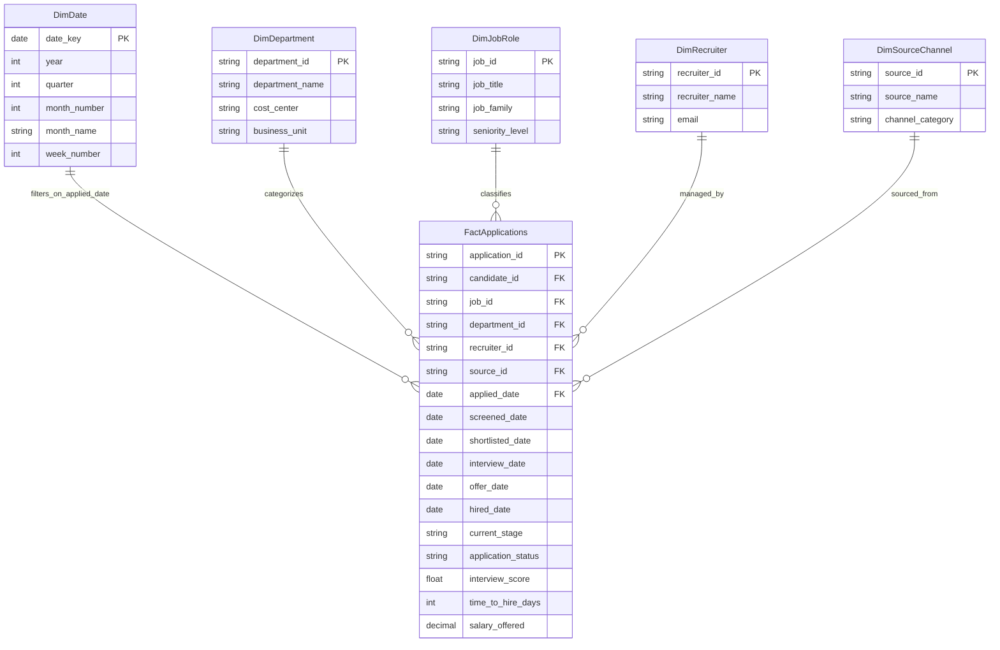

# Business Process Analysis & Information System Proposal
## Deliverable 8: Recruitment Analytics Framework, Power BI Model & Dataset

**Project Name:** Recruitment & Applicant Tracking Information System (ATS Proposal)  
**Document Reference:** ATS-BA-DOC-008  
**Project Version:** 1.0  
**Project Type:** Personal Learning Project / Business Systems Analysis Portfolio  
**Author / Role:** Business Analyst / Business Systems Analysis (Student Portfolio Project)  
**Target Organization:** Novus Enterprise Technologies (Fictional mid-sized enterprise scenario)  
**Analytics Framework:** Kimball Dimensional Modeling & Microsoft Power BI Architecture  
**Dependencies:** Cross-referenced with ATS-BA-DOC-001 through DOC-007  

---

## 1. Recruitment Analytics Strategy & KPI Framework

To resolve the complete absence of real-time management visibility identified in the AS-IS analysis (where metrics were manually stitched together from spreadsheets once a quarter), the proposed ATS features an enterprise **Recruitment Intelligence Framework**.



---

## 2. Mathematical Formulations of Core Recruitment KPIs

### 2.1 Velocity: Time-to-Hire (TTH)
The elapsed duration from the moment a candidate enters the system to the date they execute the offer letter:

$$\text{Time-to-Hire (Days)} = \text{Date}_{\text{Offer Signed}} - \text{Date}_{\text{Application Submitted}}$$

$$\text{Average Time-to-Hire} = \frac{\sum_{i=1}^{N} \text{TTH}_i}{N_{\text{Hired Candidates}}}$$

* **AS-IS Baseline:** **46.5 Days** (manual legacy process duration).
* **Proposed Target SLA (TO-BE Design Estimate):** **18.5 Days** (fully automated workflow target).
* **Synthetic Dataset Observation:** **23.0 Days** (empirical average across 21 hires in the 1,250 synthetic records; range: 15–30 days).

### 2.2 Conversion: Offer Acceptance Rate (OAR)
Measures the competitiveness of company compensation packages and the closing efficacy of hiring teams:

$$\text{Offer Acceptance Rate (\%)} = \left( \frac{\text{Total Accepted Offers}}{\text{Total Formal Offers Extended}} \right) \times 100$$

* **Sample Cohort Target:** $\frac{21}{28} \times 100 = \mathbf{75.0\%}$

### 2.3 Efficiency: Stage-to-Stage Conversion Yields

$$\text{Screening Pass Rate} = \left( \frac{\text{Screened Candidates}}{\text{Total Applications}} \right) \times 100 = \frac{650}{1,250} \times 100 = \mathbf{52.0\%}$$

$$\text{Interview Conversion Rate} = \left( \frac{\text{Shortlisted Candidates Interviewed}}{\text{Shortlisted Candidates}} \right) \times 100 = \frac{96}{185} \times 100 = \mathbf{51.9\%}$$

$$\text{Interview-to-Offer Rate} = \left( \frac{\text{Offers Extended}}{\text{Candidates Interviewed}} \right) \times 100 = \frac{28}{96} \times 100 = \mathbf{29.2\%}$$

### 2.4 Economics: Cost-per-Hire (CPH) Formula (SHRM Standard)

$$\text{Cost-per-Hire} = \frac{\sum \text{Internal Recruitment Costs} + \sum \text{External Recruitment Costs}}{\text{Total Hires in Measurement Period}}$$

Where:
* **Internal Costs:** Recruiter salary allocation, internal employee referral bonuses (\$2,500/hire).
* **External Costs:** Job board syndication licenses (\$12,000/yr), third-party agency fees (\$0 for internal fills).

---

## 3. Recruitment Funnel Cohort Performance (1,250 Sample Records)

The 1,250 candidate records generated in `data/recruitment_sample_dataset_anonymized.csv` represent a **synthetic recruitment dataset created for this personal learning project** across a 5-month recruiting cycle.

```text
RECRUITMENT FUNNEL COHORT VISUALIZATION
========================================================================================
Stage                Candidate Volume      % of Total Apps      Stage-to-Stage Yield
----------------------------------------------------------------------------------------
1. Applications      ████████████████████  1,250 (100.0%)       100.0%
2. Screened          ██████████            650   (52.0%)        52.0% (Screen Pass)
3. Shortlisted       ███                   185   (14.8%)        28.5% (Shortlist Rate)
4. Interviewed       █▌                    96    (7.7%)         51.9% (Interview Conv)
5. Offers Extended   ▌                     28    (2.2%)         29.2% (Offer Rate)
6. Hired             ▍                     21    (1.7%)         75.0% (Acceptance Rate)
========================================================================================
Average Time-to-Hire: 23.0 Calendar Days
```

---

## 4. Power BI Dimensional Data Model (Star Schema)

The reporting data mart is structured as a **Kimball Star Schema** optimized for high-performance interactive slicing and dicing in Microsoft Power BI.



---

## 5. Power BI DAX Metric Measure Library

The following **custom Data Analysis Expressions (DAX) measures** drive the interactive visuals in the Power BI dashboard:

```dax
// 1. Total Applications Count
Total Applications = COUNTROWS(FactApplications)

// 2. Candidates Screened
Candidates Screened = 
CALCULATE(
    COUNTROWS(FactApplications),
    NOT(ISBLANK(FactApplications[screened_date]))
)

// 3. Candidates Shortlisted
Candidates Shortlisted = 
CALCULATE(
    COUNTROWS(FactApplications),
    NOT(ISBLANK(FactApplications[shortlisted_date]))
)

// 4. Candidates Interviewed
Candidates Interviewed = 
CALCULATE(
    COUNTROWS(FactApplications),
    NOT(ISBLANK(FactApplications[interview_date]))
)

// 5. Offers Extended
Offers Extended = 
CALCULATE(
    COUNTROWS(FactApplications),
    NOT(ISBLANK(FactApplications[offer_date]))
)

// 6. Confirmed Hires
Confirmed Hires = 
CALCULATE(
    COUNTROWS(FactApplications),
    FactApplications[current_stage] = "HIRED"
)

// 7. Offer Acceptance Rate (OAR %)
Offer Acceptance Rate % = 
DIVIDE(
    [Confirmed Hires],
    [Offers Extended],
    0
)

// 8. Average Time-to-Hire (Calendar Days)
Avg Time to Hire (Days) = 
AVERAGEX(
    FILTER(FactApplications, FactApplications[current_stage] = "HIRED"),
    FactApplications[time_to_hire_days]
)

// 9. Application to Interview Conversion %
App to Interview Conv % = 
DIVIDE(
    [Candidates Interviewed],
    [Total Applications],
    0
)

// 10. Candidate Quality Score (Avg Interview Score)
Avg Candidate Score = 
AVERAGEX(
    FILTER(FactApplications, NOT(ISBLANK(FactApplications[interview_score]))),
    FactApplications[interview_score]
)
```

---

## 6. Power BI Dashboard Layout Specification

```text
┌────────────────────────────────────────────────────────────────────────────────────────┐
│  NOVUS ENTERPRISE ATS — TALENT ACQUISITION EXECUTIVE DASHBOARD                         │
├────────────────────────────────────────────────────────────────────────────────────────┤
│ [FILTERS: Date Range: Jan-May 2026] [Dept: All] [Recruiter: All] [Source: All]        │
├──────────────┬──────────────┬──────────────┬──────────────┬──────────────┬─────────────┤
│ TOTAL APPS   │ SCREENED     │ INTERVIEWED  │ OFFERS       │ HIRED        │ AVG TTH     │
│ 1,250        │ 650 (52%)    │ 96 (7.7%)    │ 28 (2.2%)    │ 21 (75% Acc) │ 23.0 Days   │
├──────────────┴──────────────┴──────────────┴──────────────┴──────────────┴─────────────┤
│  RECRUITMENT PIPELINE FUNNEL                │  MONTHLY APPLICATION VELOCITY & HIRES    │
│  Applications   ████████████████████ 1,250  │  350 ┤        ┌───┐                      │
│  Screened       ██████████            650   │  250 ┤  ┌───┐ │   │ ┌───┐                │
│  Shortlisted    ███                   185   │  150 ┤  │   │ │   │ │   │ ┌───┐          │
│  Interviewed    █▌                     96   │   50 ┤  └───┴─┴───┴─┴───┴─┴───┘          │
│  Offers         ▌                      28   │    0 ┼─────────────────────────          │
│  Hired          ▍                      21   │       Jan   Feb   Mar   Apr   May        │
├─────────────────────────────────────────────┼──────────────────────────────────────────┤
│  SOURCING CHANNEL YIELD & VOLUME            │  DEPARTMENTAL HIRING VELOCITY (AVG TTH)  │
│  • LinkedIn:        525 apps (10 hires)     │  • Engineering:        9 hires | 24.1d   │
│  • Indeed:          325 apps (4 hires)      │  • Product:            4 hires | 22.5d   │
│  • Career Portal:   200 apps (3 hires)      │  • Sales & Mktg:       4 hires | 21.0d   │
│  • Employee Refer:  138 apps (3 hires)      │  • Operations:         3 hires | 23.0d   │
│  • Agency:           62 apps (1 hire)       │  • Finance & HR:       1 hire  | 25.0d   │
└─────────────────────────────────────────────┴──────────────────────────────────────────┘
```

---

## 7. Sample Dataset Schema & Summary Verification

The generated CSV dataset is saved at:  
`data/recruitment_sample_dataset_anonymized.csv`

### Verified Cohort Summary Statistics:
* **Total Applications Recorded:** 1,250
* **Applications Screened:** 650 (52.0%)
* **Candidates Shortlisted:** 185 (14.8%)
* **Interviews Conducted:** 96 (7.68%)
* **Formal Offers Extended:** 28 (2.24%)
* **Offers Accepted / Hired:** 21 (1.68% of apps; 75.0% of offers)
* **Average Time-to-Hire:** **23.0 Calendar Days** (Proposed Target SLA: $\le 18.5$ days; AS-IS Baseline: 46.5 days)
* **Highest Observed Sourcing Channel Conversion:** Employee Referrals yielded the highest observed hire-conversion rate in the synthetic sample at 2.17%, compared to 1.23% for Indeed and 1.90% for LinkedIn.

---
*End of Deliverable 8. Next Phase: Deliverable 9 — UI/UX Wireframe Concepts & Interface Mockup Specifications.*
