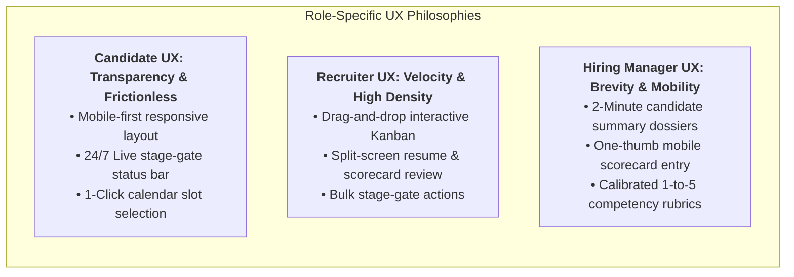

# Business Process Analysis & Information System Proposal
## Deliverable 9: UI/UX Wireframe Concepts & Interface Mockup Specifications

**Project Name:** Recruitment & Applicant Tracking Information System (ATS Proposal)  
**Document Reference:** ATS-BA-DOC-009  
**Project Version:** 1.0  
**Status:** Approved for Baseline  
**Author / Role:** Lead Business Systems Analyst  
**Design Standard:** Design System Token Architecture & Nielsen Norman Group Usability Heuristics  
**Dependencies:** Cross-referenced with ATS-BA-DOC-001 through DOC-008  

---

## 1. UI/UX Design System & Information Architecture Principles

To eliminate the frustration, cognitive fatigue, and communication gaps identified in current operations, the user experience is structured around three role-specific design philosophies:



---

## 2. Interface Mockup 1: Candidate Career Portal & Application Tracker

**Target Viewport:** Mobile Responsive & Desktop Web (Candidate View)  
**Primary User Goal:** Submit application in $< 5$ minutes and track pipeline status transparently 24/7.

```text
┌──────────────────────────────────────────────────────────────────────────────────────────────────┐
│  NOVUS ENTERPRISE CAREERS                                       [Maya Lin ▼] [Notifications (2)] │
├──────────────────────────────────────────────────────────────────────────────────────────────────┤
│                                                                                                  │
│  Welcome back, Maya!                                                                             │
│  Here is the live status of your active application:                                             │
│                                                                                                  │
│  ┌────────────────────────────────────────────────────────────────────────────────────────────┐  │
│  │  Senior Systems Software Engineer                                                          │  │
│  │  Department: Engineering • Location: San Francisco, CA (Hybrid) • Requisition: #REQ-0104    │  │
│  ├────────────────────────────────────────────────────────────────────────────────────────────┤  │
│  │                                                                                            │  │
│  │    [✓ Applied] ───── [✓ Screened] ───── [● INTERVIEW] ───── [○ Offer] ───── [○ Hired]     │  │
│  │      Jan 12             Jan 14             ACTION REQ.                                     │  │
│  │                                                                                            │  │
│  │  ┌──────────────────────────────────────────────────────────────────────────────────────┐  │  │
│  │  │  ⚠️ ACTION REQUIRED: Select Your Technical Panel Interview Time Slot                 │  │  │
│  │  │  Your application has been shortlisted! Please select a 45-minute interview slot    │  │  │
│  │  │  with Engineering Director David Vance and the Systems Panel.                        │  │  │
│  │  │                                                                                      │  │  │
│  │  │  [ 👉 Open Calendar & Choose Time Slot ]         [ Contact Recruiter: Sarah Jenkins ]│  │  │
│  │  └──────────────────────────────────────────────────────────────────────────────────────┘  │  │
│  │                                                                                            │  │
│  │  Application Timeline & Activity:                                                          │  │
│  │  • Jan 14, 2:30 PM: Application shortlisted by Talent Acquisition team.                    │  │
│  │  • Jan 14, 10:15 AM: Resume successfully parsed & verified.                                │  │
│  │  • Jan 12, 6:45 PM: Application submitted via LinkedIn syndication.                       │  │
│  └────────────────────────────────────────────────────────────────────────────────────────────┘  │
│                                                                                                  │
│  Your Profile & Documents:                                                                       │
│  📄 Resume: Maya_Lin_Staff_Systems_Resume_2026.pdf (Uploaded Jan 12, 2026) [Update]              │
│  🔒 Privacy & GDPR: All data encrypted. [Download My Data Archive] [Request Profile Erasure]    │
└──────────────────────────────────────────────────────────────────────────────────────────────────┘
```

---

## 3. Interface Mockup 2: Recruiter Interactive Pipeline Kanban Board

**Target Viewport:** Desktop Ultra-Wide / 1080p Workspace (Recruiter View)  
**Primary User Goal:** Manage candidate flow across stages with drag-and-drop velocity and real-time stage counters.

```text
┌──────────────────────────────────────────────────────────────────────────────────────────────────┐
│  NOVUS ATS WORKSTATION   [Jobs]  [Candidates]  [Pipeline]  [Analytics]   [Sarah Jenkins (Recruiter)]│
├──────────────────────────────────────────────────────────────────────────────────────────────────┤
│  Requisition: #REQ-2026-0104: Senior Systems Software Engineer (Engineering • David Vance)       │
│  [Search Candidates...] [Filter: All Sources ▼] [Min Score: 4.0+ ▼] [⚡ Bulk Actions (3 Selected)]│
├─────────────────┬─────────────────┬─────────────────┬──────────────────┬─────────────────────────┤
│ APPLIED (42)    │ SCREENED (18)   │ SHORTLISTED (8) │ INTERVIEW (4)    │ OFFER (1)               │
├─────────────────┼─────────────────┼─────────────────┼──────────────────┼─────────────────────────┤
│ ┌─────────────┐ │ ┌─────────────┐ │ ┌─────────────┐ │ ┌──────────────┐ │ ┌─────────────────────┐ │
│ │ James White │ │ │ Daniel Lee  │ │ │ Maya Lin    │ │ │ Elena Rostova│ │ │ Marcus Thorne       │ │
│ │ Score: 78%  │ │ │ Score: 88%  │ │ │ Score: 96%  │ │ │ Score: 92%   │ │ │ Offer: $165k Base   │ │
│ │ In: 2 days  │ │ │ In: 1 day   │ │ │ In: 3 days  │ │ │ Panel: Vance │ │ │ Status: Pending Sign│ │
│ │ Src: LinkedIn│ │ Src: Referral│ │ Src: LinkedIn │ │ Next: Thu 2 PM │ │ Exp: 48 Hours Left   │ │
│ └─────────────┘ │ └─────────────┘ │ └─────────────┘ │ └──────────────┘ │ └─────────────────────┘ │
│                 │                 │                 │                  │                         │
│ ┌─────────────┐ │ ┌─────────────┐ │ ┌─────────────┐ │ ┌──────────────┐ │                         │
│ │ Ava Morales │ │ │ Zoey Nelson │ │ │ Liam Carter │ │ │ Sophia Green │ │                         │
│ │ Score: 64%  │ │ │ Score: 85%  │ │ │ Score: 91%  │ │ │ Score: 89%   │ │                         │
│ │ In: 4 hours │ │ │ In: 2 days  │ │ │ In: 2 days  │ │ │ Panel: Vance │ │                         │
│ │ Src: Indeed │ │ Src: Career   │ │ Src: Referral │ │ Scorecard Due  │ │                         │
│ └─────────────┘ │ └─────────────┘ │ └─────────────┘ │ └──────────────┘ │                         │
│                 │                 │                 │                  │                         │
│ ┌─────────────┐ │                 │                 │                  │                         │
│ │ Noah Brown  │ │                 │                 │                  │                         │
│ │ Score: 52%  │ │                 │                 │                  │                         │
│ │ Knockout: OK│ │                 │                 │                  │                         │
│ └─────────────┘ │                 │                 │                  │                         │
└─────────────────┴─────────────────┴─────────────────┴──────────────────┴─────────────────────────┘
```

---

## 4. Interface Mockup 3: Recruiter Candidate Split-Screen Dossier & Evaluation View

**Target Viewport:** Desktop High-Resolution Dual Pane  
**Primary User Goal:** Review parsed resume, test scores, and interview rubrics side-by-side without context switching.

```text
┌──────────────────────────────────────────────────────────────────────────────────────────────────┐
│  CANDIDATE DOSSIER: Maya Lin  •  Application ID: #APP-2026-1042                                  │
│  Applied for: Senior Systems Software Engineer  •  Stage: SHORTLISTED ──► [Advance to Interview] │
├────────────────────────────────────────┬─────────────────────────────────────────────────────────┤
│  LEFT PANE: Candidate Profile & Resume │  RIGHT PANE: Evaluation & Panel Scorecards              │
├────────────────────────────────────────┼─────────────────────────────────────────────────────────┤
│  Contact: maya.lin@example.com         │  Consolidated Candidate Rating: ★★★★☆ 4.6 / 5.0         │
│  Phone: +1-415-555-0192 (San Francisco)│  Panel Consensus: 3 Votes [Strong Hire (2), Hire (1)]   │
│  LinkedIn: linkedin.com/in/mayalin-dev │                                                         │
│                                        │  ─────────────────────────────────────────────────────  │
│  Knockout Screening Questions:         │  PANEL EVALUATION BREAKDOWN:                            │
│  • Work Authorization: US Citizen [✓] │                                                         │
│  • Years Distributed Systems: 7 Yrs [✓]│  Interviewer 1: David Vance (Hiring Manager)            │
│  • Available in 30 Days: Yes [✓]       │  • Technical Architecture:      ★★★★★ (5/5)             │
│                                        │  • Problem Solving:             ★★★★☆ (4/5)             │
│  Resume Text (Parsed via S3 OCR):      │  • Systems Scalability:         ★★★★★ (5/5)             │
│  "Staff Systems Engineer with 7 years  │  • Cultural & Team Alignment:   ★★★★☆ (4/5)             │
│  experience architecting high-velocity │  Notes: "Exceptional mastery of Linux kernel tuning and │
│  distributed data pipelines in Go and  │  distributed consensus protocols. Definite hire."       │
│  C++. Scaled microservices to 100k QPS │                                                         │
│  with sub-10ms latency..."             │  Interviewer 2: Elena Rostova (Lead Peer Engineer)      │
│                                        │  • Technical Coding Screen:     ★★★★☆ (4/5)             │
│  Education & Certifications:           │  • Communication & Collaboration:★★★★☆ (4/5)            │
│  • B.S. Computer Science, UC Berkeley  │  Notes: "Clean, elegant concurrent Go code. Excellent   │
│  • AWS Certified Solutions Architect   │  clarity in explaining design trade-offs."             │
│                                        │                                                         │
│  [ 📄 View Original PDF Resume ]       │  [ 📝 Schedule Next Round ]   [ 🚫 Reject Candidate ]   │
└────────────────────────────────────────┴─────────────────────────────────────────────────────────┘
```

---

## 5. Interface Mockup 4: Hiring Manager Mobile-Optimized Scorecard Interface

**Target Viewport:** Mobile Web / Smartphone Viewport (375px $\times$ 812px)  
**Primary User Goal:** Complete standardized rubric evaluation in under 2 minutes immediately following an interview.

```text
┌──────────────────────────────────────┐
│  NOVUS ATS MOBILE        [Exit ✖]    │
├──────────────────────────────────────┤
│  INTERVIEW EVALUATION                │
│  Candidate: Maya Lin                 │
│  Role: Sr Systems Software Engineer  │
├──────────────────────────────────────┤
│  1. Technical Competence             │
│  [ 1 ]  [ 2 ]  [ 3 ]  [ 4 ]  [ ★5 ]  │
│  "Mastery of concurrency & systems"  │
├──────────────────────────────────────┤
│  2. Problem Solving & Architecture   │
│  [ 1 ]  [ 2 ]  [ 3 ]  [ ★4 ]  [ 5 ]  │
│  "Strong trade-off analysis"         │
├──────────────────────────────────────┤
│  3. Communication & Teamwork         │
│  [ 1 ]  [ 2 ]  [ 3 ]  [ ★4 ]  [ 5 ]  │
│  "Articulate, listens carefully"     │
├──────────────────────────────────────┤
│  4. Cultural & Values Alignment      │
│  [ 1 ]  [ 2 ]  [ 3 ]  [ 4 ]  [ ★5 ]  │
│  "High ownership, low ego"           │
├──────────────────────────────────────┤
│  Overall Recommendation:             │
│  ( ) Strong Reject                   │
│  ( ) Reject                          │
│  ( ) Neutral                         │
│  ( ) Hire                            │
│  (●) STRONG HIRE                     │
├──────────────────────────────────────┤
│  Private Evaluation Notes:           │
│  ┌──────────────────────────────────┐│
│  │Demonstrated deep grasp of Raft   ││
│  │consensus and zero-copy buffers.  ││
│  │High potential tech lead.         ││
│  └──────────────────────────────────┘│
│                                      │
│  [ 🔒 SUBMIT SCORECARD & LOCK ]      │
└──────────────────────────────────────┘
```

---

## 6. Interface Mockup 5: Digital Offer Review & E-Signature Portal (Candidate View)

**Target Viewport:** Desktop & Tablet Viewport (Candidate View)  
**Primary User Goal:** Review binding compensation package and execute legal e-signature securely.

```text
┌──────────────────────────────────────────────────────────────────────────────────────────────────┐
│  NOVUS ENTERPRISE CAREERS — FORMAL EMPLOYMENT OFFER                                              │
├──────────────────────────────────────────────────────────────────────────────────────────────────┤
│  Dear Maya Lin,                                                                                  │
│  We are thrilled to extend an official offer of employment to join Novus Enterprise Technologies!│
│                                                                                                  │
│  ┌────────────────────────────────────────────────────────────────────────────────────────────┐  │
│  │  OFFER SUMMARY & COMPENSATION PACKAGE:                                                     │  │
│  ├────────────────────────────────────────────────────────────────────────────────────────────┤  │
│  │  • Position Title:             Senior Systems Software Engineer                            │  │
│  │  • Department & Cost Center:   Engineering (CC-ENG-402)                                    │  │
│  │  • Reporting Manager:          David Vance, Director of Systems Engineering                │  │
│  │  • Base Annual Salary:         $165,000.00 USD (Paid semi-monthly)                         │  │
│  │  • Annual Performance Bonus:   15.0% Target ($24,750.00 USD)                               │  │
│  │  • Restricted Stock Units:     4,000 RSUs (4-year vesting schedule with 1-year cliff)      │  │
│  │  • Proposed Start Date:        Monday, October 15, 2026                                    │  │
│  │  • Offer Expiration Deadline:  Friday, October 02, 2026 at 5:00 PM PST                     │  │
│  └────────────────────────────────────────────────────────────────────────────────────────────┘  │
│                                                                                                  │
│  DIGITAL SIGNATURE & ACCEPTANCE (Legally Binding under US E-SIGN Act):                          │
│  [✓] I accept the terms of employment outlined above and agree to electronic signature execution.│
│                                                                                                  │
│  Type Legal Name: [ Maya Lin                                  ]                                  │
│  Signature Timestamp: 2026-09-24 18:52:45 UTC  •  IP: 136.24.88.19 (Verified)                   │
│                                                                                                  │
│  [ ✍️ ACCEPT & ELECTRONICALLY SIGN OFFER ]                 [ ✖ Decline Offer / Request Call ]    │
└──────────────────────────────────────────────────────────────────────────────────────────────────┘
```

---

## 7. Usability & Accessibility Compliance Guidelines

1. **Accessibility Standards (WCAG 2.1 Level AA):**  
   * Minimum text contrast ratio of **4.5:1** for normal text and **3:1** for large text components.
   * Full keyboard navigability (`Tab`, `Shift+Tab`, `Enter`, `Escape`) across all candidate application forms and calendar pickers.
   * Explicit `aria-label` and `aria-live` attributes on real-time stage updates and error banners.
2. **Error Prevention & Resilience:**  
   * Destructive actions (e.g. Reject Candidate, Delete Profile) require an explicit secondary confirmation modal.
   * Form drafts automatically save state to `localStorage` every 30 seconds to prevent data loss from accidental session timeouts.

---
*End of Deliverable 9. Next Phase: Deliverable 10 — Executive Pitch Deck, Project Summary & Final Portfolio Presentation.*
