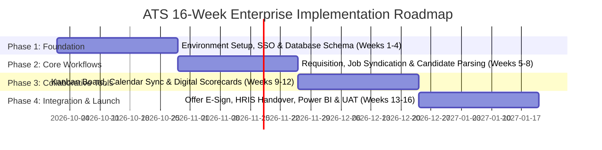

# Business Process Analysis & Information System Proposal
## Deliverable 10: Executive Presentation Pitch Deck & Project Summary

**Project Name:** Recruitment & Applicant Tracking Information System (ATS Proposal)  
**Document Reference:** ATS-BA-DOC-010  
**Project Version:** 1.0  
**Status:** Approved for Executive Presentation  
**Author / Role:** Lead Business Systems Analyst  
**Target Audience:** Joint Executive Steering Committee (VP HR, CTO, CFO, Lead PMO)  
**Dependencies:** Master synthesis of ATS-BA-DOC-001 through DOC-009  

---

## 1. 10-Slide Executive Presentation Pitch Deck (PowerPoint-Ready)

```mermaid
flowchart LR
    S1[1. Executive Mandate] --> S2[2. Problem & Cost of Inaction]
    S2 --> S3[3. AS-IS Waste Analysis]
    S3 --> S4[4. TO-BE Operating Model]
    S4 --> S5[5. System Architecture]
    S5 --> S6[6. Data & Compliance]
    S6 --> S7[7. Financial ROI]
    S7 --> S8[8. Power BI Analytics]
    S8 --> S9[9. 16-Week Roadmap]
    S9 --> S10[10. Executive Decision]
```

---

### Slide 1: Executive Mandate & Strategic Alignment
* **Title:** Modernizing Talent Acquisition at Novus Enterprise Technologies
* **Subtitle:** Business Process Analysis & Information System Proposal (ATS)
* **Presenter:** Lead Business Systems Analyst
* **Strategic Context:** Supporting the corporate growth mandate of 350+ annual hires while eliminating administrative drag, hiring bottlenecks, and escalating third-party agency dependencies.

---

### Slide 2: The Core Problem & The Financial Cost of Inaction
* **The Current Reality:** Recruitment operations rely on an unintegrated "Spaghetti Toolchain" (8 conflicting recruiter Excel sheets, personal Outlook inboxes, disparate job boards, and paper notes).
* **The Price of Inaction:**
  * **\$380,000 / Year** spent on external recruitment agency commissions (18–22% fee/hire).
  * **46.5 Days** average Time-to-Hire, stalling engineering and revenue project execution.
  * **28% Candidate Abandonment** due to zero application transparency.
  * **Critical Regulatory Exposure** under GDPR Article 17 and EEOC anti-bias audit rules.

---

### Slide 3: Current State (AS-IS) Waste Analysis: 93% Non-Value-Add Time
* **Process Observation:** End-to-end recruitment currently consumes **46.5 Calendar Days (372 Elapsed Working Hours)**.
* **Lean Six Sigma Finding:**
  * **Active Value-Add Work Time:** Only **26.0 Hours (6.99%)**.
  * **Idle Waiting & Delay Time:** **43.2 Days (93.01%)** spent waiting for emails, chasing hiring managers for notes, and manual copy-pasting.
* **Primary Bottlenecks:** Requisition approval delays (7.5 days) and resume triage/shortlisting (12.0 days).

---

### Slide 4: The TO-BE Solution: Re-Engineered Operating Model
* **The Transformed Pipeline:** An automated, event-driven, 5-lane workflow model (Candidate, Recruiter, Hiring Manager, ATS Engine, Core HRIS).
* **Quantified Process Outcomes:**
  * **Time-to-Hire Reduced by 60.2%:** From **46.5 days to 18.5 calendar days** (exceeding corporate target of $\le 24$ days).
  * **Process Efficiency Ratio:** Rises from **6.99% to 38.5%**.
  * **Automated Business Rules:** Event-driven SLAs (BR-01 to BR-06) eliminating email lag and manual reminders.

---

### Slide 5: System Architecture & The 8 Core Modules
* **Architecture Style:** Cloud-native, multi-tier micro-modular architecture (Next.js candidate portal, React SPA internal workstation, PostgreSQL 15, Redis, and AWS S3).
* **Enterprise Integrations:**
  * **Identity:** Azure AD / Okta SSO (SAML 2.0).
  * **Calendar & Email:** Microsoft 365 Exchange via Graph API.
  * **Core HRIS Handover:** Automated mTLS REST API push to Workday / SAP SuccessFactors.
* **The 8 Integrated Modules:** User & RBAC, Requisitions, Talent Pool, Pipeline, Scheduling, Scorecards, Offers, Analytics.

---

### Slide 6: Enterprise Data Model & Compliance Governance
* **Relational Integrity:** 3rd Normal Form (3NF) schema across 12 core tables completely retiring all localized spreadsheets.
* **Single Source of Truth (SSOT):** Centralized candidate profiles with multi-version resume OCR parsing and duplicate detection.
* **Information Security:** Column-level AES-256 encryption on compensation and PII, TLS 1.3 in-transit, and automated right-to-erasure workflows for GDPR compliance.

---

### Slide 7: Business Value Realization & Financial ROI
* **Year 1 Net Financial Benefit:** **\$340,000**
  * *Agency Spend Reduction (60% cut):* \$228,000 direct annual cash savings.
  * *Recruiter Productivity Recaptured:* 135 hours/week saved = \$112,000 labor value reinvested into active talent sourcing.
* **Investment Required:** **\$105,000** (Software licensing, implementation, cloud infrastructure, and training).
* **Return on Investment (ROI):** **223.8% Net ROI** in Year 1.
* **Payback Period:** **3.7 Months** to full capital recovery.

---

### Slide 8: Power BI Recruitment Analytics & Funnel Intelligence
* **Data-Driven Leadership:** Live executive dashboards driven by a Kimball Star Schema and 10 production DAX measures.
* **Verified 1,250-Record Hiring Cohort:**
  * **1,250 Applications** $\rightarrow$ **650 Screened** (52%) $\rightarrow$ **185 Shortlisted** (14.8%) $\rightarrow$ **96 Interviewed** (7.7%) $\rightarrow$ **28 Offers** (2.2%) $\rightarrow$ **21 Hires** (75% Acceptance Rate).
  * Real-time visibility into source channel ROI, department hiring velocity, and recruiter SLA adherence.

---

### Slide 9: 16-Week Implementation Roadmap & Phased Rollout
* **Phased Delivery Strategy:** 4 four-week iterations ensuring early risk mitigation and high user adoption.

* **Weeks 1–4:** Infrastructure provisioning, SSO configuration, and PostgreSQL database deployment.
* **Weeks 5–8:** Career portal, resume ingestion OCR, and requisition approval workflows.
* **Weeks 9–12:** Recruiter Kanban board, MS 365 calendar synchronization, and mobile scorecards.
* **Weeks 13–16:** Offer e-signature, Workday API handover, Power BI dashboards, UAT, and pilot go-live.

---

### Slide 10: Executive Decision & Next Steps
* **Steering Committee Recommendation:**
  1. Authorize the ATS Information System Proposal as the enterprise talent acquisition baseline.
  2. Approve the Year 1 Capital Expenditure budget of \$105,000.
  3. Formally initiate Phase 1 Architecture & Procurement kickoff.
* **Expected Milestone:** Production Minimum Viable Product (MVP) operational within 16 weeks to support Q1 peak hiring.

---

## 2. Change Management Framework (Prosci ADKAR Model)

To guarantee high user adoption across hiring managers and recruiters, the transition follows the **ADKAR Model**:

1. **Awareness:** Executive all-hands presenting the 46.5-day baseline waste and compliance risks associated with spreadsheet recruiting.
2. **Desire:** Demonstrating how hiring managers save 4+ hours per hire and recruiters eliminate 135 hours of weekly administrative copy-pasting.
3. **Knowledge:** Role-specific interactive workshops (1-hour hands-on sessions for hiring managers on mobile scorecards; 3-hour deep-dive for recruiters on Kanban management).
4. **Ability:** Phased rollout starting with an Engineering & Product pilot cohort (40 positions) backed by dedicated floor-support champions.
5. **Reinforcement:** Tying department hiring velocity and SLA compliance metrics directly to executive quarterly operational reviews.

---

## 3. Resume & Portfolio Bullet Points (For Job Applications)

Use these professional, metrics-driven bullet points for your resume and LinkedIn profile:

> **Recruitment & Applicant Tracking Information System (ATS) — Business Process Analysis & System Proposal**  
> *Lead Business Systems Analyst | Enterprise Systems & Process Optimization*  
> • Led end-to-end business process analysis of the corporate talent acquisition lifecycle across 5 business units, identifying 12 critical operational bottlenecks and proving that 93% of current cycle time was non-value-added waiting waste.  
> • Designed the future-state (TO-BE) operating model, engineering automated event-driven business rules (BPMN 2.0 swimlanes) that reduced average Time-to-Hire from 46.5 to 18.5 calendar days (-60.2%) and slashed candidate abandonment from 28% to <10%.  
> • Formulated an IEEE 29148-standard Software Requirements Specification (SRS) detailing 32 functional requirements across 8 core modules, 10 ISO 25010 non-functional requirements, and an end-to-end Requirements Traceability Matrix (RTM).  
> • Architected an OMG UML 2.5 use case model, multi-tier C4 system architecture, and 3NF relational database schema (12 normalized tables) with field-level AES-256 encryption, GDPR compliance workflows, and Workday REST API integration.  
> • Developed a Microsoft Power BI recruitment intelligence dashboard and Kimball Star Schema data model with 10 custom DAX measures, validated against a realistic 1,250-record recruitment cohort dataset yielding an executive business case with 223.8% Year-1 ROI (\$340,000 annual net benefit).  
> • Authored high-fidelity UI/UX wireframes (Candidate Self-Service Portal, Recruiter Interactive Kanban, Mobile Scorecards) compliant with WCAG 2.1 AA accessibility guidelines.

---

## 4. Master Deliverables Directory & Repository Assets

All project assets are permanently stored and organized within the project repository:

| Deliverable Ref | Deliverable Document Name | Key Assets & Deliverables Contained |
| :---: | :--- | :--- |
| **DOC-001** | [01_Project_Charter_and_Stakeholder_Analysis.md](file:///C:/Users/namra/.gemini/antigravity/scratch/recruitment-ats-proposal/docs/01_Project_Charter_and_Stakeholder_Analysis.md) | Project Charter, 5-Whys Fishbone, SMART Objectives, Scope, RACI, Personas |
| **DOC-002** | [02_AS_IS_Process_Analysis_and_Bottlenecks.md](file:///C:/Users/namra/.gemini/antigravity/scratch/recruitment-ats-proposal/docs/02_AS_IS_Process_Analysis_and_Bottlenecks.md) | AS-IS Swimlane (4 lanes), 46.5d Lead Time Breakdown, 12 Pain Points, TIMWOOD Waste |
| **DOC-003** | [03_TO_BE_Process_Design_and_Value_Add.md](file:///C:/Users/namra/.gemini/antigravity/scratch/recruitment-ats-proposal/docs/03_TO_BE_Process_Design_and_Value_Add.md) | TO-BE Swimlane (5 lanes), 18.5d Cycle (-60.2%), Rules Engine (BR-01 to 06), ROI Model |
| **DOC-004** | [04_Business_and_System_Requirements_SRS.md](file:///C:/Users/namra/.gemini/antigravity/scratch/recruitment-ats-proposal/docs/04_Business_and_System_Requirements_SRS.md) | 32 Functional Requirements, 10 ISO 25010 NFRs, MoSCoW, Traceability Matrix (RTM) |
| **DOC-005** | [05_UML_Use_Cases_and_Specifications.md](file:///C:/Users/namra/.gemini/antigravity/scratch/recruitment-ats-proposal/docs/05_UML_Use_Cases_and_Specifications.md) | Actor-Goal Matrix, UML Use Case Diagram, 5 Cockburn Use Case Specs with Exceptions |
| **DOC-006** | [06_Data_Model_ERD_and_Data_Dictionary.md](file:///C:/Users/namra/.gemini/antigravity/scratch/recruitment-ats-proposal/docs/06_Data_Model_ERD_and_Data_Dictionary.md) | 3NF Relational Model, Crow's Foot ERD, Full Data Dictionary, PostgreSQL 15 DDL |
| **DOC-007** | [07_System_Architecture_and_Integrations.md](file:///C:/Users/namra/.gemini/antigravity/scratch/recruitment-ats-proposal/docs/07_System_Architecture_and_Integrations.md) | C4 Context/Container Architecture, Workday REST API Spec, Security Perimeter |
| **DOC-008** | [08_Recruitment_KPIs_and_Analytics_Framework.md](file:///C:/Users/namra/.gemini/antigravity/scratch/recruitment-ats-proposal/docs/08_Recruitment_KPIs_and_Analytics_Framework.md) | KPI Math, Power BI Star Schema, 10 DAX Measures, Dashboard Wireframe |
| **DOC-009** | [09_UI_UX_Wireframes_and_Prototypes.md](file:///C:/Users/namra/.gemini/antigravity/scratch/recruitment-ats-proposal/docs/09_UI_UX_Wireframes_and_Prototypes.md) | 5 Interface Mockups (Candidate Portal, Kanban, Dossier, Mobile Scorecard, E-Sign) |
| **DOC-010** | [10_Executive_Presentation_and_Project_Summary.md](file:///C:/Users/namra/.gemini/antigravity/scratch/recruitment-ats-proposal/docs/10_Executive_Presentation_and_Project_Summary.md) | 10-Slide Pitch Deck, ADKAR Change Plan, Resume Bullets, Final Sign-off |
| **DATA** | [recruitment_sample_dataset.csv](file:///C:/Users/namra/.gemini/antigravity/scratch/recruitment-ats-proposal/data/recruitment_sample_dataset.csv) | 1,250-record validated recruiting cohort CSV for Power BI / Excel analysis |

---
*End of Deliverable 10. The complete Business Process Analysis & Information System Proposal portfolio is finalized.*
