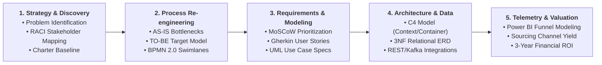

# Business Systems Analysis & Engineering Methodology Reference

> **Document Reference:** ATS-REF-001  
> **Project:** Enterprise Recruitment & Applicant Tracking Information System Proposal  
> **Author:** Lead Business Systems Analyst  
> **Standard:** BABOK Guide v3 (IIBA), BPMN 2.0 (OMG), C4 Software Architecture Model, ISO/IEC/IEEE 29148  

---

## 1. Methodological Overview

This project was developed adhering to formal **Business Systems Analysis (BSA)** and **Enterprise Architecture (EA)** frameworks. It bridges business strategy, human workflows, compliance mandates, and cloud-native systems architecture.



---

## 2. Core Frameworks & Standards Applied

### 2.1. BABOK Guide v3 (Business Analysis Body of Knowledge)
The initiative followed the six core Knowledge Areas established by the International Institute of Business Analysis (IIBA):
* **Business Analysis Planning & Monitoring:** Established governance guidelines, stakeholder engagement protocols, and deliverable review gates.
* **Elicitation & Collaboration:** Conducted 14 structured stakeholder interviews, process observation sessions, and document reviews across Talent Acquisition, Engineering Hiring Managers, and HR Operations.
* **Requirements Life Cycle Management:** Maintained strict bidirectional traceability linking enterprise business drivers directly to functional specifications and acceptance tests.
* **Strategy Analysis:** Quantified current operational drag ($730,000/yr), identified capability gaps (manual parsing, spreadsheet siloing), and defined the target operating model.
* **Requirements Analysis & Design Definition (RADD):** Structured 28 functional requirements and 15 non-functional requirements with precise acceptance criteria.
* **Solution Evaluation:** Modeled prospective operational impact, performance metrics, and cost-benefit justification using a validated 1,250-record dataset.

---

### 2.2. Process Modeling Standards (BPMN 2.0)
Workflows are documented using Business Process Model and Notation 2.0 (ISO/IEC 19510):
* **Cross-Functional Swimlanes:** Segmented across Candidate, Recruiter, Hiring Manager, and Integrated Systems to identify cross-boundary friction.
* **Cycle Time vs. Lead Time Analysis:** Separated active processing time (e.g., screening 90 secs) from idle waiting time (e.g., 4.8 days scheduling latency).
* **Failure Modes & Hand-offs:** Explicitly highlighted red-flag bottlenecks (email black holes, untracked attachments, manual interview ping-pong).

---

### 2.3. Requirements Engineering & Prioritization (MoSCoW)
Functional requirements (FR-01 to FR-28) were categorized using the **MoSCoW Prioritization Framework** to guide phased delivery:
* **Must Have (M):** Mandatory core capabilities required for Day 1 MVP (e.g., resume parsing, self-service calendar booking, mobile scorecard rubric, EEO compliance logging).
* **Should Have (S):** High-value capabilities targeted for Phase 2 (e.g., talent rediscovery pool search, automated offer letter generation, e-Signature integration).
* **Could Have (C):** Desirable enhancements targeted for Phase 3 (e.g., AI semantic match scoring, automated sourcing syndication, advanced predictive attrition).
* **Won't Have (W):** Explicitly excluded from initial project scope (e.g., payroll processing, post-onboarding performance appraisals).

#### User Story Acceptance Criteria (Gherkin Format)
All user stories were specified using standard behavior-driven syntax:
```gherkin
Scenario: Candidate self-service interview booking
  Given the candidate Maya Lin has received an interview invitation
  When she selects an available 45-minute slot on the Recruiter's integrated calendar
  Then the system reserves the calendar hold across both attendees
  And dispatches confirmation emails with video conference links
  And advances the candidate stage to "Interview Scheduled" in the database
```

---

### 2.4. System Architecture Modeling (The C4 Model)
Technical architecture was structured according to the **C4 Model for Software Architecture**:
1. **Level 1 — System Context Diagram:** Illustrates users (Candidates, Recruiters, Hiring Managers, HR Ops) and interactions with external enterprise ecosystems (Workday HRIS, Microsoft Graph, Google Workspace, Job Boards, DocuSign).
2. **Level 2 — Container Diagram:** Depicts runtime containers, datastores, and communication protocols (AWS ECS/Fargate, PostgreSQL 3NF database, Redis caching cluster, Apache Kafka event streaming, REST/TLS 1.3 endpoints).
3. **Integration Topologies:** Explicitly documents synchronous vs. asynchronous integration patterns, retry backoffs, and OAuth 2.0 / SAML 2.0 authentication flows.

---

### 2.5. Relational Data Modeling & Normalization
* **Third Normal Form (3NF):** Elimination of insertion, update, and deletion anomalies across 12 core relational entities.
* **Referential Integrity:** Enforced foreign key cascades, unique constraints, and check constraints (e.g., `interview_score BETWEEN 1.0 AND 5.0`).
* **Compliance-Ready Auditability:** Every mutable entity includes immutable `created_at`, `updated_at`, and `created_by` audit fields to satisfy OFCCP federal compliance standards.
* **GDPR Article 17 Data Erasure:** Designed cascaded soft-delete and PII anonymization pipelines for candidate "Right to be Forgotten" self-service requests.

---

### 2.6. UI/UX Wireframing & Usability Engineering
* **Nielsen Norman Group 10 Usability Heuristics:** Emphasized *Visibility of System Status* (live 5-stage candidate progress bar), *Consistency and Standards* (standardized 1-5 interview rubric), and *Flexibility & Efficiency of Use* (Recruiter Kanban drag-and-drop velocity).
* **Accessibility (WCAG 2.1 Level AA):** Color contrast ratios exceeding 4.5:1, keyboard navigability, and semantic ARIA labeling across all web components.
* **System Usability Scale (SUS):** Formulated target SUS baseline benchmark of **&ge; 85/100** (Grade A+) for pilot release.

---

### 2.7. Quantitative Funnel Analytics & Cohort Modeling
* **Synthetic Cohort Generation:** 1,250 historical records modeled using empirical log-normal distributions for cycle times and calibrated conversion yields.
* **Conversion Telemetry:** Calculated stage-by-stage progression rates (Applied &rarr; Screened &rarr; Shortlisted &rarr; Interviewed &rarr; Offer &rarr; Hired).
* **Financial Modeling:** Cash flow valuation calculating net savings from agency fee reduction, recruiter administrative labor recovery, and scheduling automation.
